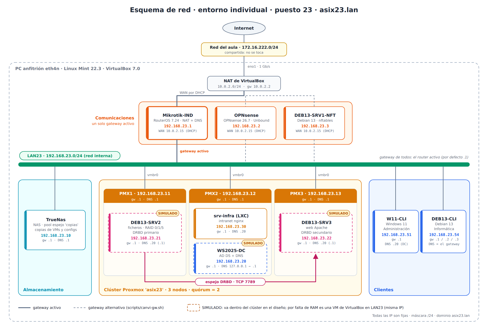

# Proyecto por tareas · "Naix un sistema" (parte individual)

Esta carpeta organiza el proyecto **tarea por tarea**, tal como se entrega. Cada ficha es independiente y contiene:

1. **Qué pide el enunciado**, con los criterios *Apte* y *Apte+*.
2. **Qué he hecho**, explicado paso a paso.
3. **Resultados** con cifras reales.
4. **Evidencias**: enlaces a la documentación completa, los logs y las capturas.
5. **Cómo comprobarlo** (los comandos para verificarlo en directo).
6. **Preguntas probables de la defensa** con su respuesta.

**Para Aules:** en [`entrega/tareas/`](../entrega/tareas) está cada ficha preparada para subirla sola: el `.md` con sus capturas en `img/`, el `.zip` con las dos cosas y una versión en PDF.

| Tarea | Ficha | Módulos | Estado |
|---|---|---|:---:|
| **Tasca 0** · Entorno de pruebas | [Tasca-0-entorno-de-pruebas.md](Tasca-0-entorno-de-pruebas.md) | FDM-RA1, FDM-RA4 | ✓ Apte · ✓ Apte+ |
| **Tasca 1** · Necesidades y sistemas | Solo de **grupo** (estudio, debate y presentación). Aporto mi parte: [01-requisits](../docs/01-requisits.md) · [03-sistemes](../docs/03-sistemes.md) | ISO-RA1, FDM-RA4 | De grupo |
| **Tasca 2** · Equipos y periféricos | [Tasca-2-equipos-y-perifericos.md](Tasca-2-equipos-y-perifericos.md) | FDM-RA1, FDM-RA4 | ✓ Apte · ✓ Apte+ |
| **Tasca 3** · Rack e interconexión | Solo de **grupo** (rack del aula, etiquetado y CPD) | FDM-RA1, FDM-RA4 | De grupo |
| **Tasca 4** · Diseño físico y lógico | [Tasca-4-diseno-fisico-y-logico.md](Tasca-4-diseno-fisico-y-logico.md) | FDM-RA4, ISO-RA1, ISO-RA3 | ✓ Apte · ✓ Apte+ |
| **Tasca 5** · Instalación y comunicaciones | [Tasca-5-instalacion-y-comunicaciones.md](Tasca-5-instalacion-y-comunicaciones.md) | ISO-RA1, FDM-RA1 | ✓ Apte · ✓ Apte+ |
| **Tasca 6** · Almacenamiento | [Tasca-6-almacenamiento.md](Tasca-6-almacenamiento.md) | ISO-RA3 | ✓ Apte · ✓ Apte+ |
| **Tasca 7** · Rendimiento | [Tasca-7-rendimiento.md](Tasca-7-rendimiento.md) | ISO-RA6, FDM-RA1 | ✓ Apte · ✓ Apte+ |
| **Tasca 8** · Caso práctico (preparación) | [Tasca-8-caso-practico.md](Tasca-8-caso-practico.md) | Todos | ✓ Guía y banco de preguntas |
| **Transversal** · Predicciones y plan de contingencia | [Transversal.md](Transversal.md) | Todos | ✓ |

> **Tasca 1 y Tasca 3:** según el enunciado, todos sus apartados (Apte y Apte+) son de **grupo**; no tienen parte individual. Aun así, para la Tasca 1 el proyecto individual incluye las necesidades y los requisitos ([01-requisits](../docs/01-requisits.md)) y el estudio de cada sistema con versión, fuente oficial, URL, fecha de consulta, licencia y SHA256 ([03-sistemes](../docs/03-sistemes.md)).

**Datos generales**

| | |
|---|---|
| Alumno | izan · 1º ASIX · puesto 23 |
| Red | LAN23 · `192.168.23.0/24` · dominio `asix23.lan` |
| Equipos | 12 VMs + 1 contenedor LXC en VirtualBox 7.0 |
| Entrega de la documentación | domingo 22/11/2026 |
| Examen práctico | miércoles 25/11/2026 |

> La documentación completa y detallada está en [`docs/`](../docs). Estas fichas la resumen y enlazan a cada apartado.
