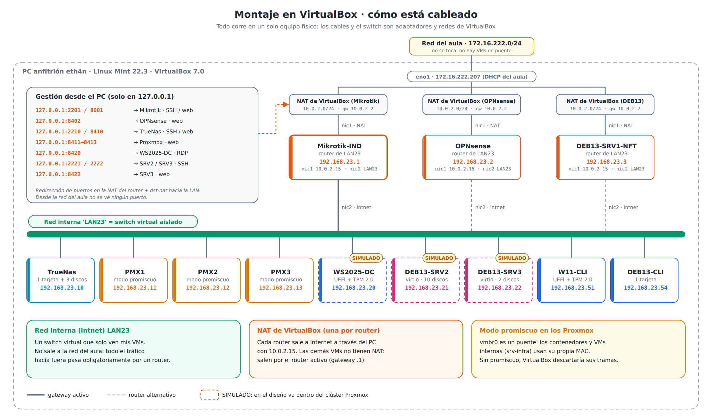

# Tasca 0 · Entorno de pruebas

**Módulos:** FDM-RA1, FDM-RA4 · **Estado:** ✓ Apte · ✓ Apte+

## Qué pide el enunciado

| Nivel | Criterio |
|---|---|
| Apte | Preparar en mi equipo un entorno de pruebas que simule el del grupo |
| Apte+ | Documentar el montaje en Markdown y publicarlo en un repositorio Git personal: esquema de VMs, recursos y problemas encontrados con su solución |

## Qué he hecho

1. **Entorno completo en VirtualBox 7.0** sobre un solo PC (Linux Mint 22.3):
   - 3 routers de comunicaciones: MikroTik `.1`, OPNsense `.2`, Debian + nftables `.3`.
   - NAS TrueNAS `.10`.
   - Clúster Proxmox de 3 nodos (`.11–.13`) con un contenedor LXC (`srv-infra .30`).
   - Controlador de dominio Windows Server 2025 `.20`.
   - Servidores Debian SRV2 (ficheros + RAID) `.21` y SRV3 (web) `.22`.
   - Clientes Windows 11 `.51` y Debian `.54`.
2. **Red aislada**: una red interna de VirtualBox (`LAN23`) que no toca la red del aula. Solo los routers salen a Internet, por NAT.
3. **Escenarios de arranque**: no caben todas las VMs a la vez (34,5 GB asignados frente a ~24 GB disponibles), así que se trabaja por escenarios (A: comunicaciones, B: dominio, C: clúster, D: RAID/rendimiento).
4. **Repositorio Git público** con toda la documentación en Markdown, los esquemas, los logs reales, las configuraciones exportadas sin contraseñas y los scripts.
5. **Seguridad del repositorio**: las contraseñas solo están en un archivo ignorado por Git, y un *hook* `pre-commit` (`scripts/comprova-secrets.sh`) bloquea cualquier commit que contenga una.

## Resultados

| | |
|---|---|
| Máquinas | 12 VMs + 1 contenedor LXC |
| Incidencias documentadas con su solución | **26** |
| Contraseñas publicadas en todo el historial | **0** |

## Evidencias

- Esquema de VMs y red: [04-disseny](../docs/04-disseny.md) · 
- Recursos de cada VM y escenarios: [05-recursos](../docs/05-recursos.md)
- Problemas y soluciones: [10-incidencies](../docs/10-incidencies.md)
- Repositorio: https://github.com/ethan3232/iso-naix-un-sistema-individual

## Cómo comprobarlo

```bash
VBoxManage list vms                      # las 12 VMs
VBoxManage showvminfo DEB13-CLI | grep NIC   # adaptador en la red interna LAN23
git log --oneline | head                 # historial del trabajo
```

## Preguntas probables de la defensa

- **¿Por qué red interna y no adaptador puente?** Con puente, mis VMs aparecerían en la red del aula, y un DHCP o una IP repetida molestaría a los compañeros. La red interna aísla mi LAN y obliga a que todo el tráfico pase por el router.
- **¿Por qué no enciendes todas las VMs a la vez?** VirtualBox reserva la RAM de cada VM encendida. Si no cabe, el PC entra en swap y todo se bloquea. Por eso trabajo por escenarios.
