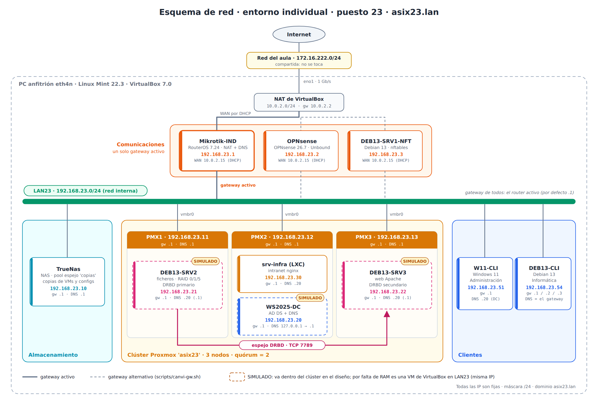
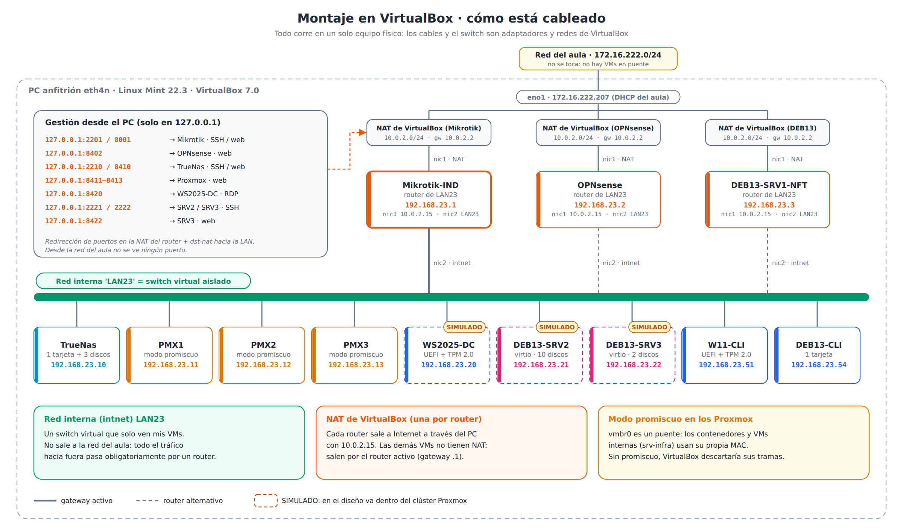

# Tasca 4 · Diseño físico y lógico

**Módulos:** FDM-RA4, ISO-RA1, ISO-RA3 · **Estado:** ✅ Apte · ✅ Apte+

## Qué pide el enunciado

| Nivel | Criterio |
|---|---|
| Apte | Esquema de red de mi sistema (configuración, montaje en VirtualBox, red `192.168.23.0/24`) |
| Apte | Tabla de máquinas, recursos simultáneos y reserva del hipervisor |
| Apte+ | Implementar el esquema y verificar la conectividad (ping, traceroute, rutas, interfaces) |

## Qué he hecho

### Esquema lógico



- **Red `LAN23` · `192.168.23.0/24`**, dominio `asix23.lan`, todas las IP fijas.
- **Un solo gateway activo** (MikroTik `.1`). OPNsense `.2` y Debian `.3` son alternativos y se cambia de uno a otro con `scripts/canvi-gw.sh`.
- **Servidores dentro del clúster Proxmox:** en el diseño, SRV2 va en PMX1, el DC en PMX2 y SRV3 en PMX3. Por falta de RAM para la virtualización anidada están **simulados** como VMs de VirtualBox en LAN23, con la misma IP y la misma función. SRV2 y SRV3 van en nodos distintos para que el espejo DRBD proteja de verdad. Explicación completa en [04 §5.1](../docs/04-disseny.md#51-servidores-dentro-del-clúster-simulados).

**Plan de direccionamiento**

| Rango | Uso |
|---|---|
| .1 – .3 | Servidores de comunicaciones |
| .10 – .19 | NAS (.10) y nodos Proxmox (.11–.13) |
| .20 – .29 | Identidad e infraestructura (DC .20, SRV2 .21, SRV3 .22) |
| .30 – .49 | Contenedores y VMs dentro de Proxmox (srv-infra .30) |
| .50 – .54 | Clientes por departamento |
| .100 – .199 | Reservado para un futuro DHCP |

### Montaje en VirtualBox



### Recursos

| | Clase | Casa |
|---|---|---|
| RAM total de todas las VMs | 34,5 GB | 34,5 GB |
| RAM disponible para VMs (reserva para el host) | ~24 GB | ~10 GB |
| Escenarios que caben | A, B, C y D | A y D |

## Resultados (Apte+)

- Desde el cliente, con cada router como gateway: `ip route` muestra el gateway correcto y `traceroute -T` da como primer salto el router elegido.
- HTTPS desde la LAN por los tres routers → `HTTP/2 200`.

## Evidencias

- Diseño completo: [04-disseny](../docs/04-disseny.md) · Recursos: [05-recursos](../docs/05-recursos.md)
- Pruebas de conectividad: [`prueba-gw-mikrotik.txt`](../evidencies/logs/prueba-gw-mikrotik.txt) · [`prueba-gw-opnsense.txt`](../evidencies/logs/prueba-gw-opnsense.txt) · [`prueba-gw-debian.txt`](../evidencies/logs/prueba-gw-debian.txt)
- Fuentes de los esquemas: [`diagrames/`](../diagrames) (`bash diagrames/generar.sh` los regenera)

## Cómo comprobarlo

```bash
scripts/canvi-gw.sh 1        # gateway = MikroTik (2 = OPNsense, 3 = Debian)
ip -br a ; ip route          # interfaz, IP y gateway en el cliente
traceroute -T -p 443 deb.debian.org   # el primer salto es el router activo
```

## Preguntas probables de la defensa

- **¿Por qué IP fijas y no DHCP?** Son servidores y hay tres routers en la misma LAN: con tres DHCP, cada cliente cogería el gateway del que respondiera primero.
- **¿Dónde está tu servidor de ficheros, en el clúster o fuera?** En el diseño, dentro del clúster (PMX1). En el montaje es una VM de VirtualBox en LAN23 con la misma IP, porque la virtualización anidada no cabe en la RAM. Para la red es lo mismo; lo único que no puedo hacer con ella es migrarla, y eso lo he demostrado con el contenedor `srv-infra`.
