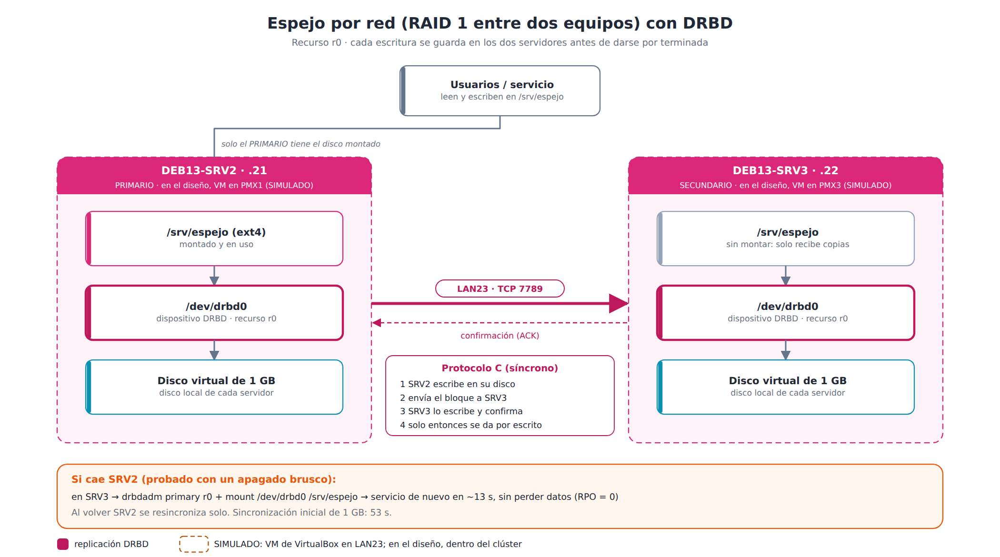

# Tasca 6 · Almacenamiento

**Módulo:** ISO-RA3 · **Estado:** ✅ Apte · ✅ Apte+

## Qué pide el enunciado

| Nivel | Criterio |
|---|---|
| Apte | Crear 3 tipos de RAID, verificarlos y explicar qué se gana con cada uno |
| Apte+ | RAID en espejo entre 2 equipos, con un caso de uso |

## Qué he hecho

### Apte: RAID 0, 1 y 5 con `mdadm` en DEB13-SRV2

1. He añadido **8 discos virtuales de 1 GB** a DEB13-SRV2. Son pequeños para que la sincronización y la reconstrucción tarden segundos y se puedan repetir.
2. He creado RAID 0 (2 discos), RAID 1 (2 discos) y RAID 5 (3 discos + 1 de reserva), con sistema de archivos y montaje permanente en `/etc/fstab`.
3. Para verificarlos he **provocado fallos**: he marcado discos como rotos, los he quitado y vuelto a añadir, y he comprobado los datos con SHA256 antes y después.

| RAID | Espacio útil | ¿Aguanta un disco roto? | Resultado de la prueba |
|---|---|---|---|
| RAID 0 | 2,0 GB (100 %) | ❌ No | Más espacio y velocidad teórica, sin protección |
| RAID 1 | 1,0 GB (50 %) | ✅ Sí | 0 lecturas fallidas en modo degradado · reconstrucción en **54 s** |
| RAID 5 | 2,0 GB (67 %) | ✅ Sí (solo uno) | 0 lecturas fallidas · reconstrucción en **15 s** · **disco de reserva automático en 21 s** |

**Qué se gana con cada uno:** RAID 0 da rendimiento sin seguridad (datos temporales). RAID 1 da seguridad sencilla (disco del sistema, pool del NAS). RAID 5 equilibra espacio y seguridad (carpetas de los departamentos).

**Límite del entorno:** los 8 "discos" son archivos en el mismo SSD físico, así que el RAID 0 no puede ir más rápido. El cuello de botella es el disco del anfitrión, no el RAID.

### Apte+: espejo entre dos equipos con DRBD



- **DRBD** replica un disco de 1 GB entre SRV2 (primario) y SRV3 (secundario) por la red, con **protocolo C** (síncrono): una escritura no termina hasta que está en los dos.
- **Caso de uso:** el servidor de ficheros de la empresa. Un RAID 1 normal protege de que se rompa un disco; DRBD protege de que se rompa **el servidor entero**.
- **Prueba:** apagado brusco de SRV2 (como un corte de luz). En SRV3, `drbdadm primary r0` + `mount` → datos disponibles en **~13 s**, con el SHA256 idéntico (**RPO 0**). Al volver SRV2 se resincronizó solo, copiando únicamente lo que había cambiado (206 MB en 25 s).

## Evidencias

- Documento completo: [07-emmagatzematge-raid](../docs/07-emmagatzematge-raid.md)
- Logs: [`raid-creacion.txt`](../evidencies/logs/raid-creacion.txt) · [`raid-fallos.txt`](../evidencies/logs/raid-fallos.txt) · [`raid-rendimiento-fio.txt`](../evidencies/logs/raid-rendimiento-fio.txt) · [`drbd-espejo-red.txt`](../evidencies/logs/drbd-espejo-red.txt)
- Configuración: [`configs/drbd/r0.res`](../configs/drbd/r0.res)

## Cómo comprobarlo

```bash
cat /proc/mdstat                       # estado de los RAID: [UU] sano, [U_] degradado
sudo mdadm --detail /dev/md5           # detalle del RAID 5 y el disco de reserva
cat /proc/drbd                         # Connected Primary/Secondary UpToDate/UpToDate
```

## Preguntas probables de la defensa

- **¿Un RAID es una copia de seguridad?** No. Si borras un archivo, se borra en todos los discos a la vez. El RAID protege de que se rompa un disco; la copia protege de errores, borrados y ransomware.
- **¿Por qué no se nota que el RAID 0 vaya más rápido?** Porque todos los discos virtuales están en el mismo SSD físico. Con discos físicos separados sí se notaría.
- **¿Qué diferencia hay entre DRBD y una copia en el NAS?** DRBD es en tiempo real (no se pierde nada, RPO 0); la copia es periódica (se pierde lo escrito desde la última).
