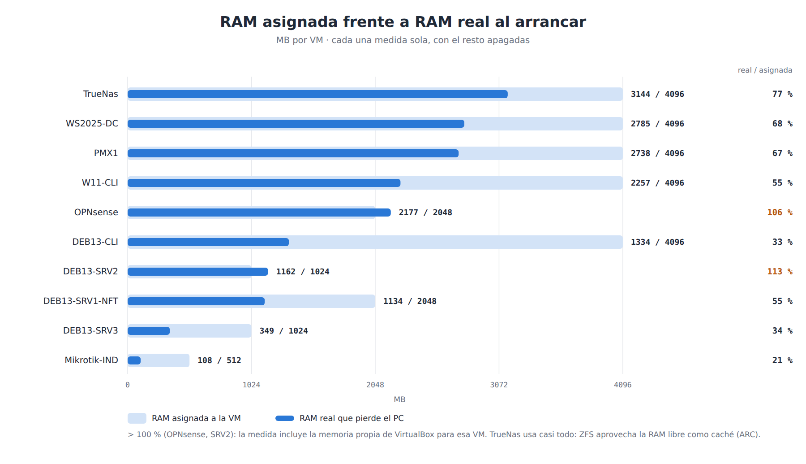

# Tasca 7 · Rendimiento

**Módulos:** ISO-RA6, FDM-RA1 · **Estado:** ✓ Apte · ✓ Apte+

## Qué pide el enunciado

| Nivel | Criterio |
|---|---|
| Apte | Línea base y carga del anfitrión; qué VM satura qué recurso; cuántas VMs aguanta el equipo |
| Apte+ | Dos optimizaciones de las VMs con medidas antes y después |

## Qué he hecho

1. **Línea base** del anfitrión en reposo (CPU, RAM, disco, red) con mis scripts [`mide-vm.sh`](../scripts/mide-vm.sh) y [`mide-todas.sh`](../scripts/mide-todas.sh).
2. **Cada VM sola**: la he arrancado sin ninguna otra encendida y he medido su RAM real, el pico de CPU, la lectura de disco y lo que tarda en calmarse.
3. **Carga por recurso**: con SRV2 y SRV3 he metido carga de un solo tipo cada vez (CPU, RAM, disco, red) para ver qué satura qué.
4. **Capacidad**: he ido encendiendo VMs hasta el límite y lo he contrastado con el cálculo.
5. **Validación de las medidas**: tres de las primeras medidas eran falsas (disco a 0, RSS de VirtualBox, `dd` con ceros). Lo descubrí comparándolas con otra fuente y las corregí.

## Resultados



| Recurso | ¿Quién lo satura? | ¿Es el límite? |
|---|---|---|
| **RAM** | TrueNAS, WS2025-DC y PMX1 (~3 GB cada una) | ✓ **Sí: marca cuántas VMs caben** |
| **Disco** | Las Windows al arrancar; cualquier VM escribiendo | ✓ **Sí, con carga** (USB, 399 MB/s; iowait de hasta el 82 %) |
| **CPU** | Windows al arrancar (2 hilos) | ✗ No (máximo 32 %) |
| **Red interna** | Copias entre VMs, DRBD | ✗ No (12 Gbit/s con virtio) |

**¿Cuántas VMs aguanta?** En el PC de casa, unos **11 GB de VMs**: 5 VMs con el navegador abierto. El límite es la RAM y, con carga, el disco.

### Apte+: dos optimizaciones

| Optimización | Antes | Después | Decisión |
|---|---|---|---|
| **1. Tarjeta de red virtio-net** en lugar de Intel e1000 (SRV2 y SRV3) | 4,74 Gbit/s | **12,3 Gbit/s**, y la mitad de CPU por Gbit/s | ✓ Se mantiene |
| **2. Caché de E/S del anfitrión** en el disco de SRV2 | sin caché | ×60 en escritura, **×80 en `fsync`** | ✗ **Revertida**: escribe en la RAM del PC y un corte de luz perdería datos "ya escritos". En un servidor con RAID y DRBD no compensa |

Medida real de la optimización de red (`iperf3` entre SRV2 y SRV3, 3 rondas):

```
### antes-e1000 · NIC: 82540EM
ronda 1: 4.73 Gbit/s · CPU del host 28,4 % · 6,0 % de CPU por cada Gbit/s
ronda 3: 4.75 Gbit/s · CPU del host 27,5 % · 5,8 % de CPU por cada Gbit/s
### despues-virtio · NIC: virtio
ronda 1: 12.7 Gbit/s · CPU del host 33,7 % · 2,7 % de CPU por cada Gbit/s
ronda 3: 12.2 Gbit/s · CPU del host 37,1 % · 3,0 % de CPU por cada Gbit/s
```

## Evidencias

- Documento completo: [08-rendiment](../docs/08-rendiment.md)
- Logs: [`rend-por-vm.txt`](../evidencies/logs/rend-por-vm.txt) · [`rend-carga.txt`](../evidencies/logs/rend-carga.txt) · [`rend-capacidad.txt`](../evidencies/logs/rend-capacidad.txt) · [`optim-red-antes-e1000.txt`](../evidencies/logs/optim-red-antes-e1000.txt) · [`optim-red-despues-virtio.txt`](../evidencies/logs/optim-red-despues-virtio.txt) · [`optim-disco-antes-sin-cache.txt`](../evidencies/logs/optim-disco-antes-sin-cache.txt) · [`optim-disco-despues-con-cache.txt`](../evidencies/logs/optim-disco-despues-con-cache.txt)

## Cómo comprobarlo

```bash
vmstat 2                                   # wa = espera de disco · si/so = swap
bash scripts/mide-vm.sh DEB13-SRV2 60 solo # medir una VM
VBoxManage showvminfo DEB13-SRV2 | grep -i "nic 1"   # tipo de tarjeta: virtio
```

## Preguntas probables de la defensa

- **¿Cómo sabes que tus medidas son correctas?** Porque cada cifra se contrasta con otra fuente. Por ejemplo, la RAM de una VM no se mide con el RSS del proceso, sino con lo que baja la memoria disponible del PC: VirtualBox reserva la RAM desde su driver del kernel.
- **¿Por qué desactivaste una optimización que iba 80 veces más rápido?** Porque la velocidad venía de no escribir de verdad en el disco. En un servidor de ficheros, la seguridad de los datos va primero.
