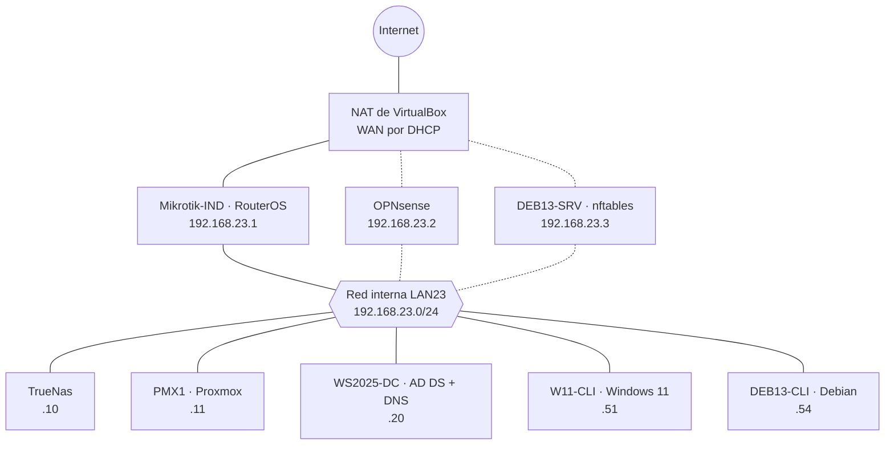

# Naix un sistema — Entorno de pruebas individual

**ASIX ThinkLab V2.0** · 1º ASIX · Módulos ISO y FDM · Puesto 23 · Alumno: izan

Simulación en VirtualBox del sistema informático de la empresa: comunicaciones, NAS, virtualización, dominio, servidores de infraestructura y clientes, con copias de seguridad, RAID, medidas de rendimiento y plan de contingencia.


## Índice

| Doc | Contenido |
|---|---|
| [00 · Predicciones](docs/00-prediccions.md) | Lo que pensaba antes de investigar |
| [01 · Requisitos](docs/01-requisits.md) | Necesidades y requisitos mínimos |
| [02 · Inventario](docs/02-inventari.md) | Equipo de clase y de casa, diagnósticos |
| [03 · Sistemas](docs/03-sistemes.md) | Sistemas elegidos, fuentes y SHA256 |
| [04 · Diseño](docs/04-disseny.md) | Esquema lógico, red e interfaces |
| [05 · Recursos](docs/05-recursos.md) | Tabla de máquinas y escenarios |
| [06 · Instalación](docs/06-installacio/README.md) | Una guía por máquina |
| [07 · RAID](docs/07-emmagatzematge-raid.md) | RAID 0, 1 y 5, fallo y reconstrucción |
| [08 · Rendimiento](docs/08-rendiment.md) | Línea base, carga y optimizaciones |
| [09 · Contingencia](docs/09-contingencia.md) | RTO/RPO y recuperaciones probadas |
| [10 · Incidencias](docs/10-incidencies.md) | Problemas y soluciones |

## Esquema de red



*Línea continua: gateway activo. Línea discontinua: gateways alternativos (se prueban de uno en uno).*

## Direccionamiento — `192.168.23.0/24`

| IP | VM (VirtualBox) | Función | Asignación | Estado |
|---|---|---|---|---|
| 192.168.23.1 | Mikrotik-IND | MikroTik RouterOS 7.24.5 · gateway por defecto | Fija | ✅ |
| 192.168.23.2 | OPNsense | OPNsense 26.7 · comunicaciones alternativo | Fija | 🟡 instalado |
| 192.168.23.3 | DEB13-SRV | Debian 13 + nftables · comunicaciones alternativo | Fija | ✅ |
| 192.168.23.10 | TrueNas | TrueNAS SCALE 25.10.7 · destino de las copias | Fija | ✅ |
| 192.168.23.11 | PMX1 | Proxmox VE 9.2 · nodo 1 del clúster | Fija | 🟡 reinstalado |
| 192.168.23.12 | PMX2 | Proxmox VE 9.2 · nodo 2 del clúster | Fija | 🟡 instalando |
| 192.168.23.20 | WS2025-DC | Windows Server 2025 · AD DS + DNS (asix23.lan) | Fija | ✅ |
| 192.168.23.30–49 | — | VMs y contenedores de Proxmox | Fija | ⬜ |
| 192.168.23.51 | W11-CLI | Cliente Windows 11 Pro · unido al dominio | Fija | ✅ |
| 192.168.23.54 | DEB13-CLI | Cliente Debian 13 | Fija | ✅ |

WAN de los routers: adaptador NAT de VirtualBox con IP por DHCP. LAN: red interna de VirtualBox `LAN23`. Máscara 255.255.255.0 · dominio `asix23.lan`.

## Estado de las tareas

| Tarea | Contenido | Estado |
|---|---|---|
| Tasca 0 | Entorno de pruebas y repositorio | 🟡 en curso |
| Tasca 2 | Inventario y diagnóstico | ⬜ pendiente |
| Tasca 4 | Diseño físico y lógico | ⬜ pendiente |
| Tasca 5 | Instalación y comunicaciones | 🟡 en curso — MikroTik ✅ · Debian nftables ✅ · cliente Debian ✅ |
| Tasca 6 | RAID | ⬜ pendiente |
| Tasca 7 | Rendimiento | ⬜ pendiente |
| Contingencia | Plan y recuperaciones | ⬜ pendiente |

Leyenda: ✅ hecho · 🟡 en curso · ⬜ pendiente · 🧪 simulado. Detalle en [PROGRESO.md](PROGRESO.md).

<details>
<summary><b>Estructura del repositorio</b></summary>

```
docs/          documentación por tarea (nombres del enunciado)
diagrames/     esquemas .mmd y sus exportaciones
evidencies/    captures/<máquina>/ y logs/ (salidas de comandos)
configs/       configuraciones exportadas SIN credenciales
scripts/       creación de VMs, copias, cambio de gateway, inventario…
```

Las credenciales se guardan fuera de git. En la documentación aparecen como `********`.
</details>
