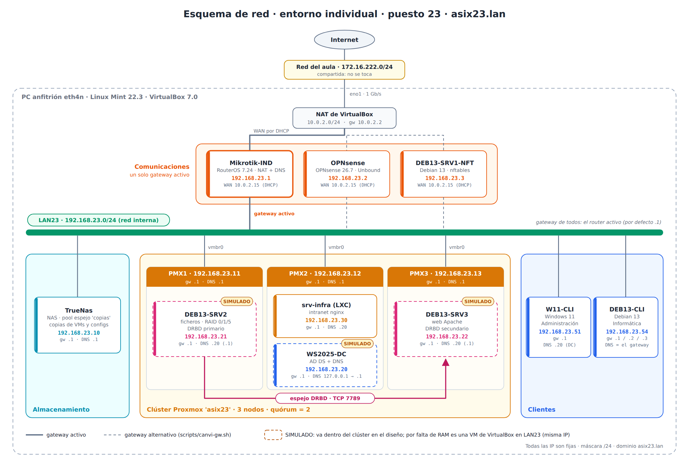
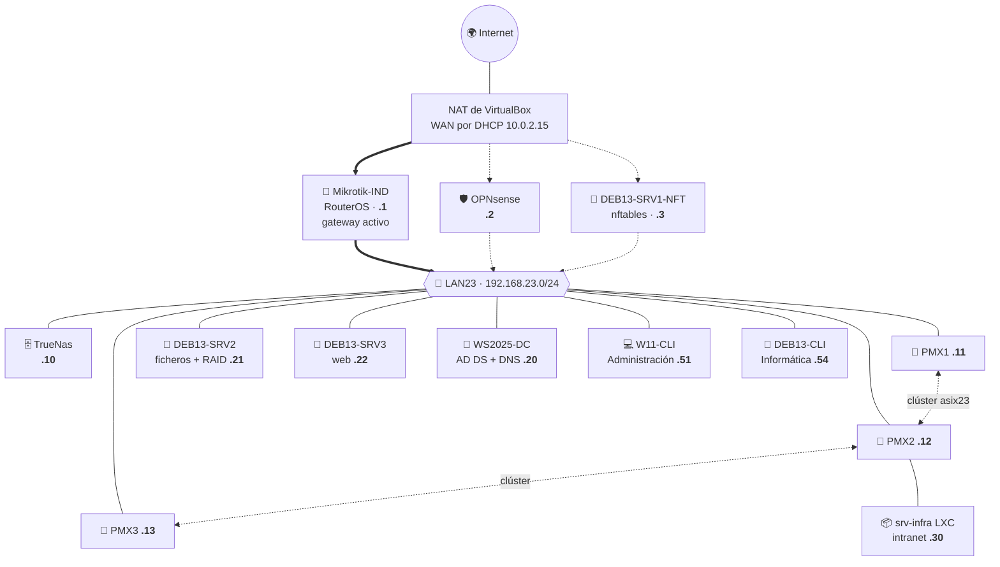

<div align="center">

# 🖥️ Naix un sistema
### Entorno de pruebas individual · ASIX ThinkLab V2.0

**1º ASIX** · Módulos **ISO** y **FDM** · Puesto **23** · Red `192.168.23.0/24` · Alumno: **izan**


<br>


*Simulación en VirtualBox del sistema informático de la empresa: tres servidores de comunicaciones, NAS con copias automáticas, clúster de virtualización, dominio de Active Directory y clientes, con RAID, medidas de rendimiento y plan de contingencia.*

</div>

---

## 📌 Resumen en 30 segundos

| | |
|---|---|
| 🌐 **Red** | LAN interna `LAN23` (192.168.23.0/24), dominio **`asix23.lan`**. 3 routers intercambiables (.1/.2/.3) con NAT y cortafuegos probados |
| 🗄️ **Datos** | TrueNAS con pool **espejo** `copias` → recibe cada noche las configuraciones de los equipos y las imágenes de las VMs |
| 🧱 **Virtualización** | Clúster Proxmox **`asix23`** de 3 nodos: contenedor `srv-infra` (intranet) y VM de prueba. Migración en caliente con **8 ms** de corte |
| 👥 **Identidades** | Windows Server 2025 como **DC + DNS**, OUs por departamento, Windows 11 unido al dominio |
| 🔒 **Seguridad** | Credenciales fuera del repo + *hook* que bloquea cualquier commit con contraseñas |

## 🗺️ Esquema de red

<div align="center"></div>

<details>
<summary>Ver versión Mermaid</summary>



</details>

<sub>Línea gruesa: gateway activo · línea discontinua: gateways alternativos (se prueban de uno en uno con `scripts/canvi-gw.sh`).</sub>

## 📇 Direccionamiento

| IP | VM | Función | Estado |
|---|---|---|:---:|
| `192.168.23.1` | Mikrotik-IND | RouterOS 7.24.5 · gateway por defecto · NAT + cortafuegos | ✅ |
| `192.168.23.2` | OPNsense | OPNsense 26.7 · comunicaciones alternativo | ✅ |
| `192.168.23.3` | DEB13-SRV1-NFT | Debian 13 + nftables · comunicaciones alternativo | ✅ |
| `192.168.23.10` | TrueNas | TrueNAS SCALE 25.10.7 · destino de las copias | ✅ |
| `192.168.23.11` | PMX1 | Proxmox VE 9.2 · nodo 1 del clúster `asix23` | ✅ |
| `192.168.23.12` | PMX2 | Proxmox VE 9.2 · nodo 2 del clúster `asix23` | ✅ |
| `192.168.23.13` | PMX3 | Proxmox VE 9.2 · nodo 3 del clúster `asix23` | ✅ |
| `192.168.23.20` | WS2025-DC | Windows Server 2025 · AD DS + DNS (`asix23.lan`) | ✅ |
| `192.168.23.21` | DEB13-SRV2 | Debian 13 · ficheros + **RAID 0/1/5** (mdadm) | ✅ |
| `192.168.23.22` | DEB13-SRV3 | Debian 13 · web Apache | ✅ |
| `192.168.23.30` | srv-infra (LXC) | Servidor de infraestructura · intranet nginx | ✅ |
| `192.168.23.51` | W11-CLI | Windows 11 Pro · Administración · en el dominio | ✅ |
| `192.168.23.54` | DEB13-CLI | Debian 13 · Informática · cliente de pruebas | ✅ |
| `.50 .52 .53` | — | Dirección · Comercial · Producción | 🧪 diseño |

Máscara `255.255.255.0` · Asignación **fija** en todos (no hay DHCP en LAN23) · WAN de los routers: NAT de VirtualBox por DHCP.

## ✅ Estado de las tareas

| Tarea | Qué pide | Estado |
|---|---|:---:|
| **Tasca 0** | Entorno de pruebas + repositorio Git | ✅ |
| **Tasca 2** | Inventario, diagnósticos y cuellos de botella | 🟡 casa ✅ (cuello de botella: SSD por USB) · falta clase |
| **Tasca 4** | Diseño físico y lógico, recursos | ✅ |
| **Tasca 5** | Instalación y comunicaciones | ✅ |
| **Tasca 6** | RAID 0/1/5 | ✅ Apte · ⬜ Apte+ (espejo entre 2 equipos) |
| **Tasca 7** | Rendimiento y optimizaciones | ⬜ |
| **Contingencia** | RTO/RPO y recuperaciones | 🟡 plan hecho con tiempos reales |

<sub>✅ hecho · 🟡 en curso · ⬜ pendiente · 🧪 simulado — detalle ítem a ítem en [PROGRESO.md](PROGRESO.md)</sub>

## 📚 Documentación

| | Documento | Contenido |
|:---:|---|---|
| 🔮 | [00 · Predicciones](docs/00-prediccions.md) | Lo que pensaba antes de investigar |
| 📋 | [01 · Requisitos](docs/01-requisits.md) | Necesidades y requisitos mínimos |
| 🔍 | [02 · Inventario](docs/02-inventari.md) | Equipo de clase y de casa, diagnósticos |
| 💿 | [03 · Sistemas](docs/03-sistemes.md) | Versiones, fuentes oficiales, licencias y **SHA256** |
| 📐 | [04 · Diseño](docs/04-disseny.md) | Esquema lógico, interfaces, clúster |
| 📊 | [05 · Recursos](docs/05-recursos.md) | Tabla de VMs, RAM simultánea, escenarios |
| ⚙️ | [06 · Instalación](docs/06-installacio/README.md) | **Una guía por máquina** (ver abajo) |
| 💽 | [07 · RAID](docs/07-emmagatzematge-raid.md) | RAID 0, 1 y 5, fallo y reconstrucción |
| 📈 | [08 · Rendimiento](docs/08-rendiment.md) | Línea base, carga y optimizaciones |
| 🚑 | [09 · Contingencia](docs/09-contingencia.md) | RTO/RPO y recuperaciones probadas |
| 🐞 | [10 · Incidencias](docs/10-incidencies.md) | 16 problemas reales y cómo se resolvieron |
| 🤖 
<details>
<summary><b>⚙️ Guías de instalación por máquina</b></summary>

| Máquina | Lo más destacado |
|---|---|
| [MikroTik](docs/06-installacio/mikrotik.md) | NAT, cortafuegos input/forward, log de permitido/bloqueado |
| [OPNsense](docs/06-installacio/opnsense.md) | Interfaces corregidas, Unbound en reenvío, **orden de reglas** |
| [Debian SRV](docs/06-installacio/debian-srv.md) | `ip_forward` + nftables persistente, log del kernel |
| [TrueNAS](docs/06-installacio/truenas.md) | Pool espejo, NFS, **copias automáticas "pull"** |
| [Proxmox](docs/06-installacio/proxmox.md) | Clúster, contenedor vs VM, **migraciones medidas**, vzdump al NAS |
| [Windows Server](docs/06-installacio/windows-server.md) | Dominio `asix23.lan`, OUs, DNS, copia del AD |
| [Clientes](docs/06-installacio/clients.md) | Windows 11 en el dominio, Debian de pruebas |

</details>

<details>
<summary><b>🧪 Resultados destacados</b></summary>

| Prueba | Resultado |
|---|---|
| HTTPS desde la LAN por cada router (.1 / .2 / .3) | ✅ `HTTP/2 200` |
| Telnet desde la LAN por cada router | 🚫 bloqueado y registrado en el log |
| Migración en caliente de una VM entre nodos | **12,7 s**, **8 ms** sin servicio |
| Migración de un contenedor | 85 s, ~84 s sin servicio (se copia el disco entero) |
| Copia completa del contenedor al NAS | 205 MB en 47 s |
| Copia del Directorio Activo (IFM) al NAS | 4,9 MB |
| Cuello de botella del host (3 instalaciones a la vez) | CPU 80 % libre, **13–16 % esperando al disco** → el SSD SATA |

</details>

<details>
<summary><b>📁 Estructura del repositorio</b></summary>

```
docs/          documentación por tarea (nombres de archivo del enunciado)
diagrames/     esquemas .mmd y sus exportaciones
evidencies/    captures/<máquina>/*.png  y  logs/*.txt (salidas reales de comandos)
configs/       configuraciones exportadas SIN credenciales (MikroTik, nftables…)
scripts/       automatización: copias, cambio de gateway, control de VMs, Windows…
```

</details>

<details>
<summary><b>🔐 Credenciales y seguridad</b></summary>

- Las contraseñas están solo en `CREDENCIALES-PRIVADAS.md`, que **está en `.gitignore`**.
- `scripts/comprova-secrets.sh` se ejecuta como *hook* `pre-commit` y **bloquea** el commit si encuentra alguna contraseña.
- En la documentación aparecen como `********`.
- Auditoría del historial completo: **0 contraseñas** publicadas.

</details>

---

<div align="center"><sub>Proyecto individual · ASIX ThinkLab "Naix un sistema" · CIP FP Batoi · Curso 2026-2027</sub></div>
