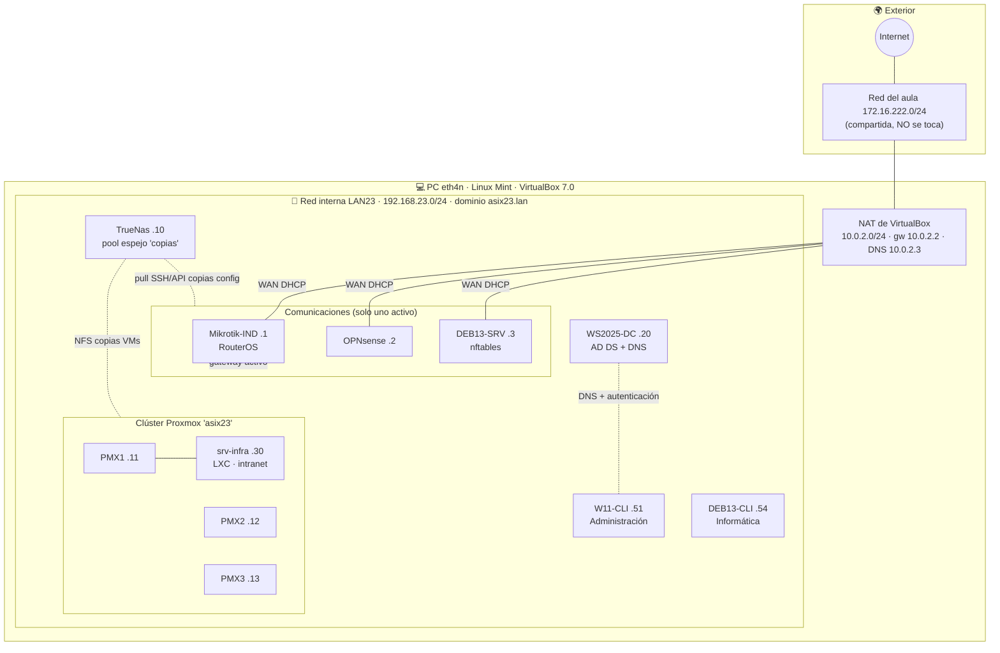

# 04 · Diseño físico y lógico

**Tasca 4** · Estado: ✅ · Red de mi puesto: **192.168.23.0/24** (puesto 23 del aula)

## 1. Esquema lógico


*Esquema de red exportado con Graphviz ([`diagrames/esquema-red.dot`](../diagrames/esquema-red.dot), también en [SVG](../diagrames/esquema-red.svg)). Línea gruesa: gateway activo; discontinua: gateways alternativos.*

Versión Mermaid (se dibuja directamente en GitHub, fuente en [`diagrames/esquema-logico.mmd`](../diagrames/esquema-logico.mmd)):



## 2. Esquema "físico" (montaje en VirtualBox)

Todo corre en **un solo equipo físico**: el portátil de clase (eth4n). Los "cables" son adaptadores virtuales:

| Elemento real | Equivalente en VirtualBox |
|---|---|
| Conmutador de la LAN | **Red interna `LAN23`** (`--nic intnet --intnet LAN23`): un switch virtual aislado, solo para mis VMs |
| Router del ISP / red del rack | **NAT de VirtualBox** (adaptador 1 de cada router): cada router recibe 10.0.2.15 por DHCP y sale por el PC |
| Cable de cada equipo al switch | Adaptador conectado a `LAN23` (`cableconnected on`) |
| Acceso del técnico a la gestión | Redirecciones de puertos **solo en 127.0.0.1** (no se ven desde la red del aula) |

```
                  PC eth4n (Linux Mint)
 ┌──────────────────────────────────────────────────────────────┐
 │  NAT VBox ──[nic1]── Mikrotik-IND ──[nic2]──┐                 │
 │  NAT VBox ──[nic1]── OPNsense     ──[nic2]──┤                 │
 │  NAT VBox ──[nic1]── DEB13-SRV    ──[nic2]──┤                 │
 │                                             │                 │
 │                     ════ red interna LAN23 ═╪═══════════════  │
 │                     │      │      │      │      │      │      │
 │                 TrueNas  PMX1  PMX2  PMX3  WS2025  W11  DEB13-CLI
 └──────────────────────────────────────────────────────────────┘
          │ eno1 1 Gbps (172.16.222.207, red del aula)
```

**¿Por qué red interna y no puente (bridge)?** Con puente, mis VMs aparecerían en la red compartida del aula (172.16.222.0/24) y un DHCP o una IP repetida molestaría a los compañeros. El enunciado prohíbe lanzar un DHCP de pruebas en la red compartida. La red interna aísla mi LAN y **obliga a que todo el tráfico pase por el router**, que es lo que queremos demostrar.

## 3. Parámetros de red de cada interfaz

| Máquina | Interfaz | Red VBox | IP / máscara | Gateway | DNS | Dominio | Asignación |
|---|---|---|---|---|---|---|---|
| Mikrotik-IND | ether1 (WAN) | NAT | 10.0.2.15/24 | 10.0.2.2 | 10.0.2.3 → 1.1.1.1, 9.9.9.9 | — | DHCP |
| Mikrotik-IND | ether2 (LAN) | LAN23 | **192.168.23.1/24** | — | (servidor DNS para la LAN) | — | Fija |
| OPNsense | em0 (WAN) | NAT | 10.0.2.15/24 | 10.0.2.2 | 10.0.2.3 | — | DHCP |
| OPNsense | em1 (LAN) | LAN23 | **192.168.23.2/24** | — | Unbound (reenvío) | — | Fija |
| DEB13-SRV | enp0s3 (WAN) | NAT | 10.0.2.15/24 | 10.0.2.2 | 10.0.2.3 | — | DHCP |
| DEB13-SRV | enp0s8 (LAN) | LAN23 | **192.168.23.3/24** | — (`never-default`) | — | — | Fija |
| TrueNas | enp0s3 | LAN23 | 192.168.23.10/24 | 192.168.23.1 | 192.168.23.1 | asix23.lan | Fija |
| PMX1 | vmbr0 (nic0) | LAN23 | 192.168.23.11/24 | 192.168.23.1 | 192.168.23.1 | asix23.lan | Fija |
| PMX2 | vmbr0 (nic0) | LAN23 | 192.168.23.12/24 | 192.168.23.1 | 192.168.23.1 | asix23.lan | Fija |
| PMX3 | vmbr0 (nic0) | LAN23 | 192.168.23.13/24 | 192.168.23.1 | 192.168.23.1 | asix23.lan | Fija |
| WS2025-DC | Ethernet | LAN23 | 192.168.23.20/24 | 192.168.23.1 | **127.0.0.1** (él mismo) · reenviador .1 | asix23.lan | Fija |
| srv-infra (LXC) | eth0 → vmbr0 | LAN23 | 192.168.23.30/24 | 192.168.23.1 | 192.168.23.20 | asix23.lan | Fija |
| W11-CLI | Ethernet | LAN23 | 192.168.23.51/24 | 192.168.23.1 | **192.168.23.20** (DC) | asix23.lan | Fija |
| DEB13-CLI | enp0s3 | LAN23 | 192.168.23.54/24 | .1 / .2 / .3 (`canvi-gw.sh`) | el del gateway activo | asix23.lan | Fija |

**¿Por qué todo con IP fija y sin DHCP?** Son servidores (siempre se les busca por la misma IP) y además hay tres routers en la misma LAN: con tres servidores DHCP, cada cliente cogería el gateway del que respondiera primero. Los clientes .50–.54 también van fijos para que las pruebas sean repetibles. **Rango reservado** para un futuro DHCP: `.100–.199`.

### Plan de direccionamiento

| Rango | Uso |
|---|---|
| .1 – .3 | Servidores de comunicaciones (fijados por el enunciado) |
| .10 – .19 | Almacenamiento y virtualización (NAS .10, nodos Proxmox .11–.13) |
| .20 – .29 | Servidores de identidad e infraestructura (DC .20) |
| .30 – .49 | VMs y contenedores dentro de Proxmox (srv-infra .30) |
| .50 – .54 | Clientes por departamento: Dirección .50, Administración .51, Comercial .52, Producción .53, Informática .54 |
| .100 – .199 | Reservado para DHCP (solo dentro de LAN23) |

## 4. Cambio de gateway activo

Solo un router hace de gateway a la vez. Los tres están siempre en la LAN con su IP, pero los clientes apuntan a uno:

```bash
scripts/canvi-gw.sh 1   # MikroTik   (DNS .1)
scripts/canvi-gw.sh 2   # OPNsense   (DNS .2)
scripts/canvi-gw.sh 3   # Debian     (DNS 1.1.1.1, porque Debian no tiene servidor DNS)
```

Comprobación en cada caso: `ip route` (gateway) + `traceroute -T` (el primer salto es el router elegido). Resultados: [MikroTik](../evidencies/logs/prueba-gw-mikrotik.txt) · [OPNsense](../evidencies/logs/prueba-gw-opnsense.txt) · [Debian](../evidencies/logs/prueba-gw-debian.txt).

## 5. Clúster: nodos, quórum, red y almacenamiento

| | Diseño |
|---|---|
| Nodos | **3** (PMX1, PMX2, PMX3) → quórum = 2 votos: **si cae un nodo, el clúster sigue funcionando** |
| Red | Corosync sobre LAN23 (en producción: red separada y redundante) |
| Almacenamiento | `local-lvm` en cada nodo (local) + `nas-copias` (NFS de TrueNAS, compartido, para copias) |
| Gestión conjunta | ✅ |
| Migración | ✅ medida ([Proxmox](06-installacio/proxmox.md#8-migraciones-medidas-log-completo)) |
| Alta disponibilidad | 🧪 Diseño: necesitaría almacenamiento compartido para los **discos** de las VMs (NFS/iSCSI/Ceph) |

## 6. Decisiones y alternativas

| Decisión | Alternativas | Por qué esta |
|---|---|---|
| Red interna `LAN23` | Puente al aula, red host-only | Aislada y sin riesgo para la red compartida |
| WAN por NAT de VirtualBox | Puente con IP del rack | El enunciado lo permite en la parte individual |
| Dominio `asix23.lan` | `.local`, subdominio público | `.local` choca con mDNS; no tenemos dominio público |
| DNS del dominio en el DC | DNS en el router | AD necesita registros SRV que solo gestiona su DNS |
| Copias "pull" desde el NAS | Cada equipo envía | Los equipos no guardan credenciales del NAS |
