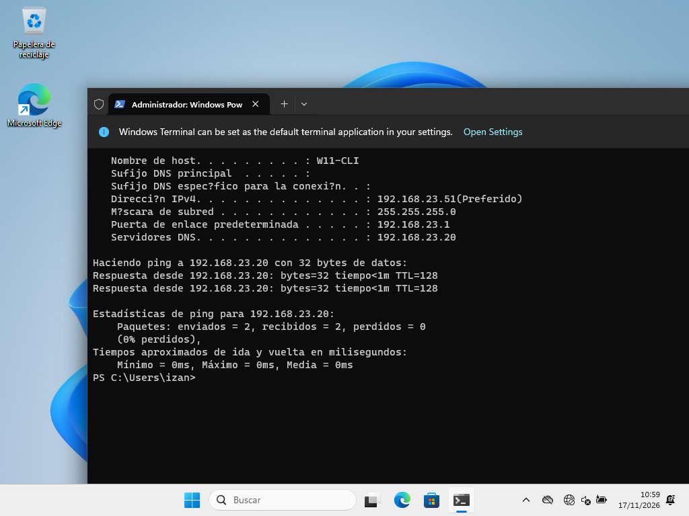
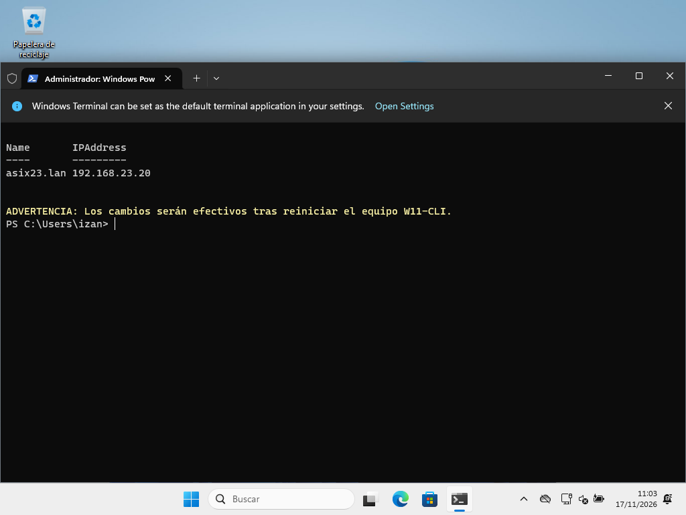

# Clientes — Windows 11 (Administración) y Debian (Informática)

| | W11-CLI | DEB13-CLI |
|---|---|---|
| Departamento | **Administración** | **Informática** |
| Sistema | Windows 11 **Pro** 25H2 (26200.6584) | Debian 13 con GNOME |
| Recursos | 2 vCPU · 4 GB · 64 GB · **UEFI + TPM 2.0** | 1 vCPU · 4 GB · 20 GB · BIOS |
| Red | 192.168.23.51/24 · gw .1 · **DNS .20 (el DC)** | 192.168.23.54/24 · gw .1 (cambiable) · DNS según el gateway |
| Dominio | ✅ Miembro de `asix23.lan` (OU Administracion) | No (justificado abajo) |
| Estado | ✅ | ✅ |

## ¿Por qué Windows para Administración y Linux para Informática?

| Departamento | Sistema | Motivo |
|---|---|---|
| Administración | Windows 11 Pro | Usa programas de gestión, contabilidad y ofimática que en las pymes suelen ser solo para Windows. La edición **Pro** es obligatoria para unirse a un dominio (la Home no puede). |
| Informática | Debian | Herramientas de administración (SSH, `nmap`, `tcpdump`, scripts), sin coste de licencia y con control total. Es además el equipo con el que se hacen las pruebas de los routers. |
| Dirección, Comercial, Producción | 🧪 Solo diseño | No caben más VMs en la RAM del equipo; se dejan en el diseño con Windows 11 (Dirección y Comercial: ofimática y CRM) y Linux (Producción: puesto fijo con una sola aplicación web). |

## W11-CLI

### Instalación (desatendida)

```bash
VBoxManage unattended install W11-CLI --iso=win11.iso --image-index=6 \
  --user=izan --password=******** --hostname=W11-CLI.asix23.lan --locale=es_ES --time-zone=Europe/Madrid
```

- Imagen 6 = **Windows 11 Pro**. Requisitos oficiales cumplidos justo: 4 GB de RAM, 64 GB, UEFI con arranque seguro y **TPM 2.0** (VirtualBox 7 emula el TPM).
- Incidencias: pantalla *"Press any key to boot from CD"* (6) y parada en *"Clave de producto"* (7) → [incidencias](../10-incidencies.md).
- Las Guest Additions no se instalaron solas → se instalaron a mano (`VBoxWindowsAdditions.exe /S`).

### Usuario de administración

`izan` (local, administrador). Al unir el equipo al dominio, los usuarios del dominio también pueden iniciar sesión.

### Red

Desde un **Terminal (Administrador)**:

```powershell
New-NetIPAddress -InterfaceIndex $a.ifIndex -IPAddress 192.168.23.51 -PrefixLength 24 -DefaultGateway 192.168.23.1
Set-DnsClientServerAddress -InterfaceIndex $a.ifIndex -ServerAddresses 192.168.23.20
```

**El DNS tiene que ser el DC (.20)**, no el router: para unirse al dominio el equipo busca el registro `_ldap._tcp.asix23.lan`, que solo conoce el DNS del dominio.


*Demuestra: IP 192.168.23.51/24, gateway .1, DNS .20 y ping correcto al controlador de dominio.*

### Unión al dominio

```powershell
Add-Computer -DomainName asix23.lan -OUPath "OU=Administracion,DC=asix23,DC=lan" -Credential ASIX23\Administrador
Restart-Computer
```


*Demuestra: `asix23.lan` resuelve a 192.168.23.20 y el equipo queda unido (efectivo tras reiniciar).*

Comprobación después del reinicio ([log](../../evidencies/logs/w11-cli-dominio.txt)):

```
Domain       : asix23.lan
PartOfDomain : True
Test-ComputerSecureChannel → True        ← la relación de confianza con el DC funciona
DC: \\WS2025-DC.asix23.lan   Dirección: \\192.168.23.20
```

En el DC: `CN=W11-CLI,OU=Administracion,DC=asix23,DC=lan`.

### Copia de seguridad

Para un cliente de dominio lo importante son **los datos del usuario**, no el sistema (se reinstala con el mismo procedimiento desatendido en ~30 min y vuelve a unirse al dominio).

- Datos: se deben guardar en el servidor (carpetas compartidas / redirección de carpetas por GPO) → el NAS los copia.
- Sistema: instantánea de VirtualBox antes de cambios importantes.

## DEB13-CLI

### Red (NetworkManager)

```bash
nmcli con mod "Wired connection 1" con-name LAN23 ipv4.method manual \
  ipv4.addresses 192.168.23.54/24 ipv4.gateway 192.168.23.1 ipv4.dns 192.168.23.1 \
  ipv4.dns-search asix23.lan ipv6.method disabled
```

Paquetes: `openssh-server sudo traceroute curl netcat-openbsd`, instalados **a través de MikroTik** (primera prueba real del NAT). `izan` está en el grupo `sudo`.

### Cliente de pruebas de los tres routers

`scripts/canvi-gw.sh 1|2|3` cambia su gateway y su DNS. Con él se hicieron las pruebas de [MikroTik](mikrotik.md), [OPNsense](opnsense.md) y [Debian](debian-srv.md).

### ¿Por qué no se une al dominio?

Se podría (con `realmd` + `sssd`), pero es el equipo del departamento de Informática y se usa como **puesto de pruebas** que cambia constantemente de gateway. Unirlo no aporta nada a las pruebas y añade una dependencia del DC. Queda como mejora.

### Copia de seguridad

Copia de `/etc` y de `/home/izan` al NAS cuando se necesite; el sistema se reinstala desde la ISO netinst.

## Preguntas probables de la defensa

- **¿Por qué W11 Pro y no Home?** Home no puede unirse a un dominio de Active Directory.
- **¿Qué pasa si el cliente usa el router como DNS?** Navega bien, pero no encuentra el dominio: `Add-Computer` falla con *"no se pudo contactar con el dominio"*.
- **¿Qué es el canal seguro?** Una contraseña de equipo que comparten el PC y el DC. Si se rompe (por ejemplo, al restaurar una copia antigua del PC), el equipo deja de poder iniciar sesiones de dominio y hay que repararlo con `Test-ComputerSecureChannel -Repair`.
