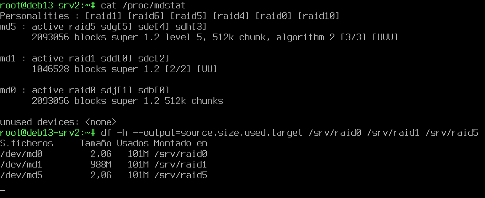
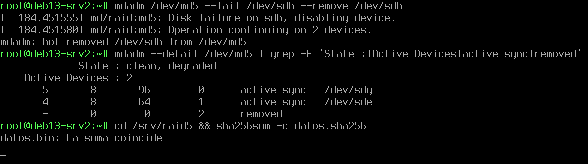
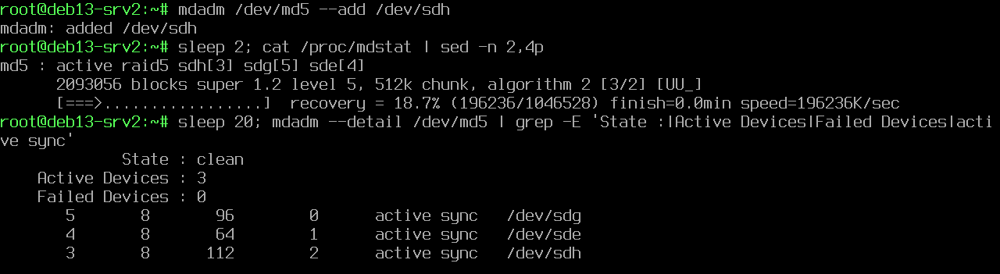
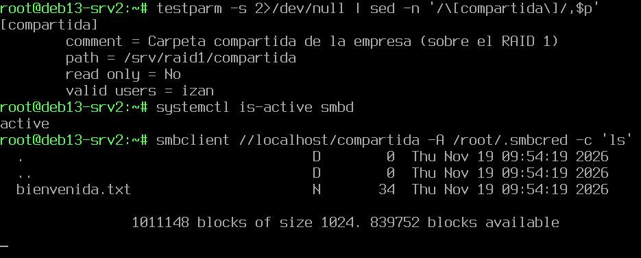
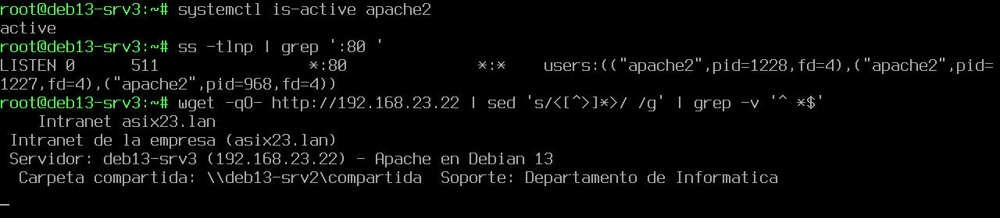
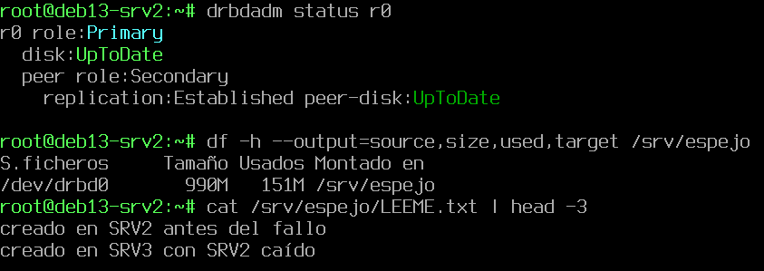
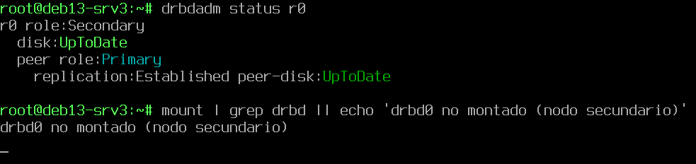

# Servidores Debian 13 — DEB13-SRV2 (ficheros + RAID) y DEB13-SRV3 (web)

| | DEB13-SRV2 | DEB13-SRV3 |
|---|---|---|
| Función | Servidor de ficheros + **RAID 0/1/5** con `mdadm` + **primario** del espejo DRBD ([07](../07-emmagatzematge-raid.md)) | Servidor web Apache (intranet) + **secundario** del espejo DRBD |
| IP | `192.168.23.21/24` | `192.168.23.22/24` |
| Hostname | `deb13-srv2.asix23.lan` | `deb13-srv3.asix23.lan` |
| Recursos | 1 vCPU · 1 GB RAM · 20 GB + 8 × 1 GB (RAID) + 1 GB (DRBD) | 1 vCPU · 1 GB RAM · 20 GB + 1 GB (DRBD) |
| Red | Adaptador 1 → red interna `LAN23` · tarjeta **virtio-net** (antes e1000: ver [08 §5.1](../08-rendiment.md)) | ídem |
| Paquetes | `mdadm samba sysstat fio parted drbd-utils iperf3 stress-ng` | `apache2 sysstat drbd-utils iperf3 stress-ng fio` |
| Gestión desde el PC | `ssh -p 2221 izan@127.0.0.1` | `ssh -p 2222 izan@127.0.0.1` · web `http://127.0.0.1:8422` |

**Nombres:** se llaman SRV1/SRV2/SRV3 en serie. La **SRV1** es la Debian router (`DEB13-SRV1-NFT`, nftables, `.3`).

## 1. Instalación (desatendida)

Debian 13.1 *netinst* (misma ISO y SHA256 que en [03-sistemes](../03-sistemes.md)), con la instalación desatendida de VirtualBox. Sin escritorio: solo «utilidades estándar» + SSH.

```bash
VBoxManage unattended install DEB13-SRV2 --iso=debian-13.1.0-amd64-netinst.iso --user=izan \
  --password-file=<fichero> --hostname=deb13-files.asix23.lan --locale=es_ES --country=ES \
  --time-zone=Europe/Madrid --start-vm=headless
```

- Durante la instalación, el adaptador 1 está en **NAT** para descargar paquetes. Después se pasa a `LAN23`.
- Problemas encontrados: arranque desde el disco a medio instalar, el script post-instalación que falla (sin `sudo`) y `dhcpcd` que borra los DNS → incidencias en [10-incidencies](../10-incidencies.md).
- **¿Por qué sin escritorio?** Un servidor no lo necesita: arranca con ~230 MB de RAM usados y tiene menos paquetes que actualizar y menos superficie de ataque.

## 2. Red

`/etc/network/interfaces` (copia anterior en `interfaces.antes-lan23`):

```
auto enp0s3
iface enp0s3 inet static
    address 192.168.23.21/24
    gateway 192.168.23.1
```

DNS en `/etc/resolv.conf.head`: `192.168.23.20` (DC) y `192.168.23.1` (MikroTik) de reserva.

**Verificación** (los dos servidores): ping al gateway **0 % de pérdida, 0,3 ms**; ping a Internet `1.1.1.1` **0 % de pérdida, 15 ms**; resolución de `deb.debian.org` correcta, también **tras reiniciar**.

### Acceso desde el PC (sin tocar la red del aula)

PC `127.0.0.1:2221/2222/8422` → reenvío de puertos de VirtualBox en el adaptador NAT del MikroTik → **`dst-nat`** del MikroTik → `.21:22`, `.22:22`, `.22:80`. Las reglas aceptan **solo** el tráfico que viene del PC (`src-address=10.0.2.2`), como las del resto de servidores. Copia de las reglas anteriores: [`mikrotik-nat-antes-srv2-srv3.json`](../../evidencies/logs/mikrotik-nat-antes-srv2-srv3.json) y backup `antes-srv2-srv3` en el router.

## 3. Servicio

### 3.1 SRV2: RAID y servidor de ficheros (Samba)

Los 3 RAID están montados en `/srv/raid0`, `/srv/raid1` y `/srv/raid5` (pruebas completas en [07](../07-emmagatzematge-raid.md)).



*Demuestra: los tres RAID (`md0` nivel 0, `md1` nivel 1 y `md5` nivel 5) están activos con todos sus discos (`[UU]`, `[UUU]`) y montados en `/srv`.*

Fallo controlado del RAID 5 (se marca `sdh` como estropeado, se quita y se vuelve a añadir):



*Demuestra: con un disco menos el RAID 5 queda `clean, degraded` con 2 discos activos y el archivo de prueba sigue íntegro (`La suma coincide`).*



*Demuestra: al volver a añadir el disco empieza la reconstrucción (`recovery`) y en unos segundos el RAID vuelve a `clean` con los 3 discos en `active sync`.*

**Recurso compartido `compartida`** (añadido el 19/11/2026): carpeta de la empresa sobre el RAID 1 (`/srv/raid1/compartida`), solo para usuarios autorizados (`valid users = izan`, usuario de Samba creado con `smbpasswd -a`). Configuración en [`configs/samba/smb-compartida.conf`](../../configs/samba/smb-compartida.conf); copia del archivo anterior en `/etc/samba/smb.conf.antes-2026-11-19`.



*Demuestra: el recurso `[compartida]` está definido, el servicio `smbd` está activo y un usuario autenticado puede listar los archivos de la carpeta.*

- **¿Por qué sobre el RAID 1?** Es el que protege los datos ante la avería de un disco con el montaje más sencillo (2 discos). El RAID 0 no tolera ningún fallo.

### 3.2 SRV3: servidor web (intranet)

Apache con una página de intranet sencilla en `/var/www/html/index.html` ([`configs/apache/index.html`](../../configs/apache/index.html); la página original de Debian se guardó como `index.html.debian-original`). Desde el PC: `http://127.0.0.1:8422` → **HTTP 200**.



*Demuestra: Apache está activo, escucha en el puerto 80 y sirve la página de la intranet en `192.168.23.22`.*

### 3.3 Espejo por red (DRBD) entre SRV2 y SRV3

Recurso `r0` → `/dev/drbd0` montado en `/srv/espejo` en el **primario** (SRV2). Montaje, pruebas de caída y caso de uso en [07 §7](../07-emmagatzematge-raid.md).



*Demuestra: SRV2 es primario, los dos discos están `UpToDate` y la replicación está establecida; el espejo está montado y conserva los archivos escritos en las pruebas de caída.*



*Demuestra: SRV3 es secundario y tiene una copia al día (`UpToDate`), pero no monta el disco: solo el primario puede usarlo.*

> El espejo **no se monta en el `fstab`**: solo lo monta el nodo que es primario, a mano (`drbdadm primary r0 && mount /dev/drbd0 /srv/espejo`) o con Pacemaker en producción.

## 4. Copias de seguridad

| Qué | Cómo |
|---|---|
| Configuración (`/etc`: red, `fstab`, `mdadm.conf`, `drbd.d/r0.res`, Samba, Apache) | Igual que DEB13-SRV1-NFT: la copia nocturna del NAS se lleva `/etc` en un `.tgz` |
| Datos de los RAID, de la carpeta compartida y del espejo DRBD | Ni el RAID ni DRBD **son una copia** (un borrado se replica al instante): los datos importantes se copian al NAS |
| Sistema completo | Se reinstala en ~15 min con la instalación desatendida + `/etc` de la copia |

## Preguntas probables de la defensa

- **¿Por qué IP fija y no DHCP?** Es un servidor: los clientes y el DNS tienen que encontrarlo siempre en la misma dirección. Además, en LAN23 no hay servidor DHCP.
- **¿Qué diferencia hay entre un RAID y una copia de seguridad?** El RAID protege ante la avería de un disco; si alguien borra un archivo de la carpeta compartida, el RAID lo borra en todos los discos a la vez. Solo una copia (en el NAS) permite recuperarlo.
- **¿Por qué `nofail` en el `fstab` de los RAID?** Para que, si un RAID no arranca, el servidor arranque igualmente (lección de la incidencia provocada del `fstab`).
