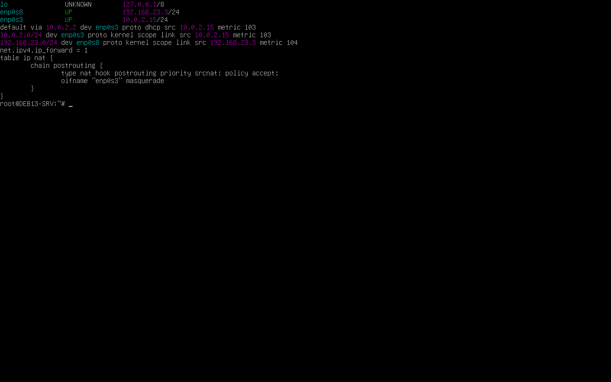
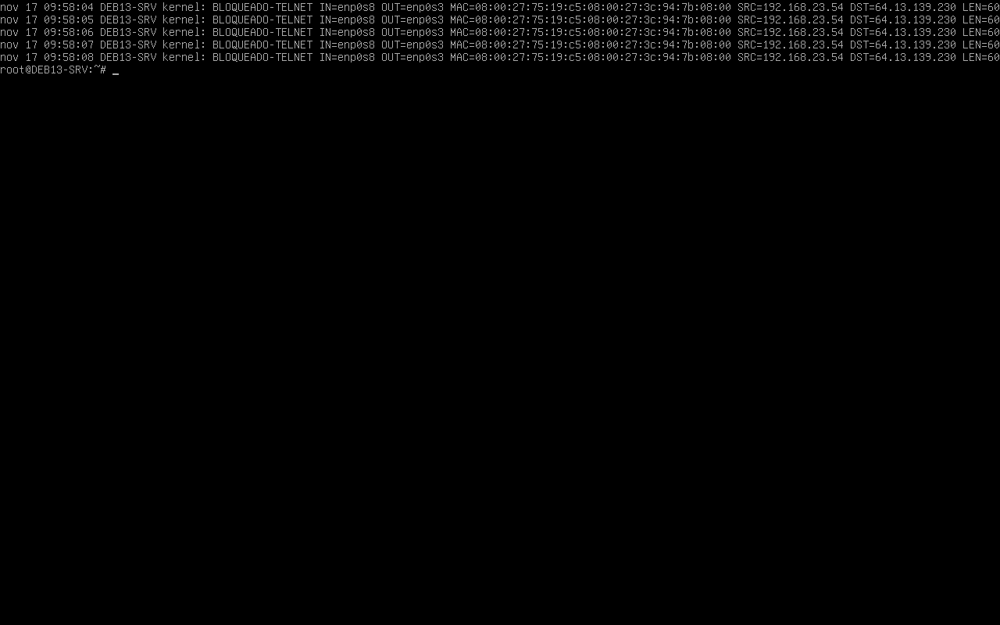

# Debian SRV con nftables — servidor de comunicaciones GNU/Linux (192.168.23.3)

| Dato | Valor |
|---|---|
| VM en VirtualBox | `DEB13-SRV` (grupo `ISO-INDV`) |
| Sistema | Debian GNU/Linux **13 (trixie)**, kernel 6.12.117, con escritorio GNOME |
| Función | Servidor de comunicaciones alternativo: router + NAT + cortafuegos `nftables` |
| Recursos | 1 vCPU · 2 GB RAM · disco 20 GB |
| Interfaces | `enp0s3` = WAN (NAT VirtualBox, DHCP) · `enp0s8` = LAN23 `192.168.23.3/24` |
| Estado | ✅ Configurado y verificado |

## 1. Requisitos e imagen

- Imagen: `debian-13.1.0-amd64-netinst.iso` (oficial, <https://www.debian.org/distrib/netinst>).
- Requisitos mínimos oficiales sin escritorio: 256 MB de RAM y 2 GB de disco; con escritorio, 1 GB de RAM recomendado (<https://www.debian.org/releases/trixie/amd64/ch03s04.es.html>).
- Licencia: software libre (DFSG), gratuito, con soporte de la comunidad y actualizaciones de seguridad.
- La VM ya estaba instalada **con GNOME**. Para un router no hace falta escritorio: es candidato a **optimización** en la Tasca 7 (arrancar en modo texto y medir la RAM antes y después).

## 2. Red en VirtualBox

| Adaptador VBox | Interfaz Debian | Red | IP | Asignación |
|---|---|---|---|---|
| 1 | enp0s3 | NAT de VirtualBox | 10.0.2.15/24, gw 10.0.2.2 | DHCP |
| 2 | enp0s8 | Red interna `LAN23` | 192.168.23.3/24, **sin gateway** | Fija |

La red la gestiona **NetworkManager** (viene con GNOME). Se configuró con `nmcli`:

```bash
# Copia previa para poder volver atrás
tar czf /root/backups/00-red-inicial.tgz /etc/NetworkManager /etc/network

nmcli con add type ethernet ifname enp0s3 con-name WAN ipv4.method auto ipv6.method disabled
nmcli con mod "Wired connection 1" con-name LAN23 ipv4.method manual \
      ipv4.addresses 192.168.23.3/24 ipv4.never-default yes ipv6.method disabled
nmcli con up WAN; nmcli con up LAN23
```

**¿Por qué `ipv4.never-default yes` en la LAN?** Un equipo solo debe tener **una ruta por defecto**. Si la LAN también la tuviera, Debian podría intentar salir a Internet por la LAN (hacia sí mismo) en vez de por la WAN.

## 3. Usuario de administración

- Usuario `izan` (contraseña `********`), añadido al grupo **`sudo`** para administrar sin entrar como root.
- `root` con contraseña `********` (solo para emergencias desde la consola).
- Acceso remoto: `openssh-server` instalado. Desde el anfitrión se entra con clave SSH (sin contraseña) por la redirección `127.0.0.1:2203 → 22`.

Paquetes instalados: `openssh-server sudo nftables tcpdump traceroute curl` (todos de los repositorios oficiales de Debian).

## 4. Router: reenvío de paquetes + nftables

### Activar el reenvío (`ip_forward`)

Por defecto Linux **no reenvía** paquetes entre interfaces (no es un router). Se activa de forma **persistente** en [`/etc/sysctl.d/99-router.conf`](../../configs/debian-srv/99-router.conf):

```
net.ipv4.ip_forward = 1
```

### Reglas nftables

Archivo completo y comentado: [`configs/debian-srv/nftables.conf`](../../configs/debian-srv/nftables.conf), instalado en `/etc/nftables.conf` y cargado en cada arranque con `systemctl enable nftables`.

| Tabla / cadena | Política | Reglas importantes |
|---|---|---|
| `inet filtro` / input | **drop** | lo, established, ICMP, gestión desde LAN23, SSH solo desde 10.0.2.2 (anfitrión), resto con log `IN-DROP` |
| `inet filtro` / forward | **drop** | established; **TCP 23 → drop + log `BLOQUEADO-TELNET`**; **TCP 443 nuevo → accept + log `PERMITIDO-HTTPS`**; LAN → WAN accept; resto log `FWD-DROP` |
| `ip nat` / postrouting | accept | `oifname enp0s3 masquerade` |

**Política `drop` por defecto**: todo lo que no se permite explícitamente se bloquea. Es más seguro que permitir todo y bloquear lo malo, porque no hace falta conocer de antemano todos los ataques.

Antes de aplicar: `cp /etc/nftables.conf /root/backups/nftables.conf.orig` y comprobación de sintaxis con `nft -c -f` (no aplica nada si hay un error).

## 5. Verificación


*Demuestra: las dos interfaces con su IP, la ruta por defecto por la WAN, `ip_forward = 1` y la tabla NAT con masquerade.*

Configuración completa: [`evidencies/logs/debian-srv-config.txt`](../../evidencies/logs/debian-srv-config.txt).

Prueba con el cliente `DEB13-CLI` usando **.3 como gateway** (`scripts/canvi-gw.sh 3`) — salida en [`evidencies/logs/prueba-gw-debian.txt`](../../evidencies/logs/prueba-gw-debian.txt):

| Prueba | Resultado | Interpretación |
|---|---|---|
| `ip route` en el cliente | `default via 192.168.23.3` | El cliente usa Debian como gateway |
| `traceroute -T -p 443 deb.debian.org` | salto 1 = 192.168.23.3, salto 2 = 10.0.2.2 | El tráfico sale **por Debian** |
| `curl -sI https://deb.debian.org` | `HTTP/2 200` | **Conexión permitida** |
| `nc -zv telehack.com 23` | *timed out* | **Conexión bloqueada** |

### Interpretación del registro (`journalctl -k`)

```
DEB13-SRV kernel: PERMITIDO-HTTPS IN=enp0s8 OUT=enp0s3 SRC=192.168.23.54 DST=151.101.134.132 ... PROTO=TCP SPT=56232 DPT=443 ... SYN
DEB13-SRV kernel: BLOQUEADO-TELNET IN=enp0s8 OUT=enp0s3 SRC=192.168.23.54 DST=64.13.139.230 ... PROTO=TCP SPT=44890 DPT=23 ... SYN
```

| Campo | Significado |
|---|---|
| `IN=enp0s8 OUT=enp0s3` | Entra por la LAN y quiere salir por la WAN → cadena *forward* |
| `SRC=192.168.23.54` | El cliente DEB13-CLI |
| `DPT=443` / `DPT=23` | Puerto de destino: HTTPS (permitido) / Telnet (bloqueado) |
| `TTL=63` | Era 64 en el cliente; el router lo ha restado al reenviarlo |
| `SYN` | Primer paquete de la conexión TCP |


*Demuestra: nftables registra en el log del kernel la conexión HTTPS permitida y los intentos de Telnet bloqueados.*

## 6. Copia de seguridad y vuelta atrás

| Copia | Dónde | Cómo volver |
|---|---|---|
| Red original | `/root/backups/00-red-inicial.tgz` | `tar xzf ... -C /` y `systemctl restart NetworkManager` |
| nftables original | `/root/backups/nftables.conf.orig` | `cp` a `/etc/nftables.conf` + `nft -f /etc/nftables.conf` |
| Configuración en Git | `configs/debian-srv/` | Copiar de nuevo con `scp` |
| Copia de `/etc` en TrueNAS | ⬜ pendiente | |

Si una regla deja sin acceso por SSH: la **consola de VirtualBox** no depende de la red → `sudo nft flush ruleset` deja pasar todo.

## 7. Fallo provocado y recuperación ([log](../../evidencies/logs/fallo-recuperacion-debian-srv.txt))

**Escenario**: alguien edita `/etc/nftables.conf`, deja un error de sintaxis y el servidor se reinicia (corte de luz, actualización…).

| Paso | Hora | Evidencia |
|---|---|---|
| Estado inicial | 13:54:44 | `oifname "enp0s3" masquerade` cargado |
| **Fallo** | 13:54:44 | Línea rota al final del fichero + `systemctl reboot` |
| Arranque | 13:55:08 | `nftables: failed` · **0 reglas cargadas** |
| **Diagnóstico** | 13:55:08 | `journalctl -u nftables`: `/etc/nftables.conf:49:1-1: Error: syntax error, unexpected end of file` |
| **Recuperación** | 13:55:08 | Se extrae `etc/nftables.conf` de la última copia del NAS (`etc.tgz`), se comprueba con `nft -c -f` y se aplica |
| Servicio OK | 13:55:09 | `active` + regla de NAT cargada (**1 s**) |

| Resultado | Valor |
|---|---|
| Tiempo sin Internet medido en el cliente | **21 s** (casi todo es el reinicio del servidor) |
| Configuración perdida | **Ninguna** |

**¿Por qué es peligroso este fallo?** Sin reglas, nftables deja de **filtrar** (el servidor queda expuesto) y de hacer **NAT** (la LAN se queda sin Internet), y el servicio solo avisa en el log. Por eso siempre se comprueba con `nft -c -f fichero` **antes** de aplicar.

## Preguntas probables de la defensa

- **¿Qué diferencia hay entre `input` y `forward`?** `input` = paquetes dirigidos al propio Debian; `forward` = paquetes que pasan a través de él de una red a otra.
- **¿Qué pasa si reinicio y no he hecho persistente `ip_forward`?** Vuelve a 0 y Debian deja de enrutar: la LAN se queda sin Internet aunque las reglas nftables estén bien.
- **¿Por qué `inet` y no `ip`?** La familia `inet` aplica las mismas reglas a IPv4 e IPv6 a la vez. El NAT se hace en una tabla `ip` porque solo hacemos NAT de IPv4.
- **¿Cómo sé que es Debian el que enruta y no MikroTik?** `traceroute`: el primer salto es 192.168.23.3. Además, el log aparece en el kernel de Debian.
