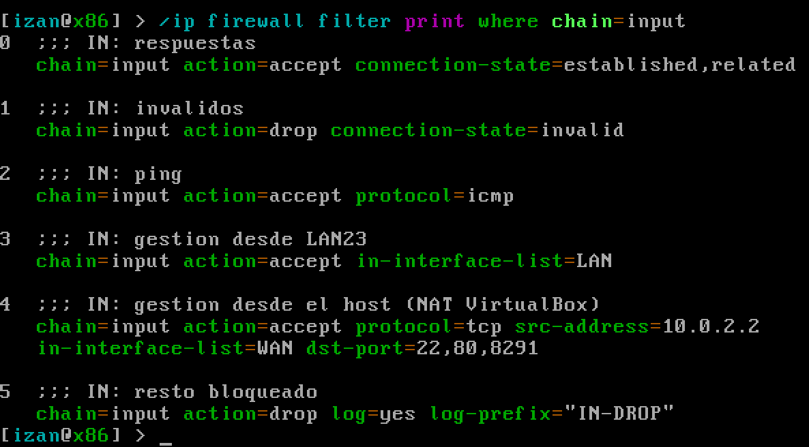
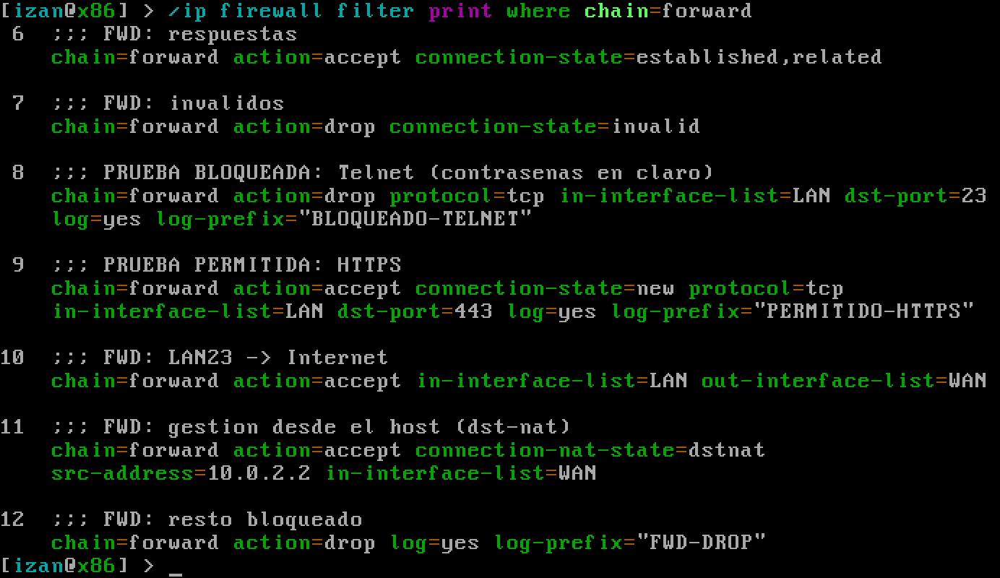
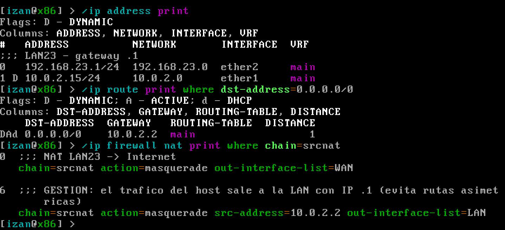
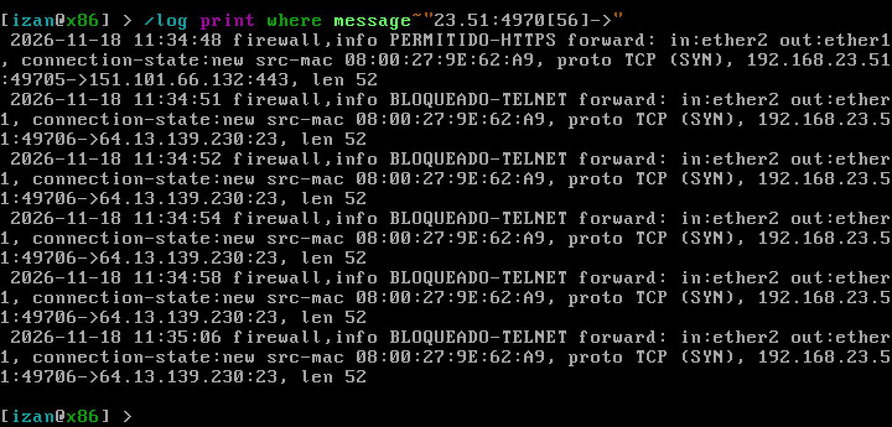
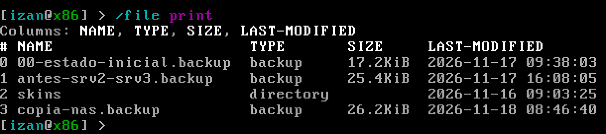

# MikroTik RouterOS — servidor de comunicaciones principal (192.168.23.1)

| Dato | Valor |
|---|---|
| VM en VirtualBox | `Mikrotik-IND` (grupo `ISO-INDV`) |
| Sistema | MikroTik RouterOS **7.24.5 (stable)**, edición x86 instalada desde ISO |
| Función | Gateway por defecto activo de LAN23 + NAT + cortafuegos |
| Recursos | 2 vCPU · 512 MB RAM · disco 2 GB |
| Interfaces | `ether1` = WAN (NAT VirtualBox, DHCP) · `ether2` = LAN23 `192.168.23.1/24` |
| Estado | ✓ Configurado y verificado |

## 1. Requisitos, licencia e imagen

- **Imagen**: `mikrotik-7.24.5.iso` (x86), descargada de la web oficial de MikroTik (<https://mikrotik.com/download>).
- **Licencia**: RouterOS x86 necesita una clave de licencia. **Sin clave funciona en modo demo de 24 h** (contadas solo mientras el router está encendido: *"Turn off the device to stop the timer"*).
  - Decisión: usar la VM `Mikrotik-IND` que ya tenía instalada y **apagarla cuando no se use** para que no se agote el contador.
  - Alternativa estudiada: **CHR** (*Cloud Hosted Router*), la edición para máquinas virtuales, con licencia gratuita permanente pero limitada a 1 Mbit/s de subida por interfaz. Se descartó para mantener la VM de clase.
- **Requisitos mínimos**: RouterOS funciona con muy poca RAM (CHR desde 256 MB). Se baja la RAM de 4 GB a **512 MB** porque el router consume ~200 MB (ver `free-memory` en `/system resource`). Así ahorramos 3,5 GB para otras VMs.

## 2. Red en VirtualBox

```
VBoxManage modifyvm Mikrotik-IND --nic1 nat --nic2 intnet --intnet2 LAN23 --nictype2 virtio
```

| Adaptador VBox | Interfaz RouterOS | Red | IP | Asignación |
|---|---|---|---|---|
| 1 | ether1 | NAT de VirtualBox | 10.0.2.15/24, gw 10.0.2.2, DNS 10.0.2.3 | DHCP |
| 2 | ether2 | Red interna `LAN23` | 192.168.23.1/24 | Fija |

Para gestionarlo desde el PC (sin tocar la red del aula) se añaden redirecciones de puertos **solo en 127.0.0.1**: `2201 → 22` (SSH) y `8001 → 80` (WebFig/REST API).

## 3. Usuario de administración

- Primer arranque: usuario `admin` sin contraseña → RouterOS obliga a cambiarla. Contraseña: `********`.
- Se crea el usuario **`izan`** en el grupo `full` (administrador).
- Servicios inseguros o innecesarios desactivados: `telnet`, `ftp`, `api`, `api-ssl`.

## 4. Configuración aplicada

Archivo completo y comentado: [`configs/mikrotik/mikrotik-base.rsc`](../../configs/mikrotik/mikrotik-base.rsc). Exportación real del router: [`configs/mikrotik/mikrotik-export.rsc`](../../configs/mikrotik/mikrotik-export.rsc).

Resumen:

```routeros
/ip dhcp-client add interface=ether1 comment=WAN
/ip address add address=192.168.23.1/24 interface=ether2
/ip dns set allow-remote-requests=yes servers=1.1.1.1,9.9.9.9
/ip firewall nat add chain=srcnat out-interface-list=WAN action=masquerade
```

### ¿Por qué *masquerade*?
La LAN usa IPs privadas (192.168.23.x) que no se pueden enrutar en Internet. El NAT cambia la IP de origen de los paquetes por la IP de la WAN del router. Usamos `masquerade` (y no `src-nat` con IP fija) porque la WAN recibe la IP **por DHCP** y podría cambiar.

### Cortafuegos

| Cadena | Regla | Para qué |
|---|---|---|
| input | aceptar `established,related` | Dejar pasar las respuestas de lo que el router pide |
| input | descartar `invalid` | Paquetes rotos o sin conexión conocida |
| input | aceptar ICMP | Poder hacer ping al router |
| input | aceptar desde lista `LAN` | Gestión desde LAN23 |
| input | aceptar TCP 22/80/8291 desde 10.0.2.2 | Gestión desde el PC anfitrión (NAT) |
| input | **descartar el resto + log `IN-DROP`** | El router no se expone a Internet |
| forward | aceptar `established,related` / descartar `invalid` | Igual que arriba, para el tráfico que lo atraviesa |
| forward | **descartar TCP 23 + log `BLOQUEADO-TELNET`** | **Prueba de conexión bloqueada**: Telnet envía usuario y contraseña en claro |
| forward | **aceptar TCP 443 nuevo + log `PERMITIDO-HTTPS`** | **Prueba de conexión permitida** |
| forward | aceptar LAN → WAN | La LAN navega |
| forward | descartar el resto + log `FWD-DROP` | Política por defecto: lo que no se permite, se bloquea |

El orden importa: RouterOS evalúa las reglas de arriba abajo y aplica la primera que coincide. Por eso la regla que bloquea Telnet está **antes** de la que permite todo LAN → WAN.



*Demuestra: el router solo acepta respuestas, ping y gestión desde LAN23 o desde el PC (puertos 22, 80 y 8291); todo lo demás que va dirigido a él se descarta y se registra con el prefijo `IN-DROP`.*



*Demuestra: en el tráfico que atraviesa el router, el bloqueo de Telnet (regla 8) va antes que el permiso de HTTPS (9) y que la salida general LAN → Internet (10); al final, todo lo demás se descarta y se registra (`FWD-DROP`).*

## 5. Verificación



*Demuestra: `ether1` (WAN) tiene IP por DHCP (10.0.2.15), `ether2` (LAN) tiene 192.168.23.1/24, la ruta por defecto sale por 10.0.2.2 y existe la regla de NAT *masquerade* de LAN23 hacia Internet.*

Prueba desde el cliente `DEB13-CLI` (192.168.23.54) con gateway .1 — salida completa en [`evidencies/logs/prueba-gw-mikrotik.txt`](../../evidencies/logs/prueba-gw-mikrotik.txt):

| Prueba | Resultado | Interpretación |
|---|---|---|
| `ping 192.168.23.1` | 0 % pérdida, 0,36 ms | El cliente llega al gateway por LAN23 |
| `getent hosts deb.debian.org` | resuelve | El router hace de DNS para la LAN |
| `traceroute -T -p 443 deb.debian.org` | salto 1 = 192.168.23.1, salto 2 = 10.0.2.2, salto 3 = destino | El tráfico sale **por MikroTik** y después por la NAT de VirtualBox |
| `curl -sI https://deb.debian.org` | `HTTP/2 200` | **Conexión permitida** |
| `nc -zv telehack.com 23` | *timed out* | **Conexión bloqueada** |

### Interpretación del registro

```
09:57:22 PERMITIDO-HTTPS forward: in:ether2 out:ether1, connection-state:new ... proto TCP (SYN), 192.168.23.54:49688->151.101.66.132:443
09:57:26 BLOQUEADO-TELNET forward: in:ether2 out:ether1, connection-state:new ... proto TCP (SYN), 192.168.23.54:37528->64.13.139.230:23
09:57:27 BLOQUEADO-TELNET ... (se repite 5 veces)
```

- `in:ether2 out:ether1`: el paquete entra por la LAN y quiere salir por la WAN (cadena *forward*).
- `PERMITIDO-HTTPS` aparece **una vez**: solo registramos el primer paquete (SYN) de la conexión; el resto pasa por la regla `established`.
- `BLOQUEADO-TELNET` aparece **varias veces con el mismo puerto de origen (37528)**: como el router descarta el paquete sin responder, el cliente cree que se ha perdido y **reintenta el SYN** hasta agotar los 5 s de `nc -w5`.



*Demuestra: el cortafuegos registra una sola vez la conexión HTTPS permitida y varias veces el mismo intento de Telnet bloqueado (mismo puerto de origen 49706: son reintentos del SYN). En esta captura la prueba se repitió desde el cliente Windows 11 (192.168.23.51).*

> **Nota sobre `ping` a Internet**: el ping desde las VMs a Internet no responde. No es culpa del router: la NAT de VirtualBox en Linux necesita que el anfitrión permita ICMP sin privilegios (`net.ipv4.ping_group_range`). Por eso se usa `traceroute -T` (TCP), que sí funciona. Ver [incidencias](../10-incidencies.md).

Configuración completa aplicada (direcciones, rutas, NAT, cortafuegos, sin contraseñas): [`mikrotik-config.txt`](../../evidencies/logs/mikrotik-config.txt).

## 6. Copia de seguridad y vuelta atrás

| Copia | Cómo | Para qué |
|---|---|---|
| `00-estado-inicial.backup` | `/system backup save` antes de configurar | Volver al estado de fábrica: `/system backup load name=00-estado-inicial` |
| `mikrotik-export.rsc` | `/export terse` | Configuración en texto, legible y versionada en Git |
| `copia-nas.backup` + `/export`, copiados al **TrueNAS** | El NAS los recoge por SSH/SCP con `copia-configs.sh` y los guarda en `/mnt/copias/configs/mikrotik/<fecha>/` ([truenas §6](truenas.md)) | Copia **fuera** del propio equipo: si el router se pierde, la copia sigue en el NAS |



*Demuestra: en el router están la copia del estado inicial, la de antes de añadir SRV2/SRV3 y `copia-nas.backup`, que es la que recoge el NAS.*

**Diferencia entre `/export` y `/system backup`**: el *export* es texto (se puede leer, comparar y aplicar en otro router) pero no incluye contraseñas; el *backup* es binario, incluye usuarios y contraseñas, y solo se restaura en el mismo modelo de equipo.

## 7. Fallo provocado y recuperación ([log](../../evidencies/logs/fallo-recuperacion-mikrotik.txt))

**Escenario**: un administrador borra por error la IP de la LAN (`192.168.23.1/24`) y la regla de NAT. Toda la empresa se queda sin gateway.

| Paso | Hora | Qué pasa |
|---|---|---|
| Estado inicial | 13:50:39 | `ether2` = 192.168.23.1/24, NAT activo |
| **Fallo** | 13:50:39 | Se borran la IP de la LAN y el NAT → los clientes pierden Internet |
| Detección | 13:50:54 | El bucle de comprobación del cliente marca *SIN-INTERNET* |
| **Recuperación** | 13:50:54 | `/system backup load name=copia-nas.backup` (desde la WAN, que sigue funcionando) |
| Router operativo | 13:51:14 | 20 s (incluye el reinicio del router) |

| Resultado | Valor |
|---|---|
| **Tiempo sin servicio medido en el cliente** | **26 s** |
| Datos/configuración perdidos | **Ninguno** (la copia era de un minuto antes) |

### Primer intento: el plan tenía un fallo

En el primer intento la idea era bajar la copia **del NAS**. No se pudo: desde el PC se llega al NAS **a través del propio MikroTik** (redirección de puertos), y con la LAN del router borrada la copia era **inaccesible**. Lección: **la copia tiene que poder alcanzarse sin el equipo que ha fallado**. Mejora aplicada — tres copias en tres sitios:

1. `copia-nas.backup` **en el propio router** (la refresca el NAS en cada copia) → recuperación en segundos.
2. `/export` en **Git** (`configs/mikrotik/`) → se puede pegar a mano desde la consola aunque no haya red.
3. Copia en el **NAS** → por si se estropea el disco del router.

Vía de emergencia si todo falla: **consola de VirtualBox** (no depende de la red) + `/import` del export de Git.

## Preguntas probables de la defensa

- **¿Por qué la WAN es NAT de VirtualBox y no puente?** Porque la red del aula (172.16.222.0/24) es compartida: con puente, mi router aparecería en ella y podría causar conflictos. El enunciado permite NAT con IP por DHCP.
- **¿Qué hace masquerade?** Cambia la IP privada de origen por la de la WAN para que las respuestas vuelvan al router.
- **¿Por qué hay dos cadenas (input y forward)?** `input` = tráfico **para** el router; `forward` = tráfico que **atraviesa** el router.
- **¿Por qué el bloqueo de Telnet sale varias veces en el log?** Por los reintentos del SYN, ya que el router descarta sin responder (*drop*, no *reject*).
- **¿Cómo vuelvo atrás si una regla me deja sin acceso?** Desde la consola de la VM (no depende de la red): `/system backup load name=00-estado-inicial` o desactivar la regla con `/ip firewall filter disable <n>`.
