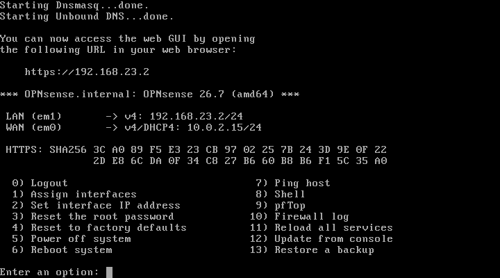
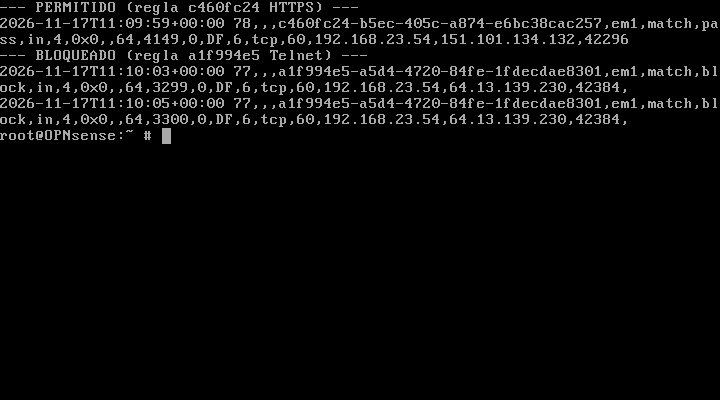

# OPNsense — servidor de comunicaciones alternativo (192.168.23.2)

| Dato | Valor |
|---|---|
| VM en VirtualBox | `OPNsense` (grupo `ISO-INDV`) |
| Sistema | OPNsense **26.7** (FreeBSD 14), amd64 |
| Función | Router + NAT + cortafuegos (pf) + DNS (Unbound) para LAN23 cuando es el gateway activo |
| Recursos | 2 vCPU · 2 GB RAM · 20 GB · BIOS |
| Interfaces | `em0` = **WAN** (NAT VirtualBox, DHCP 10.0.2.15) · `em1` = **LAN** 192.168.23.2/24 |
| Gestión | Web `https://127.0.0.1:8402` desde el PC (redirección por MikroTik) · consola |
| Estado | ✅ Instalado, configurado y probado |

## 1. Requisitos, licencia e imagen

- Imagen `OPNsense-26.7-dvd-amd64.iso`. OPNsense publica el SHA256 del **`.bz2` comprimido**, no de la ISO → **N/C** ([evidencia](../../evidencies/logs/sha256-isos.txt)).
- Licencia **BSD 2-Clause**: libre y gratuita. Deciso vende la edición *Business* y soporte.
- Requisitos: 64 bits, 2 GB de RAM recomendados (el instalador avisa de que quiere 3 GB para copiar el sistema *live* al disco; con 2 GB funcionó).

## 2. Instalación

1. Arranque de la ISO en modo *live* → login `installer` / `opnsense`.
2. Teclado US · **Install (UFS)** · disco `ada0` (20 GB) · contraseña de root `********` · *Complete Install* → *Halt*.
3. Se quita la ISO y se arranca desde el disco (`/dev/gpt/rootfs`).

**¿Por qué UFS y no ZFS?** Con un solo disco virtual, ZFS no da redundancia y usa más RAM (tenemos 2 GB). UFS es el sistema de ficheros clásico de FreeBSD, ligero y suficiente para un cortafuegos.

## 3. Interfaces y red (menú de consola)

| Paso | Opción de consola | Valores |
|---|---|---|
| Asignar interfaces | `1) Assign interfaces` | Sin LAGG ni VLAN · **WAN = em0** · **LAN = em1** |
| IP de la LAN | `2) Set interface IP address` → LAN | 192.168.23.2/24 · sin gateway (es la LAN) · sin IPv6 · **sin servidor DHCP** · web en HTTPS |

- La autodetección había puesto las interfaces **al revés** ([incidencia 12](../10-incidencies.md)). Se comprobó con la MAC de cada adaptador en VirtualBox: `em0` = `08:00:27:F1:71:D7` = adaptador 1 (NAT).
- **Sin DHCP en la LAN**: en LAN23 todos los equipos tienen IP fija, y tres routers con DHCP a la vez se pisarían.


*Demuestra: LAN (em1) = 192.168.23.2/24 y WAN (em0) = 10.0.2.15 por DHCP.*

## 4. Usuario de administración

`root` (obligatorio en OPNsense) con contraseña `********`. La web solo es accesible desde la LAN (regla *anti-lockout*) y, para gestionarla desde el PC, a través de la redirección de MikroTik.

## 5. Internet para la LAN

- **NAT de salida automático**: OPNsense crea solo el NAT (*masquerade*) de la LAN hacia la WAN.
- **DNS**: Unbound, en **modo reenvío** (*forwarding*) hacia el DNS que da el DHCP de la WAN. En modo recursivo no resolvía nada, porque desde la red del aula no se llega a los servidores raíz ([incidencia 15](../10-incidencies.md)).

## 6. Cortafuegos: conexión permitida y bloqueada

Reglas creadas en la interfaz **LAN** (por la API de OPNsense, igual que en *Firewall → Rules*):

| Secuencia | Acción | Protocolo / puerto | Log | Descripción |
|---|---|---|---|---|
| 10 | **block** | TCP 23 | ✅ | PRUEBA BLOQUEADA: Telnet |
| 20 | **pass** | TCP 443 | ✅ | PRUEBA PERMITIDA: HTTPS |
| 50 | pass | cualquiera | — | Default allow LAN to any |

> **Error encontrado y corregido**: al principio la regla por defecto *Default allow LAN to any* tenía la **secuencia 1** y era `quick`, así que se aplicaba **antes** que el bloqueo y el Telnet pasaba (en el log solo salía `pass,out` por la WAN). En pf, con `quick`, **gana la primera regla que coincide**. Se movió la regla por defecto a la secuencia 50, después de guardar la configuración (`01-antes-de-reordenar.xml`) ([incidencia 16](../10-incidencies.md)).

### Verificación ([log completo](../../evidencies/logs/prueba-gw-opnsense.txt))

Cliente `DEB13-CLI` con gateway .2 (`scripts/canvi-gw.sh 2`):

| Prueba | Resultado |
|---|---|
| `ip route` | `default via 192.168.23.2` |
| `traceroute -T -p 443 deb.debian.org` | salto 1 = **192.168.23.2**, salto 2 = 10.0.2.2 |
| `curl -sI https://deb.debian.org` | `HTTP/2 200` → **permitida** |
| `nc -zv telehack.com 23` | *timed out* → **bloqueada** |


*Demuestra: la regla `c460fc24` (HTTPS) hace `pass,in` en em1 y la regla `a1f994e5` (Telnet) hace `block,in` en em1 para el cliente 192.168.23.54.*

Cómo se lee una línea del registro de pf:

```
a1f994e5-...,em1,match,block,in,4,...,tcp,60,192.168.23.54,64.13.139.230,42384,23
   regla      intf        acción dir IPv4   proto      origen          destino    puertos
```

## 7. Copia de seguridad y vuelta atrás

| Copia | Dónde | Cómo volver |
|---|---|---|
| `00-config-inicial.xml` | `~/iso-lab/backups/opnsense/` (fuera del repo: contiene el *hash* de root) | *System → Configuration → Backups → Restore* o menú de consola `13) Restore a backup` |
| `01-antes-de-reordenar.xml` | ídem | ídem |
| Copia en el NAS | ⬜ pendiente de automatizar en `copia-configs.sh` | |

**¿Por qué el `config.xml` no se sube a Git?** Contiene los *hashes* de las contraseñas y certificados privados.

## 8. Fallo provocado y recuperación ([log](../../evidencies/logs/fallo-recuperacion-opnsense.txt))

**Escenario**: un administrador desactiva por error las reglas que dejan salir a la LAN. Queda solo la **denegación por defecto** y nadie navega.

| Paso | Hora | Qué pasa |
|---|---|---|
| **Fallo** | 13:56:49 | Se desactivan *Default allow LAN to any* y *PRUEBA PERMITIDA: HTTPS* y se aplican |
| Detección | 13:57:06 | El cliente no sale a Internet |
| **Recuperación** | 13:57:06 | *System → Configuration → History* → volver a la versión anterior (`revert_backup`) + aplicar reglas |
| Servicio OK | 13:57:07 | Reglas otra vez activas (**1 s**) |

| Resultado | Valor |
|---|---|
| Tiempo sin Internet medido en el cliente | **15 s** |
| Configuración perdida | **Ninguna** |

**Historial local vs. copia del NAS**: OPNsense guarda solo una copia de `config.xml` **cada vez que cambia algo** (las vimos en el historial: una por cada cambio hecho por la API). Es lo más rápido para deshacer un error. La copia del NAS sirve cuando se pierde el **disco entero**: se reinstala OPNsense y se carga el `config.xml` en *System → Configuration → Backups → Restore*.

## Preguntas probables de la defensa

- **¿Qué diferencia hay entre MikroTik, OPNsense y Debian como router?** Los tres hacen lo mismo (NAT + filtrado); cambia la forma de gestionarlos: RouterOS por CLI o Winbox, OPNsense por web (basado en FreeBSD y pf) y Debian a mano con nftables.
- **¿Por qué el orden de las reglas importa?** Porque las reglas `quick` se aplican en cuanto coinciden. Si "permitir todo" va primero, el bloqueo nunca se evalúa.
- **¿Qué es la regla *anti-lockout*?** Una regla automática que siempre deja entrar a la web desde la LAN, para no quedarte fuera por error.
