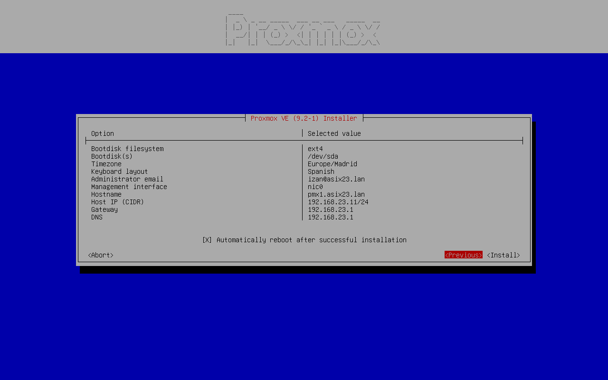
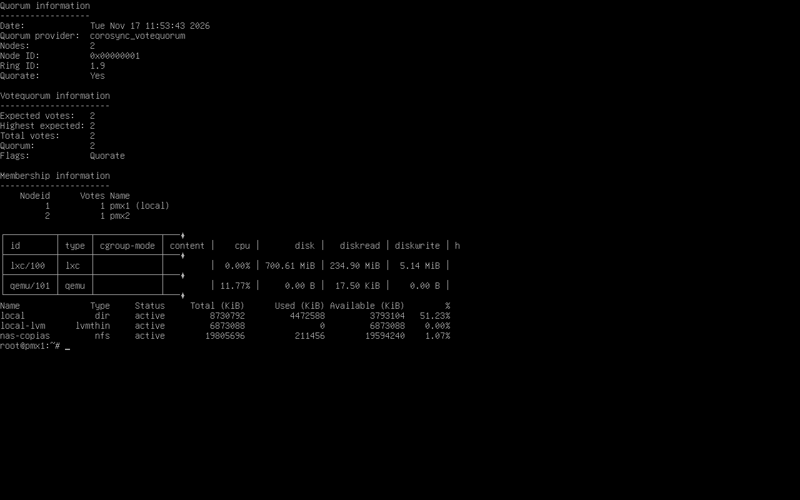

# Proxmox VE — clúster de virtualización `asix23` (192.168.23.11, .12 y .13)

| Dato | PMX1 | PMX2 | PMX3 |
|---|---|---|---|
| VM en VirtualBox | `PMX1` | `PMX2` | `PMX3` |
| Sistema | Proxmox VE **9.2** (pve-manager 9.2.2, Debian 13) | igual | igual |
| Hostname | `pmx1.asix23.lan` | `pmx2.asix23.lan` | `pmx3.asix23.lan` |
| Red (`vmbr0` sobre `nic0`) | 192.168.23.11/24 · gw .1 · DNS .1 · **fija** | 192.168.23.12/24 | 192.168.23.13/24 |
| Recursos | 2 vCPU · 4 GB · 20 GB · **VT-x anidado** | 2 vCPU · 4 GB · 32 GB | 2 vCPU · 4 GB · 32 GB |
| Web | `https://127.0.0.1:8411` (desde el PC) | `https://127.0.0.1:8412` | `https://127.0.0.1:8413` |
| Estado | ✅ Clúster, contenedor, VM, migraciones y copias | ✅ | ✅ |

## 1. Requisitos, licencia e imagen

- Imagen `proxmox-ve_9.2-1.iso` · SHA256 **coincide** con `https://enterprise.proxmox.com/iso/SHA256SUMS`.
- Licencia **AGPLv3**: gratis. La suscripción (de pago) solo da acceso al repositorio *enterprise* y soporte. Se ha desactivado el repositorio *enterprise* y activado **`pve-no-subscription`** (si no, `apt update` da error 401).
- Requisitos: CPU de 64 bits **con VT-x/AMD-V**, 2 GB de RAM mínimo (más la de las VMs). Como Proxmox corre **dentro** de VirtualBox, hace falta **virtualización anidada**:

```bash
VBoxManage modifyvm PMX1 --nested-hw-virt on     # comprobado: /dev/kvm existe dentro de PMX1
VBoxManage modifyvm PMX1 --nicpromisc1 allow-all # las VMs internas usan sus propias MAC por el puente vmbr0
```

## 2. Instalación

PMX1 ya estaba instalado, pero **no se conocía la contraseña de root** → se reinstaló (decisión de izan, [incidencia 10](../10-incidencies.md)). PMX2 y PMX3 se instalaron nuevos (el 3.er nodo se añadió después, a petición del profesorado: el diseño de referencia tiene **tres nodos**). Instalador **Terminal UI** con:

| Opción | Valor | Por qué |
|---|---|---|
| Disco / sistema de ficheros | `/dev/sda` · **ext4** (LVM-thin para las VMs) | Un solo disco: ZFS no aportaría redundancia y gasta más RAM |
| País / zona / teclado | Spain · Europe/Madrid · Spanish | |
| Contraseña root | `********` (mínimo 8 caracteres) | |
| Red | IP fija, gateway y DNS `.1` | Un hipervisor nunca va por DHCP |


*Demuestra: opciones elegidas en la instalación de PMX1 (ext4, Europe/Madrid, teclado español, 192.168.23.11/24).*

## 3. Usuario de administración

`root@pam` (usuario Linux del sistema, obligatorio en Proxmox). Acceso remoto por SSH con clave y por la web.

## 4. Clúster

```bash
# en PMX1
pvecm create asix23
# en PMX2 y en PMX3
pvecm add 192.168.23.11 --use_ssh
```

PMX3 se unió en **12 s**. Estado final ([log](../../evidencies/logs/proxmox-cluster.txt)): `Expected votes: 3 · Total votes: 3 · Quorum: 2 · Quorate`.

### Prueba de quórum: se apaga un nodo

| | Antes | PMX3 apagado |
|---|---|---|
| Votos | 3 de 3 | **2 de 3** |
| Quórum necesario | 2 | 2 |
| Estado | Quorate | **Quorate ✅** — el clúster sigue gestionando |

Con **2 nodos** esto no pasaba: al caer uno quedaba 1 de 2 votos y el clúster se bloqueaba. **Por eso se usan 3 nodos** (o 2 + un QDevice): siempre queda mayoría con un nodo caído.

> El primer `pvecm add` falló con *"cluster not ready - no quorum?"* porque se lanzó justo mientras PMX1 reiniciaba corosync. Al repetirlo, se unió en **14 s**.


*Demuestra: clúster `asix23` con 2 nodos, quórum 2/2 (`Quorate: Yes`), el contenedor 100 y la VM 101, y el almacenamiento `nas-copias` del NAS.*

### Nodos, quórum, red y almacenamiento

| Concepto | En nuestro clúster |
|---|---|
| **Quórum** | Mayoría de votos (más de la mitad) para que el clúster acepte cambios y evitar el *split-brain*. Con **3 nodos** el quórum es 2: **aguanta la caída de un nodo** (probado). Con 2 nodos no aguantaba ninguna |
| **Red del clúster (corosync)** | Comparte la red de gestión LAN23. En producción va en una red separada, porque corosync necesita latencia baja |
| **Almacenamiento** | Cada nodo tiene su `local-lvm` (**local**, no compartido) + `nas-copias` (NFS del NAS, **compartido**, solo para copias) |
| Gestión conjunta | ✅ Una sola web para los dos nodos |
| Migración | ✅ Manual, probada (ver abajo) |
| **Alta disponibilidad (HA)** | ❌ No: necesita almacenamiento compartido para los discos y 3 votos. Diferencia clave: migrar = lo muevo yo; HA = se mueve solo si un nodo muere |

## 5. Servidores virtualizados

| ID | Tipo | Nombre | Función | Recursos | Red |
|---|---|---|---|---|---|
| 100 | **Contenedor LXC** (Debian 13, sin privilegios) | `srv-infra` | **Servidor de infraestructura**: intranet web con **nginx** (`intranet.asix23.lan`) | 1 vCPU · 512 MB · 4 GB | 192.168.23.30/24, DNS .20 (el DC) |
| 101 | **Máquina virtual KVM** | `vm-prueba` | VM para probar migraciones | 1 vCPU · 512 MB · 2 GB | vmbr0 |

```
$ curl -s http://192.168.23.30 | grep h1        (desde PMX2)
<h1>Intranet de la empresa (ASIX23)</h1>
```

## 6. Contenedores vs. máquinas virtuales

| | Contenedor (LXC) | Máquina virtual (KVM) |
|---|---|---|
| Qué virtualiza | Solo el **sistema operativo** (comparte el kernel del host) | **Todo el hardware** (tiene su propio kernel) |
| Sistemas posibles | Solo Linux | Cualquiera (Windows, BSD, Linux…) |
| Arranque | 1–2 s | Decenas de segundos |
| Consumo | Muy bajo (nuestro CT: ~40 MB de RAM en reposo) | Más alto (RAM reservada, BIOS, kernel) |
| Aislamiento | Menor (si se rompe el kernel, caen todos) | Mayor |
| Migración en caliente | ❌ (se para y arranca: `--restart`) | ✅ (`--online`) |

**¿Cuándo usar cada uno?** Contenedor para servicios Linux ligeros (web, DNS, proxy): más densidad y menos gasto. VM cuando se necesita otro sistema operativo (Windows Server), un kernel propio o más aislamiento por seguridad.

## 7. Ventajas e inconvenientes de virtualizar servidores

| Ventajas | Inconvenientes |
|---|---|
| Varios servidores en un solo equipo → menos hardware, luz y espacio | **Punto único de fallo**: si cae el host, caen todas sus VMs |
| Copias e instantáneas de máquinas enteras | Sobrecoste de rendimiento (pequeño) |
| Mover servidores entre nodos (migración) | Si se reparten mal los recursos, unas VMs frenan a otras (lo vimos con el disco) |
| Crear un servidor de pruebas en minutos | Más complejidad: hay que saber de red virtual, almacenamiento, clúster |

## 8. Migraciones medidas ([log completo](../../evidencies/logs/proxmox-migraciones.txt))

| | Contenedor 100 → pmx2 | VM 101 → pmx2 |
|---|---|---|
| Comando | `pct migrate 100 pmx2 --restart` | `qm migrate 101 pmx2 --online --with-local-disks` |
| Duración total | **1 min 25 s** | **12,7 s** |
| Corte de servicio | **~84 s** (intranet medida desde el NAS cada segundo) | **8 ms** |
| Disco | 4 GB asignados, **~0,9 GB usados** → se copiaron **los 4 GB** | 2 GB vacíos → en el destino quedaron **100 % ocupados** |
| Velocidad | 50–190 MB/s (baja al llenarse la caché) | 528 MiB/s (RAM) |

### ¿Se puede mejorar?

1. **Almacenamiento compartido** (NFS/iSCSI del NAS o Ceph): los discos no se copian, solo la RAM → migración en segundos y sin corte también para el contenedor.
2. **ZFS en los nodos** + replicación (`pvesr`): se copia solo lo que cambia desde la última réplica.
3. Al migrar con discos locales, el LVM-thin **pierde la reserva dinámica** (copia bloque a bloque). Con `fstrim` dentro del invitado (o `qm disk rescan` + *discard*) se recupera el espacio.
4. Red dedicada para migraciones (10 GbE en producción).

## 9. Copias de seguridad al NAS ([log](../../evidencies/logs/proxmox-copias-nas.txt))

| Copia | Destino | Resultado |
|---|---|---|
| **Imagen completa** del CT 100 y la VM 101 (`vzdump`, modo snapshot, zstd) | `nas-copias` = NFS de TrueNAS `/mnt/copias/sistemas` | CT: **205 MB** en 47 s · VM: 73 KB (disco vacío) |
| **Tarea programada** diaria 02:30, se guardan las 3 últimas | `nas-copias` | ✅ |
| Configuración de los nodos (`/etc/pve`, red, corosync) | NAS por `copia-configs.sh` (pull) | ✅ `pve-config.tgz` |

**¿Qué tiene sentido guardar y qué no?**
- ✅ Las **VMs y contenedores** (es donde están los servicios y datos) y la **configuración del clúster** (`/etc/pve`: definiciones de VMs, almacenamiento, usuarios, corosync).
- ❌ El **sistema Proxmox entero**: se reinstala en 10 minutos (lo hemos hecho dos veces); lo valioso es la configuración y las VMs.
- ❌ Las plantillas e ISOs: se vuelven a descargar.

## Preguntas probables de la defensa

- **¿Por qué hace falta virtualización anidada?** Proxmox necesita VT-x para ejecutar VMs con KVM, y como él mismo es una VM de VirtualBox, VirtualBox tiene que "pasarle" VT-x.
- **¿Qué pasa si apago un nodo?** Quedan 2 votos de 3 → sigue habiendo quórum y todo funciona (probado). Si caen **dos**, el que queda pierde el quórum y no deja cambiar nada; emergencia: `pvecm expected 1`.
- **¿Por qué la VM migra sin cortes y el contenedor no?** KVM puede copiar la RAM en caliente mientras la VM sigue funcionando y solo la para unos milisegundos al final. LXC no tiene esa función en Proxmox: hay que parar, copiar y arrancar.
- **¿Por qué el contenedor tardó más si es más ligero?** Porque tenía un disco de 4 GB que se copió entero; la VM de prueba tenía 2 GB y casi todo ceros.
