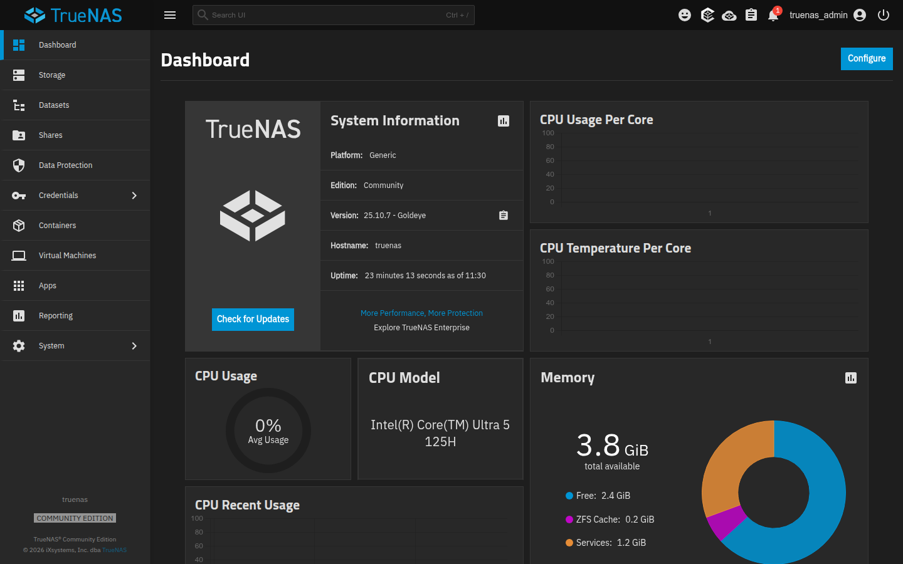
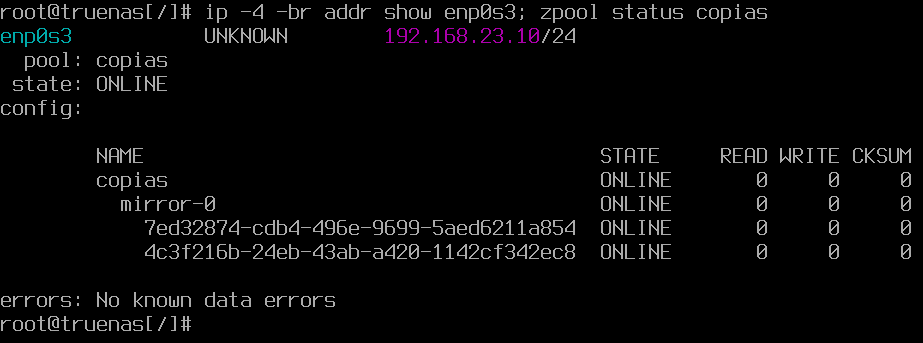
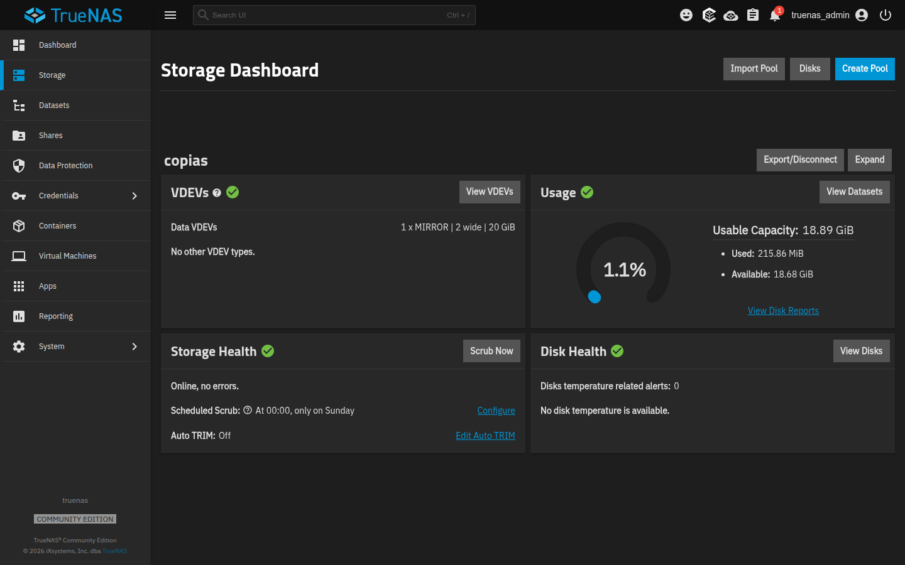
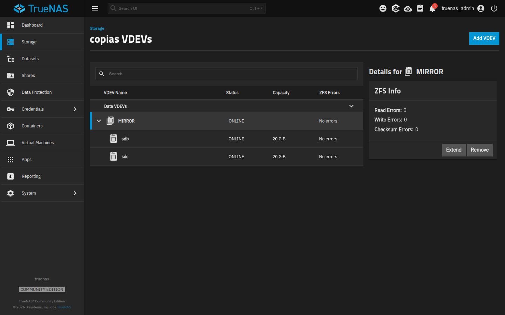
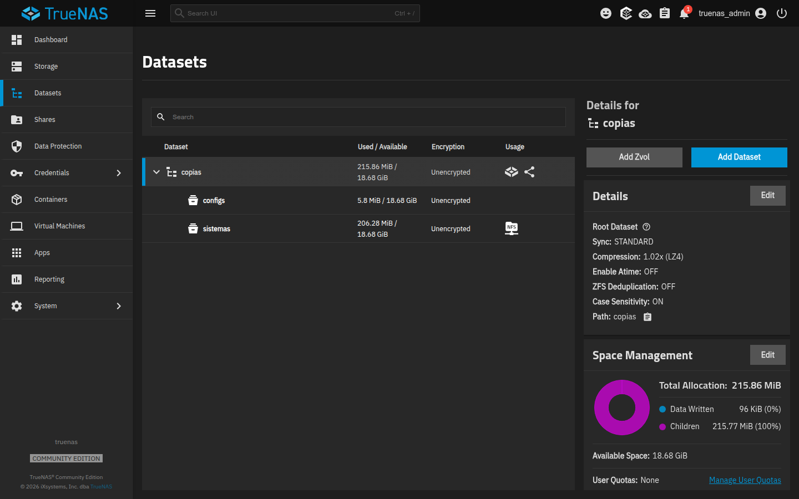
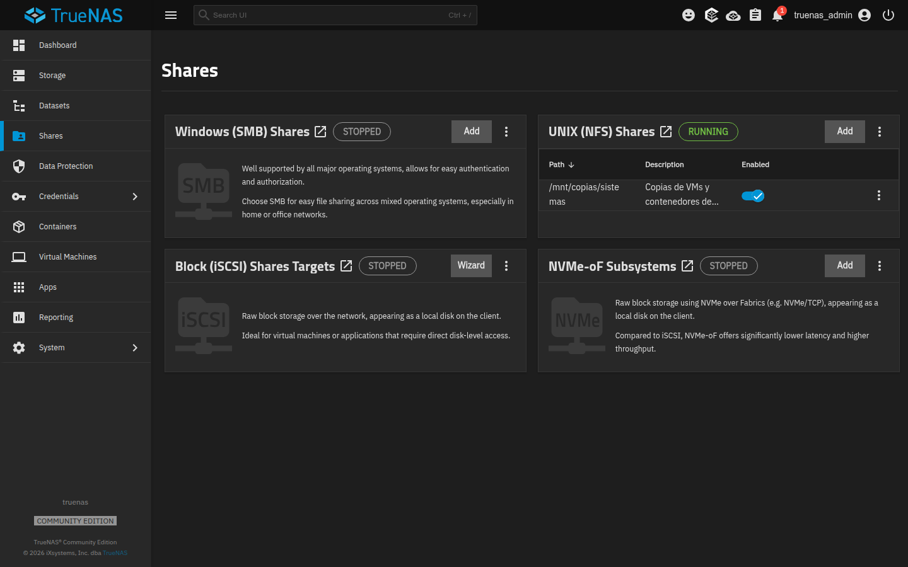
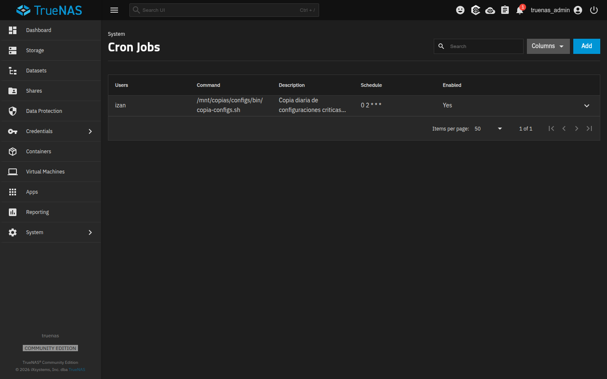
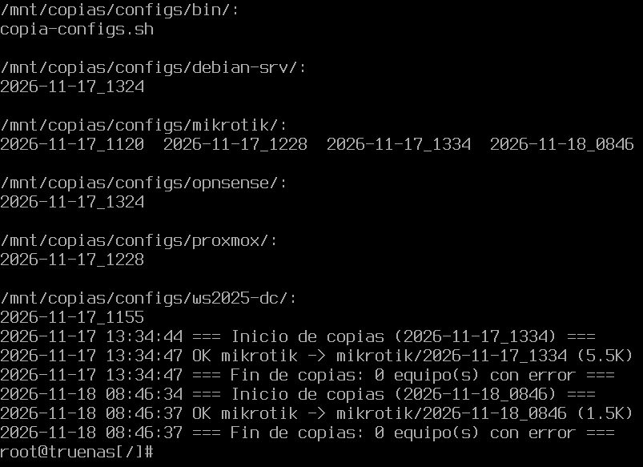

# TrueNAS SCALE — servidor NAS y destino de las copias (192.168.23.10)

| Dato | Valor |
|---|---|
| VM en VirtualBox | `TrueNas` (grupo `ISO-INDV`) |
| Sistema | TrueNAS SCALE **25.10.7** (Goldeye), basado en Debian |
| Función | Almacén de las copias de seguridad de las configuraciones y sistemas críticos |
| Recursos | 2 vCPU · 4 GB RAM · disco de arranque 32 GB + **2 discos de 20 GB** para datos |
| Red | `enp0s3` en `LAN23` · 192.168.23.10/24 · gw 192.168.23.1 · DNS 192.168.23.1 · dominio `asix23.lan` · **fija** |
| Gestión | Web: `https://127.0.0.1:8410` desde el PC (redirección por MikroTik) · SSH: `127.0.0.1:2210` |
| Estado | ✅ Configurado; recibe copias automáticas |

## 1. Requisitos, licencia e imagen

- Imagen `TrueNAS-SCALE-25.10.7.iso` · SHA256 **coincide** con el oficial ([evidencia](../../evidencies/logs/sha256-isos.txt)).
- Licencia libre (GPL); iXsystems vende soporte y hardware, pero el software es gratuito.
- **Requisito oficial: 8 GB de RAM**. Asignamos **4 GB** (subidos desde los 2 GB iniciales): ZFS usa la RAM como caché (ARC); con menos va más lento pero funciona. Para un laboratorio con pocos MB de copias es aceptable; en producción no.

## 2. Instalación y firmware

La VM ya estaba instalada. Al revisarla arrancaba el **instalador** en vez del sistema: la ISO seguía conectada y el orden de arranque ponía el DVD primero ([incidencia 1](../10-incidencies.md)). Se desconectó la ISO y se dejó solo el disco en el orden de arranque.

- Firmware: BIOS. Disco de arranque: `sda` (32 GB), con el sistema en ZFS (`boot-pool`).
- **Importante**: el disco de arranque de TrueNAS es solo para el sistema; los datos van **siempre en otros discos**. Por eso se añaden dos discos nuevos.



*Demuestra: TrueNAS Community Edition 25.10.7 instalado y funcionando (`hostname: truenas`), gestionado por la web con el usuario `truenas_admin`.*

## 3. Usuarios de administración

| Usuario | Uso |
|---|---|
| `truenas_admin` | Administrador que crea el instalador (TrueNAS 25 ya no permite entrar como `root` por la web) |
| `izan` | Administrador del proyecto (grupo `builtin_administrators`), con clave SSH para las copias |

## 4. Red

Configurada desde el **menú de consola** de TrueNAS:

1. `1) Configure network interfaces` → `enp0s3` → `ipv4_dhcp: No` → `aliases: 192.168.23.10/24` → *Save* → `a` (aplicar) → comprobación con ping desde MikroTik → `p` (**persistir**).
2. `2) Configure network settings` → `domain: asix23.lan` · `ipv4gateway: 192.168.23.1` · `nameserver1: 192.168.23.1`.

> **Vuelta atrás automática**: al aplicar un cambio de red TrueNAS da **60 segundos** para confirmarlo. Si no se confirma (porque nos hemos quedado sin red), vuelve solo a la configuración anterior. Es exactamente la idea de "preparar cómo volver al estado anterior" que pide el enunciado.



*Demuestra: la interfaz `enp0s3` tiene la IP fija 192.168.23.10/24 de LAN23 y el pool `copias` está `ONLINE` en espejo (`mirror-0`) con los dos discos sin errores.*

Zona horaria cambiada a `Europe/Madrid` (venía en la de EE. UU. y las copias salían con la hora mal).

## 5. Disco adicional para las copias: pool `copias` en espejo

| Elemento | Valor | Por qué |
|---|---|---|
| Pool | `copias` | Agrupa los discos de datos |
| Disposición | **MIRROR** (espejo, equivalente a RAID 1) con `sdb` + `sdc` | Si falla un disco, las copias siguen disponibles en el otro |
| Capacidad útil | ~19 GB de 40 GB brutos | El espejo "gasta" la mitad en redundancia |
| Datasets | `copias/configs` (configuraciones) · `copias/sistemas` (imágenes de sistemas) | Separar por tipo permite cuotas, permisos e instantáneas distintas |
| Compresión | LZ4 | Casi gratis en CPU y los ficheros de texto se comprimen mucho |



*Demuestra: el pool `copias` es un espejo de 2 discos (`1 x MIRROR | 2 wide`) con 18,89 GiB útiles, sano (`Online, no errors`) y con una comprobación (*scrub*) programada cada domingo.*



*Demuestra: el espejo está formado por los discos adicionales `sdb` y `sdc` (20 GiB cada uno), los dos `ONLINE` y sin errores de lectura, escritura ni de suma de comprobación.*



*Demuestra: dentro del pool hay dos datasets separados, `configs` (configuraciones) y `sistemas` (imágenes de VMs, compartido por NFS), con compresión LZ4.*



*Demuestra: el servicio NFS está en marcha y comparte `/mnt/copias/sistemas` para las copias de las VMs y contenedores de Proxmox (`nas-copias`).*

Estado del pool ([log completo](../../evidencies/logs/truenas-estado.txt)):

```
  pool: copias
 state: ONLINE
	NAME          STATE     READ WRITE CKSUM
	copias        ONLINE       0     0     0
	  mirror-0    ONLINE       0     0     0
	    <disco 1> ONLINE       0     0     0
	    <disco 2> ONLINE       0     0     0
errors: No known data errors
```

## 6. Copias automáticas de las configuraciones críticas (Apte+)

Script: [`scripts/copia-configs.sh`](../../scripts/copia-configs.sh), instalado en el NAS en `/mnt/copias/configs/bin/` (dentro del pool, así sobrevive a una reinstalación de TrueNAS) y lanzado por una tarea **cron diaria a las 02:00** como usuario `izan`.

**Diseño "pull" (el NAS recoge)**: el NAS tiene su propia clave SSH (`id_copias`) autorizada en cada equipo. Los routers y servidores **no guardan credenciales del NAS**: si alguien compromete un router, no puede entrar al NAS a borrar las copias.

| Equipo | Qué se copia | Cómo |
|---|---|---|
| MikroTik (.1) | `/export` (texto) + `/system backup` (binario) | SSH + SCP con clave |
| Debian SRV (.3) | `/etc` completo + reglas `nft` | SSH + `sudo tar` (solo ese comando) |
| OPNsense (.2) | `config.xml` | API de OPNsense (HTTPS con clave de API) |
| Proxmox (.11) | `/etc/pve`, red, corosync | SSH + `tar` |
| TrueNAS | Base de datos de configuración `freenas-v1.db` | Copia local |

- Cada copia va a `/mnt/copias/configs/<equipo>/<fecha_hora>/` y se borran las de más de **14 días**.
- Si un equipo está apagado, se registra un `AVISO` y se sigue con los demás.

Primera ejecución:

```
2026-11-17 11:20:13 === Inicio de copias (2026-11-17_1120) ===
2026-11-17 11:20:16 OK mikrotik -> /mnt/copias/configs/mikrotik/2026-11-17_1120 (1.5K)
2026-11-17 11:20:16 === Fin de copias: 0 equipo(s) con error ===
```



*Demuestra: la tarea programada ejecuta `copia-configs.sh` cada día a las 02:00 (`0 2 * * *`) con el usuario `izan` y está activada.*



*Demuestra: en `/mnt/copias/configs/` hay una carpeta por equipo (Debian SRV, MikroTik, OPNsense, Proxmox y el DC) con una subcarpeta por fecha, y el registro `copias.log` termina cada ejecución con `0 equipo(s) con error`.*

## 7. ¿Qué tiene sentido copiar y qué no?

| Sí | No |
|---|---|
| Configuraciones (pequeñas, cambian a menudo y cuesta mucho rehacerlas) | El sistema operativo entero de un router (se reinstala en minutos desde la ISO) |
| Claves y certificados (en copia cifrada o en el `.backup`) | Cachés, temporales, logs antiguos |
| Datos de usuarios | Copias de las copias en el mismo disco |

## Preguntas probables de la defensa

- **¿Por qué un espejo y no un solo disco?** Con un solo disco, si se estropea perdemos todas las copias. El espejo aguanta la pérdida de un disco.
- **¿Un espejo es una copia de seguridad?** **No.** Si borro un fichero, se borra en los dos discos. El espejo protege de fallos de **hardware**; la copia protege de **errores y borrados**. Por eso hacemos las dos cosas.
- **¿Qué pasa si se cae el NAS?** Perdemos el destino de las copias, no los servicios. Los equipos siguen funcionando y las configuraciones también están en Git (`configs/`), que hace de segunda copia fuera del NAS.
- **¿Por qué el NAS recoge y no los equipos envían?** Por seguridad: así ningún equipo necesita la contraseña del NAS.
