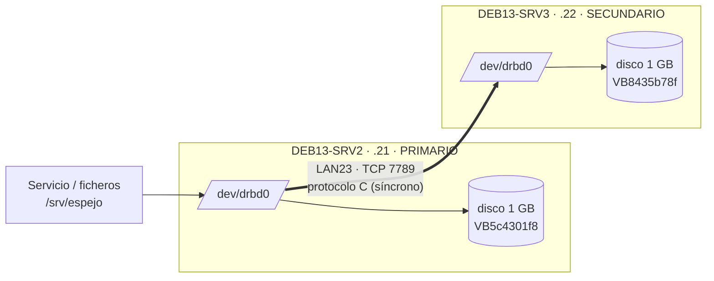

# 07 · Almacenamiento y RAID

**Tasca 6** · Estado: ✅ Apte (3 tipos de RAID creados, verificados con fallo real y reconstrucción) · ✅ Apte+ (espejo entre 2 equipos con DRBD, caída de un servidor probada)

| | |
|---|---|
| Equipo | **DEB13-SRV2** (`192.168.23.21`) · Debian 13 · 1 vCPU · 1 GB RAM |
| Herramienta | `mdadm` (RAID por software de Linux) |
| Discos | `sda` sistema (20 GB) + **8 discos virtuales de 1 GB** (`sdb`…`sdi`) en el controlador SATA |
| Evidencias | [creación](../evidencies/logs/raid-creacion.txt) · [fallos y reconstrucción](../evidencies/logs/raid-fallos.txt) · [rendimiento](../evidencies/logs/raid-rendimiento-fio.txt) |

## 1. Predicción e investigación

> ✍️ *Mis predicciones antes de empezar están en [00-prediccions.md](00-prediccions.md).*

**¿Por qué RAID por software (`mdadm`) y no la controladora de VirtualBox?** VirtualBox no emula controladoras RAID. Además, `mdadm` es lo que se usa en servidores Linux reales sin tarjeta RAID, y deja ver y **provocar** los fallos con comandos.

**¿Por qué discos de 1 GB?** Para que la sincronización y la reconstrucción tarden segundos y se puedan repetir en clase. El comportamiento es el mismo que con discos grandes; solo cambia el tiempo.

### Reparto de discos

| RAID | Dispositivo | Discos | Montado en | Sistema de ficheros |
|---|---|---|---|---|
| RAID 0 | `/dev/md0` | `sdb` + `sdc` | `/srv/raid0` | ext4 (etiqueta `raid-0`) |
| RAID 1 | `/dev/md1` | `sdd` + `sde` | `/srv/raid1` | ext4 (`raid-1`) |
| RAID 5 | `/dev/md5` | `sdf` + `sdg` + `sdh` | `/srv/raid5` | ext4 (`raid-5`) |
| Repuesto | — | `sdi` | — | Disco "nuevo" para sustituir al roto |

## 2. Implementación

```bash
mdadm --create /dev/md0 --level=0 --raid-devices=2 /dev/sdb /dev/sdc
mdadm --create /dev/md1 --level=1 --raid-devices=2 /dev/sdd /dev/sde
mdadm --create /dev/md5 --level=5 --raid-devices=3 /dev/sdf /dev/sdg /dev/sdh
mkfs.ext4 -L raid-0 /dev/md0      # (igual con md1 y md5)
mdadm --detail --scan >> /etc/mdadm/mdadm.conf   # para que se monten solos al arrancar
update-initramfs -u
# /etc/fstab:
LABEL=raid-0 /srv/raid0 ext4 defaults,nofail 0 2
```

- **`mdadm.conf` + `update-initramfs`**: sin esto, al reiniciar los RAID pueden aparecer con otro nombre (`md127`) y el `fstab` no los encuentra.
- **`nofail` en el `fstab`**: es la lección de la [incidencia provocada](10-incidencies.md). Si un RAID no arranca, el servidor arranca igualmente en lugar de quedarse en modo de emergencia.
- **Montar por `LABEL`** y no por `/dev/mdX`: si cambia el número del dispositivo, la etiqueta sigue siendo la misma.
- Copias de los ficheros originales en la VM: `/etc/fstab.antes-raid` y `/etc/mdadm/mdadm.conf.antes-raid` (vuelta atrás).

### Capacidad resultante

| RAID | Espacio bruto | Espacio útil | Aprovechamiento | Fórmula |
|---|---|---|---|---|
| RAID 0 | 2 GB | **2,0 GB** | 100 % | N × disco |
| RAID 1 | 2 GB | **1,0 GB** | 50 % | 1 disco |
| RAID 5 | 3 GB | **2,0 GB** | 67 % | (N − 1) × disco |

## 3. Verificación: fallos provocados

Método: se escriben **100 MB aleatorios** en cada RAID y se guarda su **SHA256**. Después se provoca el fallo y se comprueba si los datos siguen siendo **accesibles** y **exactamente iguales**. Durante el fallo, un bucle lee el fichero cada 0,5 s (vaciando la caché) para ver si el servicio se corta.

| Prueba | Qué se hace | Resultado | ¿Datos? |
|---|---|---|---|
| **RAID 0** sin un disco | Se para `md0` y se intenta arrancar solo con `sdb` | ❌ *"Not enough devices to start the array"*: **no arranca** | Inaccesibles (vuelven al poner los 2 discos) |
| **RAID 1** pierde `sde` | `mdadm --fail` → `--remove` → `--add sdi` | ✅ Sigue funcionando `[U_]` · **22 lecturas correctas, 0 fallidas** | SHA256 coincide en modo degradado y tras reconstruir |
| Reconstrucción RAID 1 | Copia completa de `sdd` → `sdi` | ✅ **54,3 s** (1 GB) · estado final `[UU]` | ✅ |
| **RAID 5** pierde `sdg` | `--fail` → `--remove` → `--add sde` (el disco "reparado") | ✅ Sigue funcionando `[U_U]` · **7 lecturas correctas, 0 fallidas** | SHA256 coincide |
| Reconstrucción RAID 5 | Recalcula el disco que falta con la **paridad** | ✅ **14,6 s** · estado final `[UUU]` | ✅ |
| **RAID 5 + disco de reserva** | `--add-spare sdg` y se rompe `sdf` **sin tocar nada más** | ✅ La reserva entra **automáticamente** y se reconstruye en **21,2 s** | ✅ |
| **Reinicio** | `systemctl reboot` | ✅ Los 3 RAID se montan solos | ✅ Los 3 SHA256 coinciden |

**Observaciones de la prueba:**
- En modo degradado el RAID 5 hizo **7 lecturas en 20 s** y el RAID 1 **22**. Con un disco menos, cada lectura del RAID 5 tiene que **recalcular los datos que faltan con la paridad** (XOR), así que va más lenta. En cambio, el RAID 1 sigue teniendo una copia completa.
- La reconstrucción del RAID 1 (54 s) fue más lenta que la del RAID 5 (15 s). No es por el tipo de RAID: el disco nuevo del RAID 1 (`sdi`) era un VDI **sin estrenar** y VirtualBox tenía que hacer crecer el fichero mientras escribía. Ver el apartado 4.

## 4. Rendimiento medido y su límite en este entorno

Se midió con `fio` (escritura y lectura secuencial de 1 MiB, escritura aleatoria de 4 KiB, sin caché de la VM), en **3 rondas intercaladas**. Los datos completos están en el [log](../evidencies/logs/raid-rendimiento-fio.txt).

| Destino | Escritura MB/s (mediana) | Lectura MB/s (mediana) | 4K IOPS (mediana) | Dispersión entre rondas |
|---|---|---|---|---|
| 1 disco | 25 | 370 | 5 909 | Escritura de **14 a 391** MB/s |
| RAID 0 | 17 | 110 | 2 204 | Escritura de **15 a 436** MB/s |
| RAID 1 | 15 | 117 | 1 236 | Lectura de **98 a 339** MB/s |
| RAID 5 | 15 | 248 | 1 433 | IOPS de **853 a 9 061** |

**Análisis:** las cifras **no permiten comparar los tipos de RAID**, y saber por qué es parte del resultado:

1. Los 8 "discos" son **ficheros `.vdi` en el mismo SSD físico** del anfitrión (Kingston A400 SATA). Un RAID 0 reparte los datos entre dos discos para escribir en paralelo, pero aquí los dos discos son el mismo hardware: no hay paralelismo real.
2. El A400 tiene una caché rápida pequeña. Cuando se llena, la escritura cae a ~15–25 MB/s, y eso se ve igual en **todos** los destinos, incluido el disco solo.
3. Los VDI son **dinámicos**: la primera escritura en una zona nueva obliga a VirtualBox a hacer crecer el fichero.

👉 **El cuello de botella es el disco del anfitrión**, no el RAID. Esto conecta con la [Tasca 2](02-inventari.md) (SSD SATA frente al NVMe del equipo de casa) y la [Tasca 7](08-rendiment.md).

## 5. Comparativa: qué ganamos con cada tipo

| | RAID 0 (*striping*) | RAID 1 (espejo) | RAID 5 (paridad distribuida) |
|---|---|---|---|
| Discos mínimos | 2 | 2 | 3 |
| Espacio útil | 100 % | 50 % | (N−1)/N → 67 % con 3 |
| ¿Aguanta un disco roto? | ❌ **No**, y con N discos el riesgo se multiplica por N | ✅ Sí | ✅ Sí (solo **uno**) |
| Lectura (teoría) | ⬆️⬆️ N discos en paralelo | ⬆️ puede leer de los dos | ⬆️ de N discos |
| Escritura (teoría) | ⬆️⬆️ | = (escribe en los dos) | ⬇️ *penalización de escritura*: leer, recalcular la paridad y escribir |
| En modo degradado | — (perdido) | Igual de rápido | **Más lento** (recalcula con la paridad; lo hemos visto: 7 lecturas frente a 22) |
| Uso típico | Datos temporales, caché, edición de vídeo **con copia aparte** | Disco del sistema, servidores pequeños, el pool del NAS | Servidor de ficheros: buen equilibrio de espacio y seguridad |
| En mi sistema | No se usaría para datos de la empresa | **Pool `copias` del TrueNAS** (espejo) | Carpetas de departamentos en DEB13-SRV2 |

## 6. Preguntas probables de la defensa

- **¿Un RAID es una copia de seguridad?** No. Si borro un fichero o entra un *ransomware*, el RAID copia el desastre a todos los discos al instante. El RAID protege de un **fallo de hardware**; la copia (NAS + `vzdump` + configuraciones) protege de **errores y ataques**. Por eso tenemos los dos.
- **¿Qué pasa si fallan 2 discos de un RAID 5?** Se pierde todo. Por eso existe el **disco de reserva** (lo hemos probado: entra solo en 21 s) y el **RAID 6** (dos discos de paridad).
- **¿Por qué la reconstrucción es un momento delicado?** Durante esos segundos (horas, con discos de varios TB) el RAID no tiene redundancia y los discos que quedan trabajan al máximo. Si falla otro, se pierde el RAID 5.
- **¿Cómo te enteras de que un disco ha fallado?** `cat /proc/mdstat` (`[U_]`, `(F)`), `mdadm --detail` y el servicio `mdmonitor`, que puede enviar un correo (`MAILADDR` en `mdadm.conf`).
- **¿Por qué no se ve que el RAID 0 vaya más rápido?** Porque todos los discos virtuales están en el mismo SSD físico (apartado 4). En un servidor real, con discos físicos separados, sí se nota.
- **¿Hardware RAID o software RAID?** Hardware: una controladora con su propia CPU y caché con batería, transparente para el sistema operativo, pero si se rompe hace falta una igual. Software (`mdadm`): gratis, portátil (los discos se leen en cualquier Linux), gasta un poco de CPU.

## 7. (Apte+) RAID en espejo entre dos equipos

✅ Hecho con **DRBD** (*Distributed Replicated Block Device*) entre **DEB13-SRV2** y **DEB13-SRV3**. Log completo: [`drbd-espejo-red.txt`](../evidencies/logs/drbd-espejo-red.txt) · configuración: [`configs/drbd/r0.res`](../configs/drbd/r0.res).

### 7.1 Qué es y por qué DRBD

Un RAID 1 normal copia cada escritura en **dos discos del mismo equipo**: si se rompe un disco, bien; si se rompe **el servidor** (placa, fuente, sistema), los dos discos se quedan dentro. DRBD hace un **RAID 1 por la red**: cada escritura va al disco local **y** al disco del otro servidor.



| Alternativa | Por qué no |
|---|---|
| `mdadm` RAID 1 con un disco **iSCSI** del NAS | Funciona, pero el NAS pasa a ser imprescindible para el servidor de ficheros: un punto de fallo más |
| Replicación de ZFS (TrueNAS) | No es en tiempo real: copia por instantáneas (pierdes lo escrito desde la última) |
| **DRBD** ✅ | Viene en el kernel de Debian (módulo `drbd` 8.4.11), es **síncrono** y está pensado justo para esto: dos servidores, uno activo y otro de reserva |

**Protocolo C** = una escritura no se da por terminada hasta que está en **los dos** discos → si cae el primario, el secundario tiene **exactamente** lo mismo (RPO = 0).

### 7.2 Implementación

1. VirtualBox: un disco nuevo de 1 GB en cada VM (`drbd-DEB13-SRV2.vdi`, `drbd-DEB13-SRV3.vdi`).
2. En los dos: `apt install drbd-utils` y el mismo [`/etc/drbd.d/r0.res`](../configs/drbd/r0.res).
3. Discos nombrados por **número de serie** (`/dev/disk/by-id/ata-VBOX_HARDDISK_VB…`): al añadir el disco nuevo, en SRV2 **las letras `sdX` de los RAID cambiaron** (el disco nuevo salió como `sdi` y `sdj` pasó a ser de `md1`). mdadm no se enteró porque usa sus superbloques; DRBD tampoco porque usa el número de serie.
4. Comandos:

```bash
# en los dos servidores
drbdadm create-md r0          # metadatos DRBD al final del disco
drbdadm up r0                 # conecta con el otro nodo
systemctl enable drbd         # se conecta solo al arrancar
# solo en SRV2 (la primera vez)
drbdadm primary --force r0    # "mis datos mandan" → sincronización inicial
mkfs.ext4 -L drbd-espejo /dev/drbd0
mount /dev/drbd0 /srv/espejo
```

### 7.3 Verificación: caída de un servidor entero

| # | Prueba | Resultado | Tiempo |
|---|---|---|---|
| 1 | Sincronización inicial de 1 GB (SRV2 → SRV3) | `UpToDate/UpToDate` | **53 s** (19,8 MB/s: DRBD limita el ritmo para no ahogar la red; se ajusta con `resync-rate`) |
| 2 | Escribir 100 MB aleatorios en SRV2 + SHA256 | `e293a9a2…ca6f99` | — |
| 3 | Montar el disco en SRV3 mientras SRV2 es primario | ❌ *Can't open blockdev* — **correcto**: solo un nodo puede escribir a la vez (si no, se corrompe el ext4) | — |
| 4 | **Apagado brusco de SRV2** (`VBoxManage controlvm poweroff`, como un corte de luz) → en SRV3: `drbdadm primary r0` + `mount` | ✅ Datos montados en SRV3, **SHA256 idéntico** | **~13 s** (casi todo es DRBD detectando que el otro no responde: `ping-int` 10 s) |
| 5 | Escribir 50 MB nuevos en SRV3 con SRV2 apagado | ✅ DRBD apunta lo pendiente: `oos:51272` KB | — |
| 6 | SRV2 vuelve | Entra como **secundario**, sin *split-brain*. Solo copia **206 MB** (50 MB nuevos + 156 MB que marca por precaución por haber caído siendo primario) | **25 s** (no el disco entero) |
| 7 | Cambio controlado de vuelta: SRV3 `umount` + `secondary`, SRV2 `primary` + `mount` | ✅ Los 2 ficheros con su SHA256 correcto | **2,6 s** |
| 8 | Reinicio de SRV3 | Se reconecta solo: `Connected Primary/Secondary UpToDate/UpToDate` | — |

### 7.4 Caso de uso en la empresa

El **servidor de ficheros** de los departamentos. Hoy, si DEB13-SRV2 se rompe (no un disco: **el equipo**), los RAID 1 y 5 no sirven de nada porque sus discos están dentro. Con DRBD, los datos ya están en DEB13-SRV3 y el servicio vuelve en segundos:

| | RAID 1 local (`md1`) | Espejo por red (DRBD) |
|---|---|---|
| Se rompe un disco | ✅ sigue funcionando | ✅ sigue funcionando |
| Se rompe **el servidor** | ❌ datos inaccesibles hasta repararlo | ✅ el otro servidor los monta en ~13 s |
| Coste | 2 discos | 2 servidores + red |
| Escritura | velocidad del disco | velocidad del disco **+ ida y vuelta por la red** |
| ¿Es una copia de seguridad? | ❌ | ❌ — un borrado o un ransomware se replica al instante. Sigue haciendo falta la copia en el NAS |

**Limitaciones de mi montaje:** el cambio de primario es **manual** (en producción lo haría **Pacemaker/Corosync** con una IP flotante, para que los clientes no tengan que cambiar de servidor), y las dos VMs están en el **mismo PC** (en la empresa serían dos máquinas físicas, idealmente con una red dedicada para la réplica).

### 7.5 Preguntas probables de la defensa

- *¿Qué diferencia hay entre DRBD y un RAID 1?* → El RAID 1 copia entre dos discos **del mismo equipo**; DRBD entre dos discos **de equipos distintos** por la red. DRBD protege también de la caída del servidor.
- *¿Por qué no montas el disco en los dos a la vez?* → Porque ext4 no está pensado para que dos sistemas escriban a la vez: se corrompería. DRBD lo impide (solo un primario). Para dos activos haría falta un sistema de ficheros de clúster (GFS2, OCFS2).
- *¿Qué es el split-brain?* → Que los dos nodos se crean primarios y escriban cosas distintas sin verse. Al reconectar, DRBD no sabe qué datos son los buenos y se para. Se evita con una regla de quórum o *fencing*; se resuelve a mano con `drbdadm connect --discard-my-data r0` en el nodo cuyos cambios se descartan.
- *¿Qué RPO y RTO tiene?* → RPO **0** (protocolo C, síncrono). RTO **~13 s** medido, manual.
