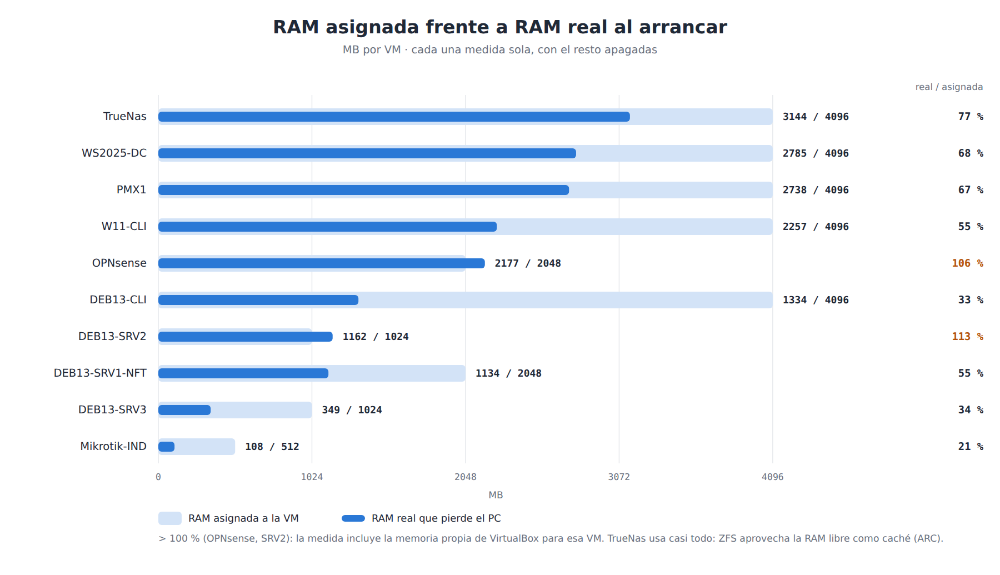

# 08 · Rendimiento y diagnóstico

**Tasca 7** · Estado: ✓ Apte · ✓ Apte+ (2 optimizaciones con medida antes/después)

Equipo medido: **PC de casa** (i5-11400F 6C/12T, 16 GB, VMs en el SSD de clase por USB 5 Gb/s; ver [02](02-inventari.md)).
Todas las cifras salen de los logs de [`evidencies/logs/`](../evidencies/logs/) (`rend-*`, `optim-*`).

## 0. Método (ThinkLoop)

| Fase | Qué se hizo |
|---|---|
| **Predicción** | "En casa aguanta unas 6–7 VMs" ([00](00-prediccions.md)) |
| **Herramientas** | [`mide-vm.sh`](../scripts/mide-vm.sh) lee `/proc` cada 2 s (CPU y iowait del host, RAM disponible, swap, disco del SSD, CPU de la VM). [`mide-todas.sh`](../scripts/mide-todas.sh) arranca las VMs **de una en una**. [`carga.sh`](../scripts/carga.sh) mete carga dentro de las VMs con `stress-ng`, `fio` e `iperf3` |
| **Implementación** | 1) línea base → 2) cada VM sola (120 s desde el arranque) → 3) carga por recurso → 4) prueba de capacidad → 5) dos optimizaciones |
| **Verificación** | Cada medida se repite o se contrasta con otra fuente (ver "medidas que engañaban") |

### Medidas que engañaban (y cómo se corrigieron)

| Problema | Cómo lo detecté | Corrección |
|---|---|---|
| El disco de **todas** las VMs salía a **0 MB** | Imposible: una VM que arranca lee cientos de MB | `VBoxHeadless` es *setuid root* y Linux no deja leer su `/proc/<pid>/io`. Se mide el **SSD entero** (`/proc/diskstats`) con una sola VM encendida |
| El RSS de TrueNAS era **452 MB** pero el host perdía **3 GB** | Comparando con la caída de `MemAvailable` | VirtualBox reserva la RAM del invitado **desde su driver del kernel** y no cuenta en el RSS. Se usa la **caída de RAM disponible** |
| `dd` dentro de la VM daba **2,4 GB/s** | El SSD físico solo había escrito 111 MB | `dd if=/dev/zero` escribe **ceros** y VirtualBox no guarda los bloques vacíos en un VDI dinámico. Se usa `fio` (datos aleatorios) |
| `stress-ng --cpu` no subía la CPU | `failed: 1: cpu` en su salida | El método por defecto (`all`) falla en la VM → `--cpu-method int64` |
| El disco se hundía de **335 a 25 MB/s** entre rondas | Rondas seguidas de `fio` | Se agota la **caché SLC** del Kingston A400 (SSD sin DRAM). Se hacen 3 rondas y se da la **mediana** |

> **Pregunta probable de defensa:** *"¿Cómo sabes que tus medidas son correctas?"* → Porque cada cifra se contrasta con otra fuente. Tres de mis primeras medidas eran falsas (disco a 0, RSS, `dd` con ceros) y solo lo vi comparando con el SSD físico y con la RAM disponible.

## 1. Línea base en reposo

Host sin ninguna VM ([`rend-base.csv`](../evidencies/logs/rend-base.csv), 60 s):

| CPU media | iowait | RAM disponible | Swap | Disco |
|---|---|---|---|---|
| **3,7 %** (máx. 5,2 %) | 0 % | **12 635 MB** de 15 859 | 0 | ~0 MB/s |

El host (Linux Mint + escritorio + navegador + terminal) ya se queda **~3,2 GB** para él: esa es la base de la **reserva del hipervisor**.

## 2. Cada VM sola: qué consume al arrancar

Cada VM se arranca **sola**, se mide 120 s y se apaga por ACPI antes de la siguiente ([`rend-por-vm.txt`](../evidencies/logs/rend-por-vm.txt), [`rend-ram-real.txt`](../evidencies/logs/rend-ram-real.txt)).

Datos en bruto de cada medición (una muestra cada 2 s): `evidencies/logs/rend-<VM>-solo.csv` y `rend-DEB13-SRV2-carga-*.csv` · resumen: [`rend-resumen.txt`](../evidencies/logs/rend-resumen.txt).

| VM | RAM asignada | **RAM real** (caída de la disponible) | Pico CPU (hilos de 12) | Disco en el arranque | Arranque calmado* |
|---|---:|---:|---:|---:|---:|
| Mikrotik-IND | 512 MB | **108 MB** | 0,7 | 38 MB | 8 s |
| DEB13-SRV3 (web) | 1024 MB | 349 MB | 1,0 | 139 MB | 16 s |
| DEB13-SRV2 (ficheros + RAID) | 1024 MB | 1162 MB | 1,0 | 673 MB | 20 s |
| DEB13-SRV1-NFT | 2048 MB | 1134 MB | 1,1 | 495 MB | 22 s |
| OPNsense | 2048 MB | 2177 MB | 1,1 | 294 MB | 30 s |
| DEB13-CLI (escritorio) | 4096 MB | 1334 MB | 5,1 † | 583 MB | 30 s |
| PMX1 (Proxmox) | 4096 MB | 2738 MB | 1,5 | 486 MB | 32 s |
| WS2025-DC | 4096 MB | 2785 MB | 1,8 | 1358 MB | 22 s |
| W11-CLI | 4096 MB | 2257 MB | **2,0** | **2103 MB** | **68 s** |
| TrueNas | 4096 MB | **3144 MB** | 1,0 (media **51 %**) | 1113 MB | 20 s |

<sub>* Primer momento en que la VM se queda por debajo del 15 % de CPU durante 10 s. † El pico de DEB13-CLI no es su vCPU: son los hilos de E/S de VirtualBox leyendo disco (ese momento el host tuvo un **iowait del 82 %**).</sub>


*Barra clara: RAM asignada · barra azul: RAM que pierde realmente el PC (caída de `MemAvailable`). Datos de la tabla de arriba. Fuente: [`diagrames/ram-vms.py`](../diagrames/ram-vms.py).*

**Lectura:**
- **RAM**: los que más gastan son **TrueNAS** (ZFS usa la RAM libre como caché ARC), **WS2025-DC** y **PMX1**. MikroTik apenas 108 MB.
- **CPU**: ninguna VM pasa de **2 hilos de 12**. Las Windows son las que más CPU piden al arrancar. TrueNAS se queda con un **51 % de un hilo** de media incluso en reposo (sus servicios de fondo).
- **Disco**: las **Windows** son las que más leen (W11: 2,1 GB y 68 s hasta calmarse). Es lo que más se nota con el SSD por USB.

## 3. Medición con carga: qué VM satura qué recurso

Escenario: **Mikrotik-IND + DEB13-SRV2 + DEB13-SRV3** encendidas. Cada prueba mete **un tipo de carga** dentro de una VM durante 50 s ([`carga.sh`](../scripts/carga.sh) → [`rend-carga.txt`](../evidencies/logs/rend-carga.txt)).

| Carga | Herramienta (dentro de la VM) | CPU del host | iowait del host | RAM disponible | VM | ¿Qué se satura? |
|---|---|---|---|---|---|---|
| Reposo | — | 6,7 % | 0,1 % | 5442 MB | 2 % | Nada |
| **CPU** en SRV3 | `stress-ng --cpu 1` | 11,9 % (+5) | 0,1 % | 5178 MB | **100 % = 1 hilo** | **La vCPU de la VM**, no el host: 1 vCPU = 1/12 del host (≈ 8 %) |
| **RAM** en SRV2 | `stress-ng --vm` 700 MB | 13,9 % | 0,2 % | **4654 MB (−788)** | 85 % | La RAM del host baja lo mismo que ocupa la VM |
| **Disco** en SRV2 | `fio` escritura 1 MB, datos aleatorios | 6,4 % | **2,3 % (máx. 11 %)** | 4389 MB | 10 % | **El SSD**: 9,9 GB escritos en 60 s, pico de **399 MB/s** = el techo del USB 5 Gb/s |
| **Red** SRV2→SRV3 | `iperf3` 45 s | **19,1 % (+12)** | 0,6 % | — | 53 % | La CPU: la red interna de VirtualBox **se hace con CPU** (4,94 Gbit/s con e1000) |
| Todo a la vez | las 4 juntas | 19 % (máx. 32 %) | **5,2 % (máx. 19 %)** | 6418 MB | 97 % (1,4 hilos) | Lo primero que se nota es el **disco** (iowait) |

**Conclusiones:**
1. **La CPU del host nunca es el límite**: con todo a la vez llegó al 32 %. Una VM con 1 vCPU **solo puede saturarse a sí misma**.
2. **El disco es el cuello de botella con carga**: una sola VM escribiendo llena el USB (399 MB/s) y sube el iowait de **todo** el host.
3. **La RAM es el límite para tener VMs encendidas**: no se reparte "en tiempo", cada GB ocupado está ocupado (siguiente apartado).
4. La **red interna** gasta CPU del host; se optimiza con virtio (apartado 5.1).

## 4. ¿Cuántas VMs aguanta mi equipo?

### Prueba real

Con las 3 VMs encendidas voy arrancando más, **solo si después quedaría ≥ 1 GB libre** para el host ([`rend-capacidad.txt`](../evidencies/logs/rend-capacidad.txt)). Durante la prueba el host tenía abiertos Firefox y Chrome (~4 GB).

| Paso | RAM asignada total | RAM disponible (90 s después) | Swap |
|---|---:|---:|---:|
| MK + SRV2 + SRV3 | 2560 MB | 6626 MB | 0 |
| + DEB13-SRV1-NFT | 4608 MB | 5899 MB | 0 |
| + OPNsense | 6656 MB | 3858 MB | 4 MB |
| + TrueNas (4 GB) | — | **✗ no cabe** (3853 − 4096 < 1024) | — |
| + WS2025-DC (4 GB) | — | **✗ no cabe** | — |

→ **5 VMs** a la vez (6,6 GB asignados) con el navegador abierto.

### Cálculo

```
RAM total del host ............................ 15 859 MB
− reserva del hipervisor (SO + escritorio) .... ~3 200 MB  (medido en la línea base)
− margen de seguridad .........................  1 024 MB
= RAM para VMs ................................ ~11 600 MB  (≈ 11 GB asignados)
  (con el navegador abierto: −4 GB → ~7 GB, como en la prueba)
```

**¿Por qué se cuenta la RAM asignada y no la real?** Porque la real **crece con el uso** hasta la asignada (TrueNAS llena su caché ZFS, Windows su caché de ficheros) y VirtualBox no la devuelve. Si sumo lo "real" y arranco más VMs, cuando trabajen todas el host irá a **swap** y todo se volverá lento.

| Escenario ([05](05-recursos.md)) | RAM asignada | Casa (~11 GB) | Clase (~23 GB) |
|---|---:|:---:|:---:|
| A · Comunicaciones (MK + CLI + NAS) | 8,7 GB | ✓ | ✓ |
| B · Dominio (MK + DC + W11 + NAS) | 12,8 GB | ✗ (se queda sin NAS: 8,7 GB) | ✓ |
| C · Clúster (MK + 2 PMX + NAS) | 12,8 GB | ✗ | ✓ |
| D · RAID / DRBD (MK + SRV2 + SRV3) | 2,5 GB | ✓ | ✓ |
| Todo el laboratorio (12 VMs) | 34,5 GB | ✗ | ✗ |

**Respuesta:** en casa, **unos 11 GB de VMs a la vez** (por ejemplo 2 VMs de 4 GB + 3 pequeñas, o 5–7 Debian/MikroTik). El límite es la **RAM**; con carga, el **disco** se nota antes que la CPU.

> **Pregunta probable de defensa:** *"Si tus VMs solo usan 1–3 GB reales, ¿por qué no arrancas más?"* → Porque es memoria que pueden reclamar en cualquier momento hasta lo asignado. Si me paso, el host entra en swap y se degradan **todas**. Mejor ajustar la RAM asignada a lo que necesita cada VM (DEB13-CLI usa 1,3 GB de 4).

## 5. (Apte+) Dos optimizaciones: antes y después

### 5.1 Tarjeta de red **virtio-net** en lugar de Intel e1000 (DEB13-SRV2 y SRV3)

- **Por qué:** con `82540EM` (e1000) VirtualBox **emula una tarjeta Intel real** registro a registro: cada paquete provoca salidas al hipervisor. Con **virtio** el invitado sabe que está virtualizado y se comunica por colas compartidas (paravirtualización). Debian trae el driver `virtio_net` de serie.
- **Cambio:** `VBoxManage modifyvm DEB13-SRV2 --nictype1 virtio` (VM apagada). La interfaz sigue llamándose `enp0s3` (mismo slot PCI) → la configuración de red no cambia.
- **Volver atrás:** `--nictype1 82540EM` (config anterior en [`optim-red-config-antes.txt`](../evidencies/logs/optim-red-config-antes.txt)).
- **Medida:** [`red-iperf.sh`](../scripts/red-iperf.sh), 3 rondas de `iperf3` de 20 s SRV2 → SRV3 midiendo la CPU del host.

| | Ronda 1 | Ronda 2 | Ronda 3 | **Media** | CPU del host | CPU por Gbit/s |
|---|---:|---:|---:|---:|---:|---:|
| Antes (e1000) | 4,73 | 4,73 | 4,75 | **4,74 Gbit/s** | 28 % | 5,9 % |
| Después (virtio) | 12,7 | 12,0 | 12,2 | **12,3 Gbit/s** | 36,5 % | **3,0 %** |

**Resultado: ×2,6 de velocidad y la mitad de CPU por cada Gbit/s.** Se mantiene. Comprobado después: IP, ping a Internet y el espejo DRBD funcionan.

### 5.2 Caché de E/S del anfitrión en el disco de DEB13-SRV2

- **Por qué:** por defecto VirtualBox escribe **directamente** en el SSD (`useHostIOCache=false`). Con la caché activada, las escrituras pasan por la **RAM del host** (caché de páginas de Linux) y la VM recibe el "ya está" antes.
- **Cambio:** `VBoxManage storagectl DEB13-SRV2 --name SATA --hostiocache on` · **Volver atrás:** `--hostiocache off`.
- **Medida:** [`disco-rondas.sh`](../scripts/disco-rondas.sh) → [`fio-disco.sh`](../scripts/fio-disco.sh) dentro de la VM, 4 pruebas × 3 rondas con 60 s de descanso. Se da la **mediana** ([antes](../evidencies/logs/optim-disco-antes-sin-cache.txt), [después](../evidencies/logs/optim-disco-despues-con-cache.txt)).

| Prueba (`fio`, `direct=1`, datos aleatorios) | Antes (sin caché) | Después (con caché) | Cambio |
|---|---:|---:|---:|
| Escritura secuencial 1 MB | 38 MB/s (335 → 38 → 25) | **2306 MB/s** | ×60 |
| Escritura aleatoria 4K | 37 MB/s (125 → 13 → 37) | **116 MB/s** | ×3 |
| Lectura aleatoria 4K | 16 MB/s | **141 MB/s** | ×9 |
| Escritura 4K **con `fsync`** (como una base de datos) | 172 IOPS | **13 883 IOPS** | ×80 |

**Interpretación:**
- **Sin caché** se ve el SSD de verdad: la 1.ª ronda va rápida y en las siguientes **se agota la caché SLC** del A400 y cae a 25–38 MB/s.
- **Con caché** las cifras son **más rápidas que el propio SSD** (2,3 GB/s por un USB de 5 Gb/s es imposible): la VM está escribiendo en la **RAM del host**.
- El ×80 del `fsync` es la clave: la VM cree que sus datos están **en el disco** cuando todavía están **en RAM**. Si el PC se apaga de golpe, **se pierden** escrituras que la VM daba por guardadas.

**Decisión:** ✗ **se vuelve a desactivar** en SRV2 (`useHostIOCache=false`, comprobado). SRV2 guarda los RAID y el espejo DRBD: de nada sirve un RAID 1 si un corte de luz se lleva lo que "ya estaba escrito". La caché solo compensa en VMs **sin datos importantes** (clientes de pruebas, VMs desechables). Mejora real alternativa para el disco: conectar la caja USB a 10 Gb/s (en clase el disco también va por USB, con las mismas IOPS: no hay un "disco rápido" alternativo) — ver [02](02-inventari.md).

> **Pregunta probable de defensa:** *"Has multiplicado el disco por 60, ¿por qué no lo dejas?"* → Porque no es velocidad real: es la RAM del host fingiendo ser el disco. Gano velocidad a cambio de **perder la garantía de escritura**. En un servidor de ficheros eso no se acepta; en un cliente de pruebas, sí.

## 6. Resumen

| Recurso | ¿Quién lo satura? | ¿Es el límite? | Mejora |
|---|---|---|---|
| **RAM** | TrueNAS, WS2025-DC, PMX1 (≈ 3 GB cada una) | ✓ **Sí: el número de VMs** | Ajustar la RAM asignada; ampliar a 32 GB (2 ranuras libres) |
| **Disco** | W11-CLI y WS2025-DC al arrancar; cualquier VM escribiendo | ✓ **Sí: con carga** (USB 399 MB/s, caché SLC) | USB 10 Gb/s; arrancar las Windows de una en una; no usar caché del host en servidores |
| **CPU** | Windows al arrancar (2 hilos), red interna | ✗ No (máx. 32 %) | virtio-net (−50 % CPU por Gbit/s) |
| **Red interna** | Copias entre VMs, DRBD | ✗ No (12 Gbit/s con virtio) | virtio-net ✓ aplicado |
