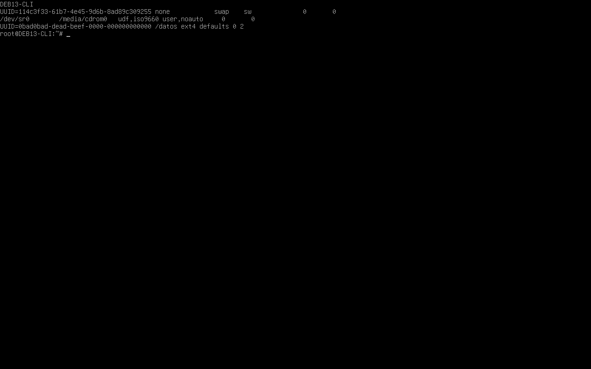
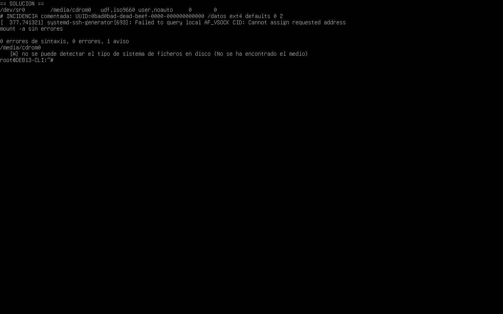
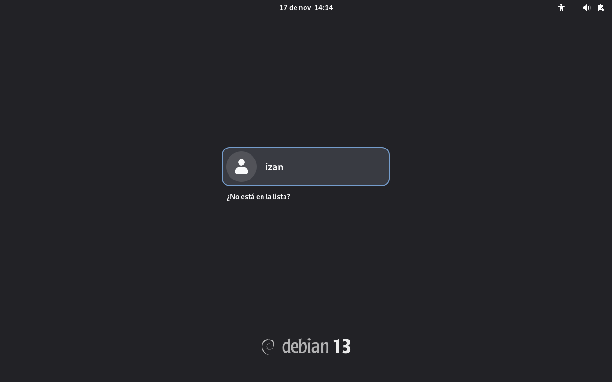
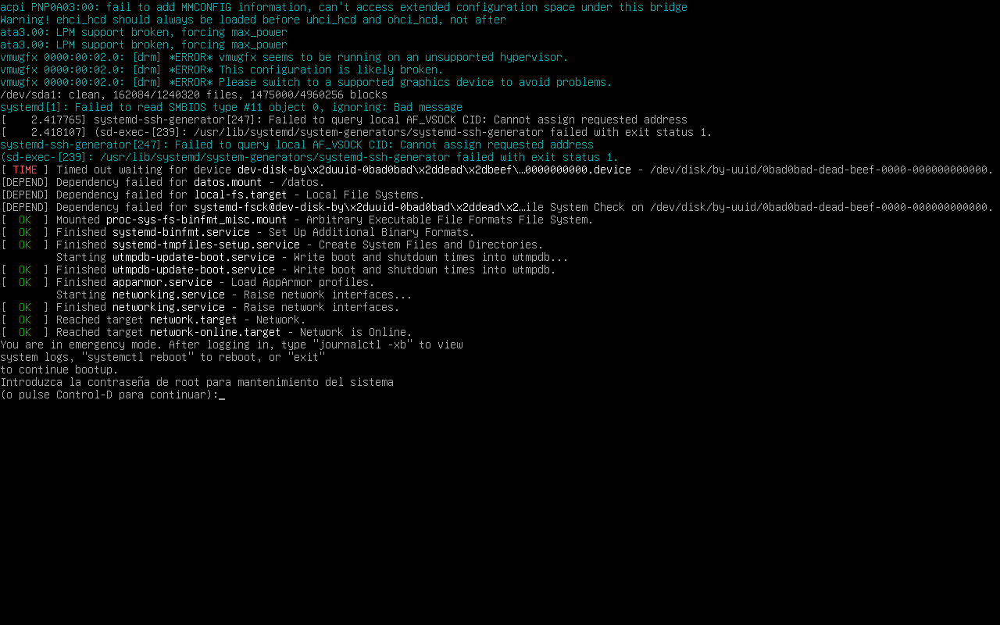
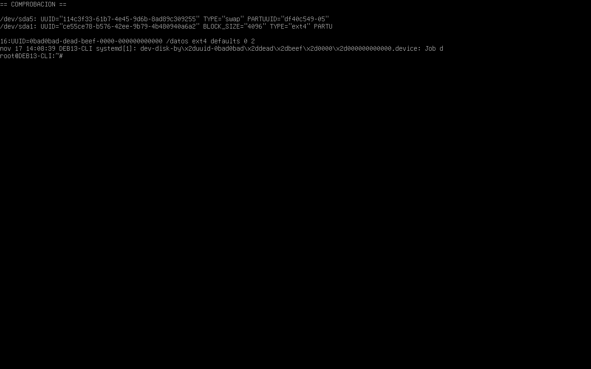

# 10 · Incidencias

Registro de problemas reales que han aparecido al montar el entorno, con el método **síntoma → hipótesis → comprobación → solución → vuelta al estado normal**.

| # | Fecha | Máquina | Síntoma | Hipótesis | Comprobación | Solución | Estado final |
|---|---|---|---|---|---|---|---|
| 1 | 17/11 | TrueNas | Al arrancar aparece el **instalador** de TrueNAS en vez del sistema | La ISO sigue conectada y el orden de arranque pone el DVD antes que el disco | El disco virtual ya ocupaba 3,5 GB → el sistema estaba instalado | Desconectar la ISO del lector (`storageattach ... --medium emptydrive`) | Arranca TrueNAS 25.10.7 desde el disco |
| 2 | 17/11 | Mikrotik-IND | Mensaje *"ROUTER HAS NO SOFTWARE KEY — You have 21h…"* | RouterOS **x86** instalado desde ISO necesita licencia; sin ella es una demo de 24 h | Documentación de MikroTik + el propio mensaje: *"Turn off the device to stop the timer"* | Se mantiene la VM y **se apaga cuando no se usa**. Alternativa: CHR (licencia gratuita) | Router operativo; contador controlado |
| 3 | 17/11 | Todas | `ping` a Internet desde las VMs no responde, pero sí funciona HTTPS | La NAT de VirtualBox no puede enviar ICMP porque el anfitrión no permite *ping sockets* sin privilegios | `sysctl net.ipv4.ping_group_range` = `1 0` (desactivado) en el anfitrión; DNS y `curl` sí funcionan | Usar `traceroute -T` (TCP). Solución definitiva (requiere sudo en el anfitrión): `sysctl -w net.ipv4.ping_group_range="0 2147483647"` | Conectividad demostrada por TCP |
| 4 | 17/11 | DEB13-SRV1-NFT | Tras pasar a LAN23, la WAN (`enp0s3`) no tiene IP y no hay Internet | El perfil de NetworkManager *Wired connection 1* se había quedado asociado a la otra tarjeta | `nmcli dev status`: `enp0s3` *desconectado*, `enp0s8` *obteniendo IP* | Perfil nuevo `WAN` (DHCP) en `enp0s3` y el antiguo renombrado a `LAN23` (IP fija) | Las dos interfaces con su IP |
| 5 | 17/11 | DEB13-SRV1-NFT / CLI | Al escribir comandos desde el anfitrión, `-` sale como `/` y `=` como `)` | La consola de texto usa teclado de EE. UU. y la herramienta tenía otra distribución | Escribir `a-b/c=d` y ver qué aparece en pantalla | Usar la distribución de EE. UU. al enviar teclas por `VBoxManage` | Comandos correctos |
| 6 | 17/11 | WS2025-DC, W11-CLI | Pantalla negra *"Press any key to boot from CD or DVD…"* y después *"No bootable option"* | En UEFI, el instalador de Windows pide pulsar una tecla y nadie la pulsó | Captura de pantalla de la VM | Reiniciar la VM y enviar la tecla espacio repetidamente durante los primeros segundos | Instalación en marcha |
| 7 | 17/11 | W11-CLI | El instalador se para en **"Clave de producto"** aunque es una instalación desatendida | El nuevo instalador de Windows 11 25H2 no lee igual el `autounattend.xml` de VirtualBox 7.0 | Captura: *"' ' no es un carácter válido"* | Borrar el campo y elegir *"No tengo clave de producto"* | La instalación continúa |
| 8 | 17/11 | Anfitrión | `sudo` no funciona desde terminal | No hay terminal para pedir la contraseña | Error *"a terminal is required to read the password"* | Instalar `gh` sin sudo en `~/.local/bin`; lo que necesite root en el anfitrión lo ejecuta izan | `gh` 2.104.0 funcionando |
| 9 | 17/11 | WS2025-DC | `Get-ADOrganizationalUnit`: *"No se pudo encontrar ningún servidor que ejecutara Servicios web de AD"* | ADWS aún arrancando tras promover el DC | `Get-Service ADWS` → *Running*; el registro SRV `_ldap._tcp` resuelve bien → no era eso | La sesión remota de `guestcontrol` no obtiene Kerberos para ADWS: se usan `dsadd`/`dsquery` (LDAP directo) | OUs creadas |
| 10 | 17/11 | PMX1 | No se puede entrar como `root` en Proxmox: fallan todas las contraseñas conocidas | Contraseña puesta en la instalación anterior y no documentada | 3 intentos con las contraseñas del proyecto → *Login incorrect* | Decisión de izan: **reinstalar** Proxmox con la contraseña documentada (alternativa: reset por GRUB `init=/bin/bash`) | `pmx1.asix23.lan` 192.168.23.11 |
| 11 | 17/11 | PMX1 | `pveam download` bajó `debian-13-standard_..._arm64` | El filtro elegía la última línea de la lista, que era la versión ARM | Nombre del fichero termina en `arm64` | Borrar y filtrar por `amd64` | Plantilla correcta |
| 12 | 17/11 | OPNsense | El instalador asignó WAN = em1 (LAN23) y LAN = em0 (NAT) | La autodetección no sabe qué cable va a Internet | MAC de cada adaptador en VirtualBox vs. `em0/em1` | Menú de consola `1) Assign interfaces`: WAN = em0, LAN = em1 | WAN por DHCP, LAN 192.168.23.2 |
| 13 | 17/11 | TrueNas | Las copias salían con la hora de EE. UU. y una hora de más | Zona horaria por defecto + reloj de la VM en hora local (Linux espera UTC) | `date` en el NAS vs. el PC | Zona `Europe/Madrid` y `VBoxManage modifyvm --rtc-use-utc on` en las VMs Linux | Hora correcta |
| 14 | 17/11 | Repo Git | El comprobador de contraseñas no revisaba un commit con logs de Windows | `grep` trataba el diff como binario (caracteres no UTF-8) y no devolvía líneas | Aviso *"coincidencia en fichero binario"* | `git diff --text` + `grep -a`; auditoría de todo el historial: **0 contraseñas** | Comprobación fiable |

## Incidencia provocada (Tasca 5.5) — fallo de arranque por `/etc/fstab`

**VM desechable**: `DEB13-DESECHABLE`, **clon enlazado** de DEB13-CLI (instantánea `base-antes-de-clonar`), sin cable de red para no chocar con la IP del original. Si algo sale mal, se borra el clon y el original no se toca.

**Fallo provocado**: se añade al final de `/etc/fstab` un disco que no existe:

```
UUID=0bad0bad-dead-beef-0000-000000000000 /datos ext4 defaults 0 2
```



| Paso | Qué se hizo | Evidencia |
|---|---|---|
| **Síntoma** | Al reiniciar, el sistema se queda en **modo de emergencia** y pide la contraseña de root | `[ TIME ] Timed out waiting for device ...0bad0bad...` · `Dependency failed for datos.mount` · `Dependency failed for local-fs.target` · *"You are in emergency mode"* |
| **Hipótesis** | Una línea de `/etc/fstab` apunta a un disco que no está; como el último campo es `2` (comprobar al arrancar) y no tiene `nofail`, systemd considera que el arranque no puede seguir | |
| **Comprobación** | `blkid` (discos que existen) vs. `grep datos /etc/fstab` (lo que se pide) + `journalctl -xb` | Solo existen `sda1` (ext4) y `sda5` (swap); el UUID `0bad0bad…` **no existe** → hipótesis confirmada |
| **Solución** | Comentar la línea, `systemctl daemon-reload`, `mount -a` (sin errores) y `findmnt --verify` (0 errores) |  |
| **Vuelta al estado normal** | `systemctl reboot` → arranca hasta la pantalla de inicio de sesión |  |


*Síntoma: el arranque espera 90 s al disco inexistente y entra en modo de emergencia.*


*Comprobación: `blkid` no muestra el UUID que pide la línea 16 de `fstab`.*

**Cómo evitarlo**: probar siempre con `mount -a` (o `findmnt --verify`) **antes** de reiniciar, y en discos que no son imprescindibles (USB, discos de datos) usar la opción `nofail`, para que si falta el disco el sistema arranque igual.

| # | Fecha | Máquina | Síntoma | Hipótesis | Comprobación | Solución | Estado final |
|---|---|---|---|---|---|---|---|
| 15 | 17/11 | OPNsense | Con .2 de gateway los clientes no resuelven nombres | Unbound hace resolución recursiva a los servidores raíz y la red del aula no lo deja | `curl` por IP sí funciona; Unbound *running* | Unbound en **modo reenvío** (usa el DNS de la WAN) | DNS correcto |
| 16 | 17/11 | OPNsense | El Telnet no aparecía bloqueado en el log | "Default allow LAN to any" (secuencia 1, `quick`) se evaluaba antes que mi bloqueo (secuencia 10) | Lista de reglas por la API; `grep` del log: 0 entradas de la LAN | Reglas por defecto pasadas a secuencia 50/51 (copia previa `01-antes-de-reordenar.xml`) | Bloqueo registrado (`block,in` regla a1f994e5) |
| 17 | 17/11 | DEB13-SRV2/SRV3 | La instalación desatendida se queda con la **pantalla negra** y el disco no crece | Arranca desde el disco a medio instalar (restos del intento cortado) y no desde la ISO | `VBox.log`: *"BIOS: Booting from Hard Disk..."*; tamaño del VDI sin cambios | Orden de arranque DVD → disco y reinicio de la instalación | Instalación completa |
| 18 | 17/11 | DEB13-SRV2/SRV3 | Al final de la instalación: *"Falló la ejecución de la orden de preconfiguración ... vboxpostinstall.sh"* | El script post-instalación de VirtualBox falla (intenta instalar las Guest Additions/configurar sudo) | El sistema y GRUB ya estaban instalados (el script es el último paso); tras continuar, arranca bien pero **sin `sudo`** | Continuar, entrar como root con `su -` e instalar `sudo` + `usermod -aG sudo izan` | Sistemas operativos con `sudo` |
| 19 | 17/11 | DEB13-SRV2/SRV3 | Tras poner IP fija, no se resuelven nombres | Algo reescribe `/etc/resolv.conf` | Tras reiniciar, el fichero dice *"Generated by dhcpcd"* y está vacío | DNS en `/etc/resolv.conf.head`, que `dhcpcd` respeta | Resuelve tras reiniciar |
| 20 | 17/11 | Mikrotik-IND | Desde el PC de casa: SSH con contraseña → *"Permission denied (publickey)"* | El usuario `izan` tiene importada la clave SSH del PC de clase; RouterOS 7 entonces solo acepta clave | Se buscó la clave en `~/.ssh` (vacío). **Corrección posterior:** la clave del laboratorio está en `~/iso-lab/ssh/id_lab` (config `~/iso-lab/ssh/config`) | Ese día se gestionó por la **API REST** (puerto 8001); lo correcto es `ssh -F ~/iso-lab/ssh/config mk` | Reglas añadidas por la API |
| 21 | 17/11 | Host (Tasca 7) | El medidor daba **0 MB** de disco para todas las VMs | `VBoxHeadless` es *setuid root*: un usuario normal no puede leer su `/proc/<pid>/io` | `ls -l /usr/lib/virtualbox/VBoxHeadless` → `-r-s--x--x root` | Medir el SSD entero (`/proc/diskstats`) con una sola VM encendida | Disco medido en todas |
| 22 | 17/11 | DEB13-CLI / W11-CLI | No se apagan con el botón ACPI y el script de medida se para | La pantalla de inicio de sesión (GNOME / Windows) ignora el botón de apagado | Captura de pantalla: VM en la pantalla de login | Apagado forzado **solo en clientes** sin sesión abierta (en servidores, el script se para) | Medidas completas |
| 23 | 17/11 | DEB13-SRV2 | `dd` dentro de la VM da **2,4 GB/s** (imposible por USB) | Escribía ceros (`/dev/zero`) y VirtualBox no guarda bloques vacíos en un VDI dinámico | El SSD físico solo escribió 111 MB | `fio` con datos aleatorios | 218 MB/s reales |
| 24 | 17/11 | DEB13-SRV2/SRV3 | `stress-ng --cpu 1` termina al instante con *"failed: 1: cpu"* | El método por defecto (`all`) prueba una operación que falla en la vCPU | `stress-ng -v` → *"terminated with an error"* | `--cpu-method int64` (y `--vm-method write64`) | 100 % de vCPU |
