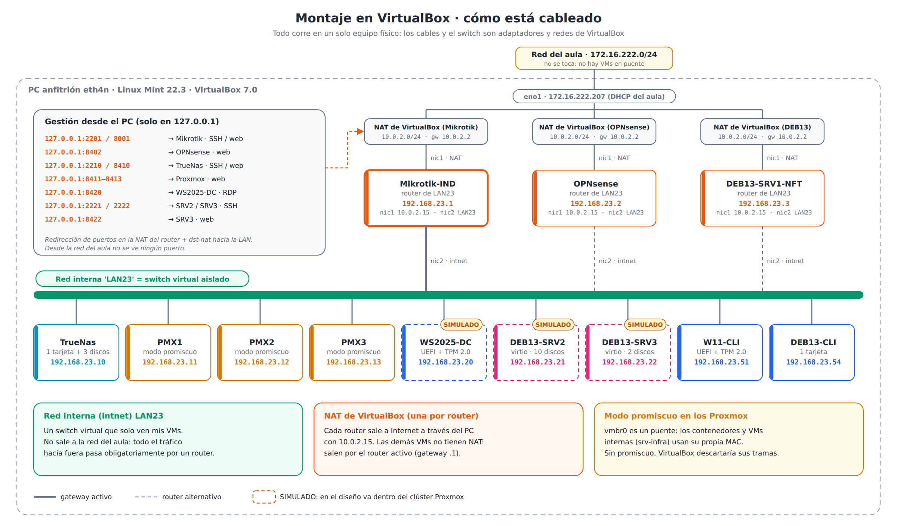

# Tasca 0 · Entorno de pruebas

**Alumno:** izan · 1.º ASIX · Puesto 23 · Red `192.168.23.0/24` · Dominio `asix23.lan` · CIP FP Batoi · Curso 2026-2027

**Módulos:** FDM-RA1, FDM-RA4 · **Estado:**  Apte ·  Apte+

## Qué pide el enunciado

| Nivel | Criterio |
|---|---|
| Apte | Preparar en mi equipo un entorno de pruebas que simule el del grupo |
| Apte+ | Documentar el montaje en Markdown y publicarlo en un repositorio Git personal: esquema de VMs, recursos y problemas encontrados con su solución |

## Qué he hecho

1. **Entorno completo en VirtualBox 7.0** sobre un solo PC (Linux Mint 22.3):
   - 3 routers de comunicaciones: MikroTik `.1`, OPNsense `.2`, Debian + nftables `.3`.
   - NAS TrueNAS `.10`.
   - Clúster Proxmox de 3 nodos (`.11–.13`) con un contenedor LXC (`srv-infra .30`).
   - Controlador de dominio Windows Server 2025 `.20`.
   - Servidores Debian SRV2 (ficheros + RAID) `.21` y SRV3 (web) `.22`.
   - Clientes Windows 11 `.51` y Debian `.54`.
2. **Red aislada**: una red interna de VirtualBox (`LAN23`) que no toca la red del aula. Solo los routers salen a Internet, por NAT.
3. **Escenarios de arranque**: no caben todas las VMs a la vez (34,5 GB asignados frente a ~24 GB disponibles), así que se trabaja por escenarios (A: comunicaciones, B: dominio, C: clúster, D: RAID/rendimiento).
4. **Repositorio Git personal** con toda la documentación en Markdown, los esquemas, los logs reales, las configuraciones exportadas sin contraseñas y los scripts.
5. **Seguridad del repositorio**: las contraseñas solo están en un archivo ignorado por Git, y un *hook* `pre-commit` (`scripts/comprova-secrets.sh`) bloquea cualquier commit que contenga una.

### Montaje en VirtualBox



*Todas las VMs están en un solo PC. Solo los routers tienen un adaptador NAT hacia Internet; el resto está únicamente en la red interna `LAN23`.*

## Resultados

| | |
|---|---|
| Máquinas | 12 VMs + 1 contenedor LXC |
| Incidencias documentadas con su solución | **26** |
| Contraseñas publicadas en todo el historial | **0** |

## Problemas encontrados y su solución

Cada problema se resolvió con el método **síntoma → hipótesis → comprobación → solución → vuelta al estado normal**.

| # | Máquina | Problema | Solución |
|---|---|---|---|
| 1 | TrueNas | Al arrancar aparece el **instalador** de TrueNAS en vez del sistema | Desconectar la ISO del lector (`storageattach ... --medium emptydrive`) |
| 2 | Mikrotik-IND | Mensaje *"ROUTER HAS NO SOFTWARE KEY — You have 21h…"* | Se mantiene la VM y **se apaga cuando no se usa**. Alternativa: CHR (licencia gratuita) |
| 3 | Todas | `ping` a Internet desde las VMs no responde, pero sí funciona HTTPS | Usar `traceroute -T` (TCP). Solución definitiva (requiere sudo en el anfitrión): `sysctl -w net.ipv4.ping_group_range="0 2147483647"` |
| 4 | DEB13-SRV1-NFT | Tras pasar a LAN23, la WAN (`enp0s3`) no tiene IP y no hay Internet | Perfil nuevo `WAN` (DHCP) en `enp0s3` y el antiguo renombrado a `LAN23` (IP fija) |
| 5 | DEB13-SRV1-NFT / CLI | Al escribir comandos desde el anfitrión, `-` sale como `/` y `=` como `)` | Usar la distribución de EE. UU. al enviar teclas por `VBoxManage` |
| 6 | WS2025-DC, W11-CLI | Pantalla negra *"Press any key to boot from CD or DVD…"* y después *"No bootable option"* | Reiniciar la VM y enviar la tecla espacio repetidamente durante los primeros segundos |
| 7 | W11-CLI | El instalador se para en **"Clave de producto"** aunque es una instalación desatendida | Borrar el campo y elegir *"No tengo clave de producto"* |
| 8 | Anfitrión | `sudo` no funciona desde los scripts de automatización | Instalar `gh` sin sudo en `~/.local/bin`; lo que necesita root en el anfitrión lo ejecuto a mano |
| 9 | WS2025-DC | `Get-ADOrganizationalUnit`: *"No se pudo encontrar ningún servidor que ejecutara Servicios web de AD"* | La sesión remota de `guestcontrol` no obtiene Kerberos para ADWS: se usan `dsadd`/`dsquery` (LDAP directo) |
| 10 | PMX1 | No se puede entrar como `root` en Proxmox: fallan todas las contraseñas conocidas | **Reinstalar** Proxmox con la contraseña documentada (alternativa: reset por GRUB `init=/bin/bash`) |
| 11 | PMX1 | `pveam download` bajó `debian-13-standard_..._arm64` | Borrar y filtrar por `amd64` |
| 12 | OPNsense | El instalador asignó WAN = em1 (LAN23) y LAN = em0 (NAT) | Menú de consola `1) Assign interfaces`: WAN = em0, LAN = em1 |
| 13 | TrueNas | Las copias salían con la hora de EE. UU. y una hora de más | Zona `Europe/Madrid` y `VBoxManage modifyvm --rtc-use-utc on` en las VMs Linux |
| 14 | Repo Git | El comprobador de contraseñas no revisaba un commit con logs de Windows | `git diff --text` + `grep -a`; auditoría de todo el historial: **0 contraseñas** |
| 15 | OPNsense | Con .2 de gateway los clientes no resuelven nombres | Unbound en **modo reenvío** (usa el DNS de la WAN) |
| 16 | OPNsense | El Telnet no aparecía bloqueado en el log | Reglas por defecto pasadas a secuencia 50/51 (copia previa `01-antes-de-reordenar.xml`) |
| 17 | DEB13-SRV2/SRV3 | La instalación desatendida se queda con la **pantalla negra** y el disco no crece | Orden de arranque DVD → disco y reinicio de la instalación |
| 18 | DEB13-SRV2/SRV3 | Al final de la instalación: *"Falló la ejecución de la orden de preconfiguración ... vboxpostinstall.sh"* | Continuar, entrar como root con `su -` e instalar `sudo` + `usermod -aG sudo izan` |
| 19 | DEB13-SRV2/SRV3 | Tras poner IP fija, no se resuelven nombres | DNS en `/etc/resolv.conf.head`, que `dhcpcd` respeta |
| 20 | Mikrotik-IND | Desde el PC de casa: SSH con contraseña → *"Permission denied (publickey)"* | Ese día se gestionó por la **API REST** (puerto 8001); lo correcto es `ssh -F ~/iso-lab/ssh/config mk` |
| 21 | Host (Tasca 7) | El medidor daba **0 MB** de disco para todas las VMs | Medir el SSD entero (`/proc/diskstats`) con una sola VM encendida |
| 22 | DEB13-CLI / W11-CLI | No se apagan con el botón ACPI y el script de medida se para | Apagado forzado **solo en clientes** sin sesión abierta (en servidores, el script se para) |
| 23 | DEB13-SRV2 | `dd` dentro de la VM da **2,4 GB/s** (imposible por USB) | `fio` con datos aleatorios |
| 24 | DEB13-SRV2/SRV3 | `stress-ng --cpu 1` termina al instante con *"failed: 1: cpu"* | `--cpu-method int64` (y `--vm-method write64`) |
| 25 | Mikrotik-IND | En clase, `ssh -F ~/iso-lab/ssh/config mk` → *"Permission denied (publickey)"* (el 17/11 funcionaba) | Lección: después de restaurar una copia hay que comprobar **también el acceso de gestión**, no solo el servicio. Hacer una copia nueva del router después de cualquier cambio de usuarios/claves |
| 26 | PMX3 | PMX3 no vuelve a entrar en el clúster tras arrancar (2 de 3 votos) | Copiar `authkey` de PMX1 (mismo SHA256 `a74c4537…` que el resto de nodos) y `systemctl restart corosync`. El archivo roto se guardó en `/root/authkey.vacia.2026-11-18` |

## Cómo comprobarlo

```bash
VBoxManage list vms                      # las 12 VMs
VBoxManage showvminfo DEB13-CLI | grep NIC   # adaptador en la red interna LAN23
git log --oneline | head                 # historial del trabajo
```

## Por qué lo he hecho así

- **¿Por qué red interna y no adaptador puente?** Con puente, mis VMs aparecerían en la red del aula, y un DHCP o una IP repetida molestaría a los compañeros. La red interna aísla mi LAN y obliga a que todo el tráfico pase por el router.
- **¿Por qué no enciendes todas las VMs a la vez?** VirtualBox reserva la RAM de cada VM encendida. Si no cabe, el PC entra en swap y todo se bloquea. Por eso trabajo por escenarios.
