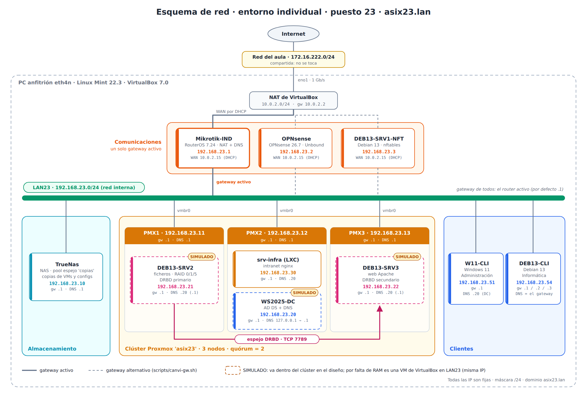
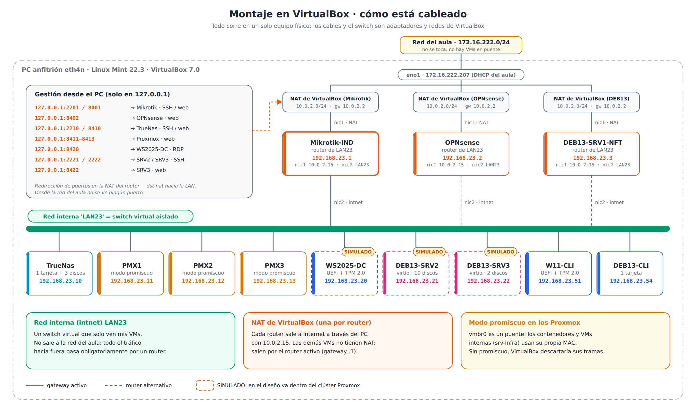
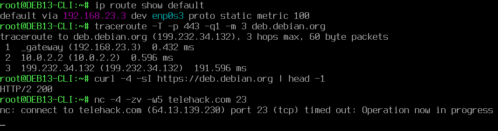

# Tasca 4 · Diseño físico y lógico

**Alumno:** izan · 1.º ASIX · Puesto 23 · Red `192.168.23.0/24` · Dominio `asix23.lan` · CIP FP Batoi · Curso 2026-2027

**Repositorio del proyecto:** [https://github.com/ethan3232/iso-naix-un-sistema-individual](https://github.com/ethan3232/iso-naix-un-sistema-individual) · **Esta tarea en GitHub:** [https://github.com/ethan3232/iso-naix-un-sistema-individual/blob/main/Proyecto-por-Tareas/Tasca-4-diseno-fisico-y-logico.md](https://github.com/ethan3232/iso-naix-un-sistema-individual/blob/main/Proyecto-por-Tareas/Tasca-4-diseno-fisico-y-logico.md)

**Módulos:** FDM-RA4, ISO-RA1, ISO-RA3 · **Estado:**  Apte ·  Apte+

## Qué pide el enunciado

| Nivel | Criterio |
|---|---|
| Apte | Esquema de red de mi sistema (configuración, montaje en VirtualBox, red `192.168.23.0/24`) |
| Apte | Tabla de máquinas, recursos simultáneos y reserva del hipervisor |
| Apte+ | Implementar el esquema y verificar la conectividad (ping, traceroute, rutas, interfaces) |

## Qué he hecho

### Esquema lógico



- **Red `LAN23` · `192.168.23.0/24`**, dominio `asix23.lan`, todas las IP fijas.
- **Un solo gateway activo** (MikroTik `.1`). OPNsense `.2` y Debian `.3` son alternativos y se cambia de uno a otro con `scripts/canvi-gw.sh`.
- **Servidores dentro del clúster Proxmox:** en el diseño, SRV2 va en PMX1, el DC en PMX2 y SRV3 en PMX3. Por falta de RAM para la virtualización anidada están **simulados** como VMs de VirtualBox en LAN23, con la misma IP y la misma función. SRV2 y SRV3 van en nodos distintos para que el espejo DRBD proteja de verdad. Explicación completa en [04 §5.1](https://github.com/ethan3232/iso-naix-un-sistema-individual/blob/main/docs/04-disseny.md#51-servidores-dentro-del-clúster-simulados).

**Plan de direccionamiento**

| Rango | Uso |
|---|---|
| .1 – .3 | Servidores de comunicaciones |
| .10 – .19 | NAS (.10) y nodos Proxmox (.11–.13) |
| .20 – .29 | Identidad e infraestructura (DC .20, SRV2 .21, SRV3 .22) |
| .30 – .49 | Contenedores y VMs dentro de Proxmox (srv-infra .30) |
| .50 – .54 | Clientes por departamento |
| .100 – .199 | Reservado para un futuro DHCP |

### Montaje en VirtualBox



### Recursos

| | Clase | Casa |
|---|---|---|
| RAM total de todas las VMs | 34,5 GB | 34,5 GB |
| RAM disponible para VMs (reserva para el host) | ~24 GB | ~10 GB |
| Escenarios que caben | A, B, C y D | A y D |

## Resultados (Apte+)

- Desde el cliente, con cada router como gateway: `ip route` muestra el gateway correcto y `traceroute -T` da como primer salto el router elegido.
- HTTPS desde la LAN por los tres routers → `HTTP/2 200`.

Extracto real de la prueba desde el cliente DEB13-CLI con el MikroTik como gateway:

```
# ip route
default via 192.168.23.1 dev enp0s3 proto static metric 100
192.168.23.0/24 dev enp0s3 proto kernel scope link src 192.168.23.54
# ping -c2 192.168.23.1 (gateway)
2 packets transmitted, 2 received, 0% packet loss
# traceroute TCP 443 a deb.debian.org
 1  _gateway (192.168.23.1)  0.807 ms
 2  10.0.2.2 (10.0.2.2)  1.530 ms
 3  151.101.130.132  209.025 ms
# curl -sI https://deb.debian.org
HTTP/2 200
```



*Demuestra: al cambiar el gateway a 192.168.23.3, la ruta por defecto y el primer salto del `traceroute` pasan a ser el Debian y HTTPS sigue funcionando.*

## Desarrollo

### Parámetros de red de cada interfaz

| Máquina | Interfaz | Red VBox | IP / máscara | Gateway | DNS | Dominio | Asignación |
|---|---|---|---|---|---|---|---|
| Mikrotik-IND | ether1 (WAN) | NAT | 10.0.2.15/24 | 10.0.2.2 | 10.0.2.3 → 1.1.1.1, 9.9.9.9 | — | DHCP |
| Mikrotik-IND | ether2 (LAN) | LAN23 | **192.168.23.1/24** | — | (servidor DNS para la LAN) | — | Fija |
| OPNsense | em0 (WAN) | NAT | 10.0.2.15/24 | 10.0.2.2 | 10.0.2.3 | — | DHCP |
| OPNsense | em1 (LAN) | LAN23 | **192.168.23.2/24** | — | Unbound (reenvío) | — | Fija |
| DEB13-SRV1-NFT | enp0s3 (WAN) | NAT | 10.0.2.15/24 | 10.0.2.2 | 10.0.2.3 | — | DHCP |
| DEB13-SRV1-NFT | enp0s8 (LAN) | LAN23 | **192.168.23.3/24** | — (`never-default`) | — | — | Fija |
| TrueNas | enp0s3 | LAN23 | 192.168.23.10/24 | 192.168.23.1 | 192.168.23.1 | asix23.lan | Fija |
| PMX1 | vmbr0 (nic0) | LAN23 | 192.168.23.11/24 | 192.168.23.1 | 192.168.23.1 | asix23.lan | Fija |
| PMX2 | vmbr0 (nic0) | LAN23 | 192.168.23.12/24 | 192.168.23.1 | 192.168.23.1 | asix23.lan | Fija |
| PMX3 | vmbr0 (nic0) | LAN23 | 192.168.23.13/24 | 192.168.23.1 | 192.168.23.1 | asix23.lan | Fija |
| WS2025-DC | Ethernet | LAN23 | 192.168.23.20/24 | 192.168.23.1 | **127.0.0.1** (él mismo) · reenviador .1 | asix23.lan | Fija |
| srv-infra (LXC) | eth0 → vmbr0 | LAN23 | 192.168.23.30/24 | 192.168.23.1 | 192.168.23.20 | asix23.lan | Fija |
| W11-CLI | Ethernet | LAN23 | 192.168.23.51/24 | 192.168.23.1 | **192.168.23.20** (DC) | asix23.lan | Fija |
| DEB13-CLI | enp0s3 | LAN23 | 192.168.23.54/24 | .1 / .2 / .3 (`canvi-gw.sh`) | el del gateway activo | asix23.lan | Fija |

**¿Por qué todo con IP fija y sin DHCP?** Son servidores (siempre se les busca por la misma IP) y además hay tres routers en la misma LAN: con tres servidores DHCP, cada cliente cogería el gateway del que respondiera primero. Los clientes .50–.54 también van fijos para que las pruebas sean repetibles. **Rango reservado** para un futuro DHCP: `.100–.199`.

#### Plan de direccionamiento

| Rango | Uso |
|---|---|
| .1 – .3 | Servidores de comunicaciones (fijados por el enunciado) |
| .10 – .19 | Almacenamiento y virtualización (NAS .10, nodos Proxmox .11–.13) |
| .20 – .29 | Servidores de identidad e infraestructura (DC .20) |
| .30 – .49 | VMs y contenedores dentro de Proxmox (srv-infra .30) |
| .50 – .54 | Clientes por departamento: Dirección .50, Administración .51, Comercial .52, Producción .53, Informática .54 |
| .100 – .199 | Reservado para DHCP (solo dentro de LAN23) |

### Cambio de gateway activo

Solo un router hace de gateway a la vez. Los tres están siempre en la LAN con su IP, pero los clientes apuntan a uno:

```bash
scripts/canvi-gw.sh 1   # MikroTik   (DNS .1)
scripts/canvi-gw.sh 2   # OPNsense   (DNS .2)
scripts/canvi-gw.sh 3   # Debian     (DNS 1.1.1.1, porque Debian no tiene servidor DNS)
```

Comprobación en cada caso: `ip route` (gateway) + `traceroute -T` (el primer salto es el router elegido). Resultados: [MikroTik](https://github.com/ethan3232/iso-naix-un-sistema-individual/blob/main/evidencies/logs/prueba-gw-mikrotik.txt) · [OPNsense](https://github.com/ethan3232/iso-naix-un-sistema-individual/blob/main/evidencies/logs/prueba-gw-opnsense.txt) · [Debian](https://github.com/ethan3232/iso-naix-un-sistema-individual/blob/main/evidencies/logs/prueba-gw-debian.txt).

### Clúster: nodos, quórum, red y almacenamiento

| | Diseño |
|---|---|
| Nodos | **3** (PMX1, PMX2, PMX3) → quórum = 2 votos: **si cae un nodo, el clúster sigue funcionando** |
| Red | Corosync sobre LAN23 (en producción: red separada y redundante) |
| Almacenamiento | `local-lvm` en cada nodo (local) + `nas-copias` (NFS de TrueNAS, compartido, para copias) |
| Gestión conjunta |  |
| Migración |  medida ([Proxmox](https://github.com/ethan3232/iso-naix-un-sistema-individual/blob/main/docs/06-installacio/proxmox.md#8-migraciones-medidas-log-completo)) |
| Alta disponibilidad | Diseño: necesitaría almacenamiento compartido para los **discos** de las VMs (NFS/iSCSI/Ceph) |

#### 5.1 Servidores dentro del clúster (simulados)

En el diseño, los servidores de la empresa **no son máquinas sueltas**: corren **dentro del clúster Proxmox**, que es lo que aporta la virtualización (gestión conjunta, copias con `vzdump` al NAS, migración entre nodos). El problema es la RAM: meter VMs dentro de los nodos Proxmox (virtualización anidada) exige dar a cada nodo la RAM de sus VMs **más** la del propio Proxmox, y no cabe.

| Servidor | Ubicación en el diseño | Ubicación real (implementada) | IP (la misma en los dos casos) |
|---|---|---|---|
| DEB13-SRV2 (ficheros + RAID + DRBD primario) | VM en **PMX1**, puente `vmbr0` → LAN23 | VM de VirtualBox en LAN23 | .21 |
| WS2025-DC (AD DS + DNS) | VM en **PMX2**, puente `vmbr0` → LAN23 | VM de VirtualBox en LAN23 | .20 |
| DEB13-SRV3 (web + DRBD secundario) | VM en **PMX3**, puente `vmbr0` → LAN23 | VM de VirtualBox en LAN23 | .22 |
| srv-infra (intranet, LXC) | Contenedor en PMX2 |  **Real**, dentro del clúster | .30 |

**Cálculo de por qué no cabe (clase, ~24 GB para VMs):** 3 nodos Proxmox + NAS ≈ 10 GB ya en marcha. Llevar dentro SRV2 (1 GB) + SRV3 (1 GB) + WS2025-DC (4 GB) obliga a subir la RAM de los nodos esos 6 GB más ~1 GB de sobrecarga por nodo, y además Windows dentro de una VM anidada va muy lento (sin aceleración de hardware real). En casa (~10 GB) es imposible.

**¿Por qué la simulación es válida?** Para el resto de la red es **indistinguible**: un puente `vmbr0` de Proxmox conecta la VM a LAN23 igual que el adaptador de VirtualBox, así que la VM tiene la misma IP, la misma puerta de enlace, el mismo DNS y da el mismo servicio. Lo que **no** se puede demostrar con ellas es lo propio del clúster (migrarlas de nodo o copiarlas con `vzdump`); eso se ha demostrado con `srv-infra` y la VM de prueba (101) en [Proxmox](https://github.com/ethan3232/iso-naix-un-sistema-individual/blob/main/docs/06-installacio/proxmox.md).

**Reparto por nodos:** SRV2 y SRV3 van en **nodos distintos** (PMX1 y PMX3) a propósito: el espejo DRBD solo protege si los dos lados están en **equipos físicos diferentes**. Si los dos estuvieran en el mismo nodo, la caída de ese nodo se llevaría las dos copias. El DC va en PMX2 junto a `srv-infra`, que lo usa como DNS.

> **Pregunta probable de defensa:** *"¿Dónde está tu servidor de ficheros, en el clúster o fuera?"* → En el diseño, dentro del clúster (PMX1). En mi montaje es una VM de VirtualBox en la misma LAN23 y con la misma IP, porque la virtualización anidada no cabe en la RAM. Para la red es lo mismo; lo único que no puedo hacer con ella es migrarla, y eso lo he demostrado con el contenedor `srv-infra`.

### Recursos simultáneos y reserva del hipervisor

| Concepto | Clase | Casa |
|---|---|---|
| **Suma de todas las VMs** (12 VMs de VirtualBox, 20 vCPU) | **34,5 GB** | **34,5 GB** |
| Recursos físicos del host | 18 hilos · 30 GiB | 12 hilos · 15,5 GiB |
| Reserva para el host (Linux Mint + escritorio + navegador + VirtualBox) | **~6 GB** | ~3,2 GB medidos sin navegador ([08 §1](https://github.com/ethan3232/iso-naix-un-sistema-individual/blob/main/docs/08-rendiment.md)) + 1 GB de margen |
| **Disponible para VMs** | **~24 GB** | **~11 GB** (≈ 7 GB con el navegador abierto: **5 VMs** en la prueba real) |

**Conclusión**: no se pueden encender todas a la vez (34,5 GB > 24 GB en clase y > 11 GB en casa). La CPU no es el problema (las VMs pasan la mayor parte del tiempo esperando), pero la **RAM** sí: VirtualBox reserva la RAM de cada VM encendida y, si no cabe, el host empieza a usar swap y todo se bloquea. Por eso se trabaja por **escenarios**.

> La vCPU sí se puede "sobresuscribir" (dar más vCPU que hilos reales) porque se reparten por turnos. La RAM no: cada MB asignado a una VM se le quita al host.

## Cómo comprobarlo

```bash
scripts/canvi-gw.sh 1        # gateway = MikroTik (2 = OPNsense, 3 = Debian)
ip -br a ; ip route          # interfaz, IP y gateway en el cliente
traceroute -T -p 443 deb.debian.org   # el primer salto es el router activo
```

## Por qué lo he hecho así

- **¿Por qué IP fijas y no DHCP?** Son servidores y hay tres routers en la misma LAN: con tres DHCP, cada cliente cogería el gateway del que respondiera primero.
- **¿Dónde está tu servidor de ficheros, en el clúster o fuera?** En el diseño, dentro del clúster (PMX1). En el montaje es una VM de VirtualBox en LAN23 con la misma IP, porque la virtualización anidada no cabe en la RAM. Para la red es lo mismo; lo único que no puedo hacer con ella es migrarla, y eso lo he demostrado con el contenedor `srv-infra`.

---

**Documentación completa, capturas, salidas de los comandos, configuraciones y scripts:** [https://github.com/ethan3232/iso-naix-un-sistema-individual](https://github.com/ethan3232/iso-naix-un-sistema-individual)
