# Tasca 5 · Instalación y comunicaciones

**Alumno:** izan · 1.º ASIX · Puesto 23 · Red `192.168.23.0/24` · Dominio `asix23.lan` · CIP FP Batoi · Curso 2026-2027

**Repositorio del proyecto:** [https://github.com/ethan3232/iso-naix-un-sistema-individual](https://github.com/ethan3232/iso-naix-un-sistema-individual) · **Esta tarea en GitHub:** [https://github.com/ethan3232/iso-naix-un-sistema-individual/blob/main/Proyecto-por-Tareas/Tasca-5-instalacion-y-comunicaciones.md](https://github.com/ethan3232/iso-naix-un-sistema-individual/blob/main/Proyecto-por-Tareas/Tasca-5-instalacion-y-comunicaciones.md)

**Módulos:** ISO-RA1, FDM-RA1 · **Estado:** ✓ Apte · ✓ Apte+

## Fet: subtareas del enunciado

> **Enunciado (part individual):** *«Cada alumne haurà de configurar en el seu entorn de prova els mateixos sistemes operatius que han fet a classe.»* · Apte+: *«Implementar un sistema per a realitzar còpies de la informació de configuració i/o configuracions importants dels diferents servidors crítics de la xarxa.»*

| # | Subtarea | Nivel | Fet | Dónde / nota |
|---|---|---|:---:|---|
| 1 | 5.1 Requisitos, licencia, recursos y origen de cada imagen; integridad SHA256 | Apte | ✓ | §1. OPNsense y Windows: el fabricante no publica el hash de la ISO (justificado) |
| 2 | 5.2 Firmware, orden de arranque, particionado y sistema de ficheros (UEFI, TPM) | Apte | ✓ | §2 |
| 3 | 5.3 Instalar y registrar las opciones, versión, dispositivos y software | Apte | ✓ | §2 |
| 4 | 5.4 Actualizar y comprobar el funcionamiento; vía de recuperación | Apte | ◐ | Vías de recuperación probadas en los 3 routers. **Falta registrar la actualización de cada sistema** |
| 5 | 5.5 Incidencia en una VM desechable (síntoma, hipótesis, comprobación, solución, retorno) | Apte | ✓ | §10 |
| 6 | Routers: usuario de administración y red WAN/LAN | Apte | ✓ | §3 |
| 7 | Routers: Internet para la LAN | Apte | ✓ | §3 |
| 8 | Routers: una conexión permitida, otra bloqueada e interpretación del registro | Apte | ✓ | §3, en los tres |
| 9 | Routers: copia en el NAS, fallo provocado y recuperación | Apte | ✓ | §3: 26 s, 15 s y 21 s |
| 10 | TrueNAS: usuarios, red, instalación y disco adicional para copias | Apte | ✓ | §4 |
| 11 | Proxmox: usuario, red y clúster | Apte | ✓ | §5 |
| 12 | Proxmox: crear los servidores virtualizados | Apte | ◐ | `srv-infra` (LXC) y una VM dentro del clúster; DC, SRV2 y SRV3 en VirtualBox por falta de RAM |
| 13 | Proxmox: ventajas e inconvenientes; contenedor frente a VM | Apte | ✓ | §5 |
| 14 | Proxmox: migración de un contenedor y de una VM (tiempo, espacio, mejoras) | Apte | ✓ | §5: ~84 s y 8 ms |
| 15 | Proxmox: copias al NAS; qué tiene sentido guardar | Apte | ✓ | §5 |
| 16 | Windows Server: usuarios, red, qué es un dominio y qué aporta, copias | Apte | ✓ | §6 |
| 17 | Servidores Linux: usuario, red, servicio y copia | Apte | ✓ | §7 |
| 18 | Clientes: usuario, red y dominio (si se justifica) | Apte | ✓ | §8: W11 unido; Debian sin unir, justificado |
| 19 | Clientes: copia de la configuración o del sistema | Apte | ◐ | Explicado qué se copia; no hay registro de una copia hecha de los clientes |
| 20 | Copias automáticas de las configuraciones de los servidores críticos | Apte+ | ✓ | §11 |

**Resumen:** 17 de 20 subtareas completas.

**Leyenda:** ✓ Fet · ◐ Fet en parte (se explica en la nota) · ⏳ Pendiente de fecha

## 1. Sistemas, licencias e imágenes (SHA256)

Todas las imágenes se descargaron de la web oficial del fabricante y se comprobó su SHA256 con `sha256sum` contra el valor publicado.

| Función | Sistema y versión | Licencia | SHA256 |
|---|---|---|---|
| Comunicaciones (principal) | MikroTik RouterOS 7.24.5 (x86) | Propietaria; x86 sin clave = demo de 24 h | ✓ coincide |
| Comunicaciones (alternativo) | OPNsense 26.7 | BSD 2-Clause (libre) | N/C ¹ |
| Comunicaciones (alternativo) | Debian 13.1 + nftables | Libre (DFSG) | ✓ coincide |
| NAS | TrueNAS SCALE 25.10.7 | Libre (GPL) | ✓ coincide |
| Virtualización | Proxmox VE 9.2-1 | AGPLv3; suscripción opcional | ✓ coincide |
| Dominio | Windows Server 2025 Standard (evaluación) | Propietaria; 180 días | N/C ² |
| Clientes | Windows 11 Pro 25H2 · Debian 13.1 | Propietaria · Libre | N/C ² · ✓ |

¹ OPNsense publica el hash del archivo comprimido (`.iso.bz2`), no de la ISO. ² Microsoft no publica un fichero de sumas; se guarda el hash calculado para comprobar en el futuro que la imagen no ha cambiado.

**¿Por qué verificar el SHA256?** Si cambia un solo bit de la ISO (descarga corrupta o imagen manipulada), la huella sale totalmente distinta. Coincidir con la del fabricante demuestra que la imagen es íntegra y auténtica.

## 2. Instalación: requisitos, firmware, particionado y opciones

| Sistema | Requisito oficial → asignado | Firmware | Disco y sistema de ficheros | Instalación |
|---|---|---|---|---|
| MikroTik RouterOS 7.24.5 | Muy poca RAM → **512 MB** (usa ~200 MB; bajado de 4 GB) | BIOS | Disco único, formato propio de RouterOS | Instalador de la ISO; `admin` obliga a cambiar la contraseña |
| OPNsense 26.7 | 2 GB recomendados (el instalador pide 3) → **2 GB** | BIOS | 20 GB · **UFS** | Modo *live* → *Install (UFS)* → se quita la ISO |
| Debian 13.1 (router y servidores) | 1 GB → 1 GB (servidores) | BIOS | ext4 + swap (particionado guiado) | Instalación **desatendida** de VirtualBox; servidores **sin escritorio** |
| TrueNAS SCALE 25.10.7 | **8 GB** → 4 GB (suficiente para unos MB de copias) | BIOS | Sistema en `sda` (ZFS `boot-pool`); datos **siempre en otros discos** | Ya instalado; se quitó la ISO del orden de arranque (incidencia 1) |
| Proxmox VE 9.2-1 | 64 bits con VT-x → virtualización **anidada** activada | BIOS | `/dev/sda` · **ext4 + LVM-thin** (un disco: ZFS no aporta redundancia y gasta RAM) | Instalador *Terminal UI*, IP fija; repositorio `pve-no-subscription` |
| Windows Server 2025 | 2 GB y 32 GB, UEFI + TPM recomendados → 4 GB · 50 GB | **UEFI + TPM 2.0** | GPT · NTFS | Desatendida, edición *Standard (experiencia de escritorio)* |
| Windows 11 Pro 25H2 | **4 GB, 64 GB, UEFI + Secure Boot, TPM 2.0** → justo el mínimo | **UEFI + TPM 2.0** | GPT · NTFS | Desatendida (imagen 6 = Pro, necesaria para el dominio) |

**¿Por qué UEFI + TPM solo en Windows?** Windows 11 lo exige y en Server 2025 es lo recomendado (arranque seguro, BitLocker). El resto funciona igual con BIOS, que es lo más sencillo en VirtualBox.

**Orden de arranque:** durante la instalación arranca primero el DVD. Después se **quita la ISO** y se deja solo el disco: si no, la VM vuelve a arrancar el instalador (incidencias 1 y 17).

**Problemas de instalación resueltos:** Windows esperando una tecla para arrancar el DVD en UEFI (incidencia 6), el instalador de Windows 11 parado en la clave de producto (7) y la instalación desatendida de Debian colgada por arrancar desde el disco a medio instalar (17).

## 3. Servidores de comunicaciones

| | MikroTik `.1` | OPNsense `.2` | Debian nftables `.3` |
|---|---|---|---|
| Administración | Usuario `izan` (grupo `full`), SSH con clave; Telnet, FTP y API desactivados | `root` (obligatorio) por la web, solo desde la LAN | `izan` en `sudo`, SSH con clave |
| WAN / LAN | `ether1` DHCP (NAT de VirtualBox) / `ether2` 192.168.23.1 | `em0` DHCP / `em1` 192.168.23.2 | `enp0s3` DHCP / `enp0s8` 192.168.23.3 |
| Internet a la LAN | NAT *masquerade* + DNS con reenvío | NAT automático + Unbound | `ip_forward=1` + `masquerade` |
| Permitido | HTTPS → `HTTP/2 200` | HTTPS → `HTTP/2 200` | HTTPS → `HTTP/2 200` |
| Bloqueado y registrado | Telnet (TCP 23) | Telnet (TCP 23) | Telnet (TCP 23) |
| Copia | `/export` + `/system backup` → NAS | `config.xml` → NAS | `/etc` + reglas → NAS |
| Fallo provocado | Borrar la IP de la LAN y el NAT | Desactivar las reglas de salida | `nftables.conf` roto + reinicio |
| **Recuperación** | **26 s**, 0 pérdida | **15 s**, 0 pérdida | **21 s**, 0 pérdida |

**¿Por qué *masquerade*?** La WAN recibe la IP por DHCP y *masquerade* usa siempre la IP actual de la interfaz; con `src-nat` habría que cambiar la regla cada vez que cambiara la IP.

**Orden de las reglas:** en los tres routers la regla que bloquea Telnet va **antes** que la que permite HTTPS y que la salida general, porque se aplica la primera regla que coincide.

### MikroTik RouterOS

*Demuestra: `ether1` (WAN) tiene IP por DHCP (10.0.2.15), `ether2` (LAN) tiene 192.168.23.1/24, la ruta por defecto sale por 10.0.2.2 y existe la regla de NAT *masquerade* de LAN23 hacia Internet.*

*Demuestra: en el tráfico que atraviesa el router, el bloqueo de Telnet (regla 8) va antes que el permiso de HTTPS (9) y que la salida general LAN → Internet (10); al final, todo lo demás se descarta y se registra (`FWD-DROP`).*

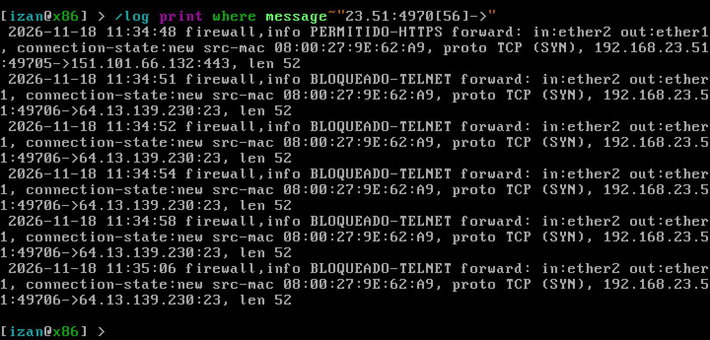

*Demuestra: el cortafuegos registra una sola vez la conexión HTTPS permitida (`PERMITIDO-HTTPS`) y varias veces el mismo intento de Telnet bloqueado (`BLOQUEADO-TELNET`).*

**Interpretación del registro:** la conexión HTTPS aparece **una vez** porque solo se registra el primer paquete (`connection-state:new`); el resto de la conexión pasa como *established*. Telnet aparece **una vez por segundo con el mismo puerto de origen**: son los reintentos del SYN del cliente, que nunca recibe respuesta.

**Fallo y recuperación:** se borraron la IP de la LAN y el NAT (toda la empresa sin gateway). Se recuperó con `/system backup load name=copia-nas.backup` en **26 s** sin servicio. En el primer intento la copia estaba solo en el NAS y **no se podía alcanzar**, porque al NAS se llega a través del propio MikroTik. Lección: la copia tiene que poder alcanzarse sin el equipo que ha fallado. Ahora hay tres copias: en el router, en el NAS y el `/export` en Git.

### OPNsense

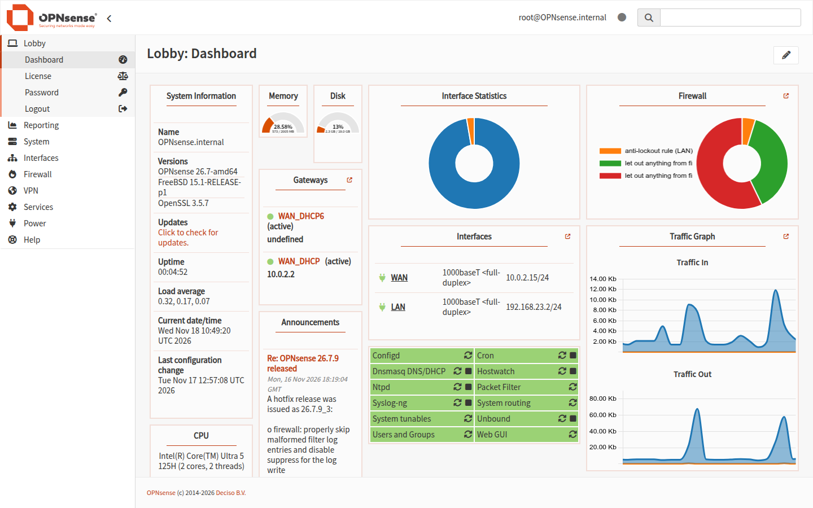

*Demuestra: OPNsense 26.7 funcionando, con la WAN (10.0.2.15/24, por DHCP) y la LAN (192.168.23.2/24) activas, la puerta de enlace `WAN_DHCP` (10.0.2.2) en línea y los servicios en verde.*

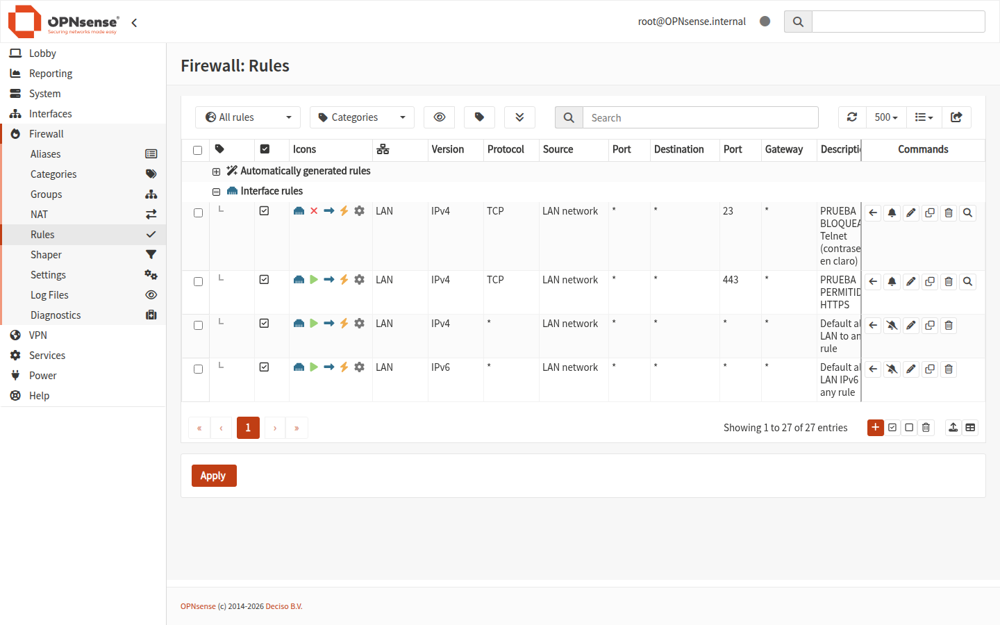

*Demuestra: en la interfaz LAN la regla que bloquea Telnet (puerto 23) está la primera, antes que la que permite HTTPS (443) y que las reglas por defecto que dejan salir a la LAN.*

*Demuestra: en Firewall → Log Files → Live View, filtrado por el cliente 192.168.23.54, la conexión HTTPS sale en verde (`pass`) y los intentos de Telnet en rojo (`block`).*

**Fallo y recuperación:** se desactivaron las reglas que dejan salir a la LAN (solo quedaba la denegación por defecto). Se recuperó desde *System → Configuration → History*, que guarda una versión de `config.xml` por cada cambio: **15 s** sin Internet en el cliente.

### Debian 13 con nftables

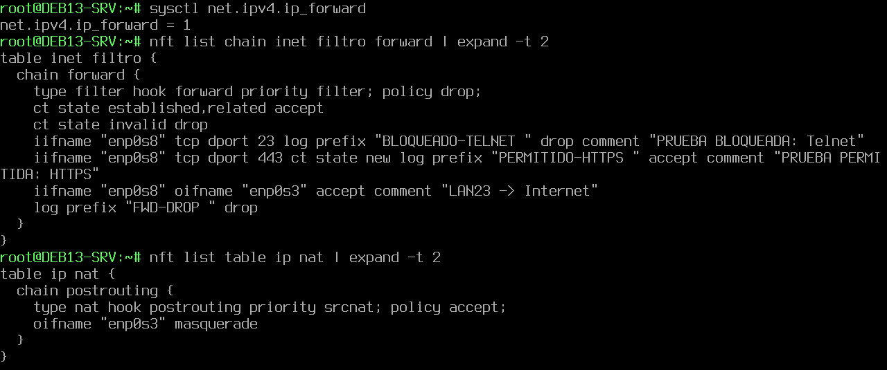

*Demuestra: el reenvío está activo (`ip_forward = 1`); la cadena `forward` tiene política `drop`, bloquea Telnet antes de permitir HTTPS y la salida LAN → Internet, y la tabla `nat` hace masquerade por la WAN.*

*Demuestra: en DEB13-CLI la ruta por defecto es 192.168.23.3, el primer salto del `traceroute` es el Debian, HTTPS responde `HTTP/2 200` y Telnet se queda sin respuesta (timed out).*

| Tabla / cadena | Política | Reglas importantes |
|---|---|---|
| `inet filtro` / input | **drop** | lo, established, ICMP, gestión desde LAN23, SSH solo desde el anfitrión; el resto se registra con `IN-DROP` |
| `inet filtro` / forward | **drop** | established; **Telnet → drop + log `BLOQUEADO-TELNET`**; **HTTPS nuevo → accept + log `PERMITIDO-HTTPS`**; LAN → WAN accept; el resto con `FWD-DROP` |
| `ip nat` / postrouting | accept | `oifname enp0s3 masquerade` |

*Demuestra: nftables registra en el log del kernel cada conexión HTTPS permitida una sola vez (el primer paquete) y los intentos de Telnet bloqueados uno por segundo (los reintentos del cliente). La salida se ha filtrado para mostrar solo hora, prefijo, origen, destino y puerto.*

**Política `drop` por defecto:** todo lo que no se permite explícitamente se bloquea, así no hace falta conocer de antemano todos los ataques.

**Fallo y recuperación:** se dejó un error de sintaxis en `/etc/nftables.conf` y se reinició el servidor. Al arrancar, `nftables: failed` con **0 reglas** (sin filtro y sin NAT). `journalctl -u nftables` señaló la línea exacta; se recuperó el fichero de la copia del NAS, se comprobó con `nft -c -f` y se aplicó: **21 s** sin Internet (casi todo es el reinicio).

## 4. TrueNAS SCALE · NAS `.10`

- Administración por la web con `truenas_admin` (TrueNAS 25 ya no deja entrar como `root`) y el usuario `izan` (administrador, con clave SSH para las copias). IP fija 192.168.23.10/24 en LAN23.
- **Disco adicional para copias:** dos discos de 20 GB en **espejo ZFS** (pool `copias`), con dos datasets: `configs` (configuraciones) y `sistemas` (copias de Proxmox, compartido por NFS).

*Demuestra: el pool `copias` es un espejo de 2 discos con 18,89 GiB útiles, sano (`Online, no errors`) y con una comprobación (scrub) programada cada domingo.*

*Demuestra: el espejo está formado por los discos adicionales `sdb` y `sdc` (20 GiB cada uno), los dos `ONLINE` y sin errores de lectura, escritura ni de suma de comprobación.*

*Demuestra: el servicio NFS está en marcha y comparte `/mnt/copias/sistemas` para las copias de las VMs y contenedores de Proxmox (`nas-copias`).*

**¿Por qué espejo?** Si se rompe un disco del NAS, las copias siguen en el otro. ZFS además comprueba cada bloque con una suma de verificación y el *scrub* semanal detecta datos dañados antes de que hagan falta.

## 5. Proxmox VE · clúster `asix23` (`.11`, `.12`, `.13`)

- **Clúster de 3 nodos** (`pvecm create` + `pvecm add`). Se probó apagando un nodo: con 2 de 3 votos sigue habiendo **quórum** y todo funciona.
- **Servidores:** contenedor LXC `srv-infra` (`.30`, intranet con nginx) y una VM KVM de prueba para las migraciones.
- **Almacenamiento:** `local` y `local-lvm` en cada nodo, y `nas-copias` (NFS del TrueNAS) compartido para las copias.

*Demuestra: el clúster `asix23` tiene quórum (`Quorate: Yes`) con los 3 nodos en línea; el contenedor está en marcha y la VM de prueba, parada.*

*Demuestra: los 3 nodos (pmx1, pmx2 y pmx3) forman parte del clúster, cada uno con 1 voto y su enlace de corosync en la red LAN23.*

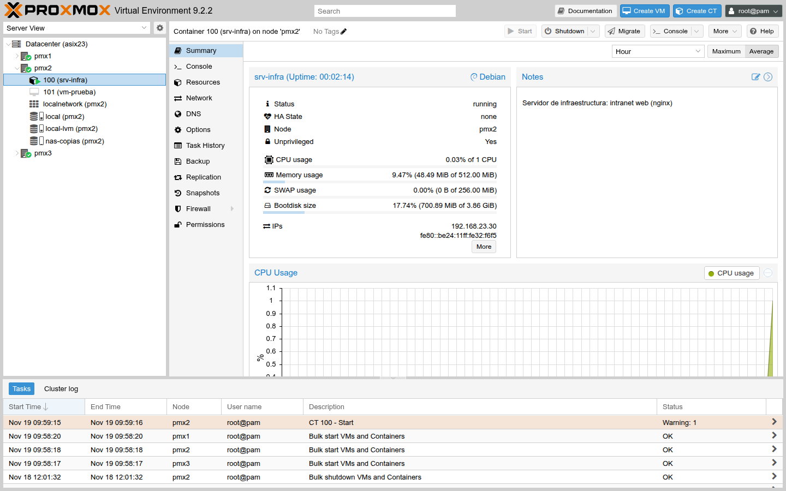

*Demuestra: el contenedor `srv-infra` (sin privilegios) está en marcha en el nodo pmx2 con la IP `192.168.23.30` y consume solo ~48 MB de los 512 MB de RAM asignados.*

**Cuándo usar cada uno:** contenedor para servicios Linux ligeros (web, DNS, proxy), porque caben más en el mismo nodo; VM cuando hace falta otro sistema operativo (Windows Server), un kernel propio o más aislamiento.

| | Contenedor (LXC) | Máquina virtual (KVM) |
|---|---|---|
| Qué virtualiza | Solo el sistema operativo (comparte el kernel) | Todo el hardware (kernel propio) |
| Sistemas | Solo Linux | Cualquiera |
| Consumo | Muy bajo (~48 MB de RAM en reposo) | Más alto |
| Aislamiento | Menor | Mayor |
| **Migración medida** | `pct migrate --restart`: **~84 s sin servicio**, copió los **4 GB** del disco | `qm migrate --online`: **12,7 s** en total y solo **8 ms** sin servicio |

**Espacio:** al migrar con discos locales se copia el disco entero bloque a bloque (el contenedor usaba 0,9 GB y se copiaron 4 GB; la VM de 2 GB vacía quedó 100 % ocupada en el destino). Se mejoraría con almacenamiento compartido (solo se copia la RAM) o con ZFS y replicación.

| Ventajas de virtualizar | Inconvenientes |
|---|---|
| Varios servidores en un equipo: menos hardware, luz y espacio | Punto único de fallo: si cae el host, caen sus VMs |
| Copias e instantáneas de máquinas enteras | Pequeño coste de rendimiento |
| Migrar servidores entre nodos | Unas VMs pueden frenar a otras (lo vimos con el disco) |

**Copias:** `vzdump` del contenedor (205 MB en 47 s) y de la VM al NFS del NAS, con una tarea programada diaria a las 02:30.

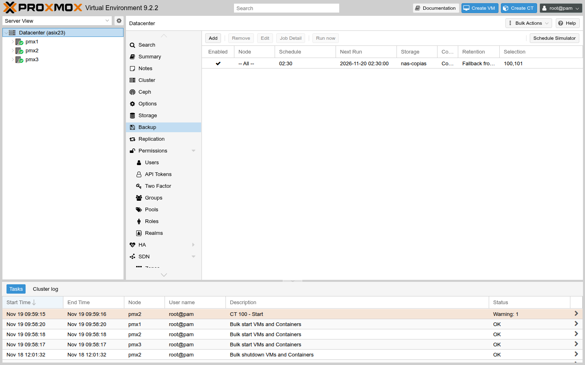

*Demuestra: hay una tarea de copia activa para todos los nodos, cada día a las 02:30, que guarda el contenedor 100 y la VM 101 en `nas-copias`.*

*Demuestra: las copias del contenedor (`.tar.zst`, 205 MB) y de la VM (`.vma.zst`) están en el NFS del TrueNAS y se pueden restaurar desde aquí.*

## 6. Windows Server 2025 · controlador de dominio `.20`

- Instalación desatendida, IP fija 192.168.23.20/24, gateway `.1` y DNS `127.0.0.1` (él mismo).
- Roles **AD DS + DNS**: dominio `asix23.lan` (NetBIOS `ASIX23`), una **OU por departamento** y reenviador DNS al gateway para los nombres de Internet.

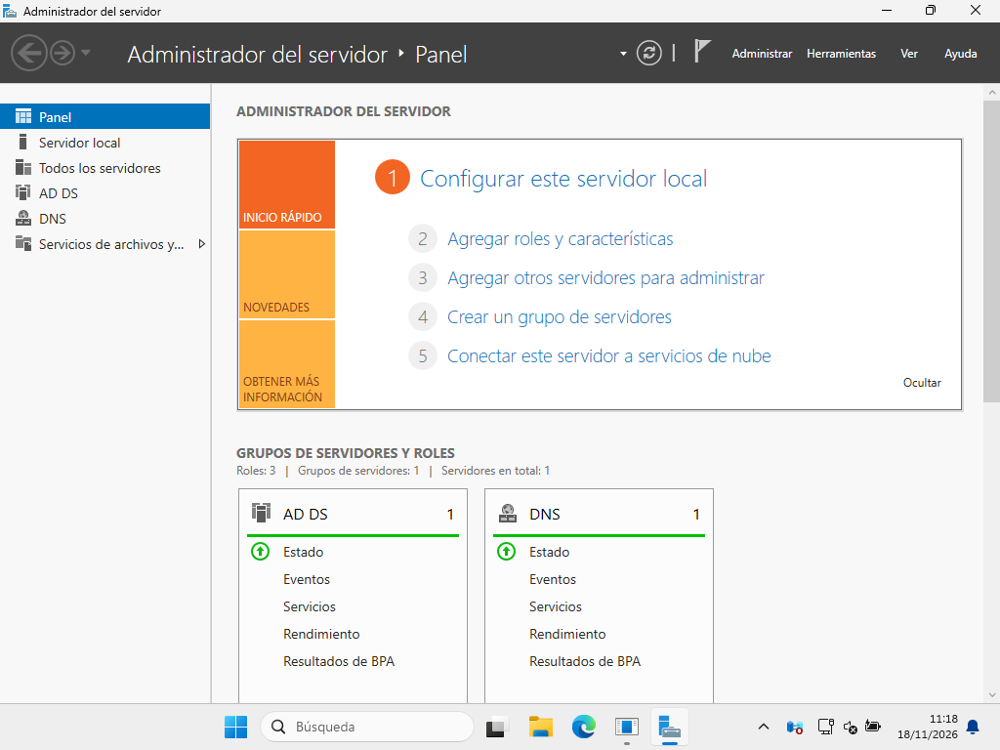

*Demuestra: el servidor tiene instalados los roles AD DS y DNS y los dos están en buen estado.*

*Demuestra: el dominio `asix23.lan` tiene una unidad organizativa por departamento (Administracion, Comercial, Direccion, Informatica y Produccion).*

*Demuestra: el cliente Windows 11 (`W11-CLI`) está unido al dominio y colocado en la OU de su departamento, Administracion.*

*Demuestra: la zona DNS `asix23.lan` está integrada en AD y tiene un registro A por cada equipo de LAN23 (routers, NAS, nodos Proxmox, intranet y clientes); el de `W11-CLI` se creó solo al unirse al dominio (tiene marca de tiempo).*

**¿Por qué `.lan` y no `.local`?** `.local` está reservado para mDNS (Bonjour/Avahi) y da conflictos con Linux y macOS.

**¿Qué es un dominio y qué aporta?** Un grupo de equipos y usuarios que comparten una base de datos central de cuentas (Active Directory). Con dominio hay **una sola cuenta por persona** válida en cualquier PC, las contraseñas se cambian una vez, las políticas (GPO) se aplican a todo un departamento y, si alguien se va, se deshabilita su cuenta y pierde el acceso a todo.

**Copia:** con `ntdsutil ifm` se hizo una copia coherente de la base de datos de AD (`ntds.dit`) y de SYSVOL con el DC en marcha: 4,9 MB guardados en el NAS. El sistema operativo no se copia porque se reinstala; lo valioso es AD.

## 7. Servidores Debian 13 (infraestructura) · SRV2 `.21` y SRV3 `.22`

- Instalación desatendida **sin escritorio** (arrancan con ~230 MB de RAM y tienen menos superficie de ataque), IP fija en LAN23, DNS al DC.
- **SRV2:** servidor de ficheros con Samba (recurso `compartida` sobre el RAID 1) y los RAID de la Tasca 6. **SRV3:** servidor web Apache con la intranet.
- **Copia:** el NAS se lleva cada noche `/etc` (red, `fstab`, RAID, Samba, Apache). El sistema se reinstala en ~15 min.

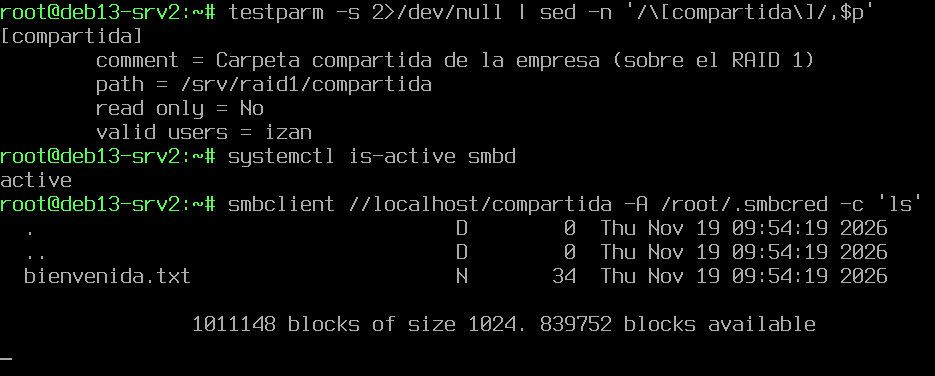

*Demuestra: el recurso `[compartida]` está definido, el servicio `smbd` está activo y un usuario autenticado puede listar los archivos de la carpeta.*

*Demuestra: Apache está activo, escucha en el puerto 80 y sirve la página de la intranet en 192.168.23.22.*

## 8. Clientes · W11-CLI `.51` y DEB13-CLI `.54`

| | W11-CLI (Administración) | DEB13-CLI (Informática) |
|---|---|---|
| Por qué este sistema | Programas de gestión y contabilidad para Windows; la edición **Pro** es necesaria para unirse a un dominio | Herramientas de administración (SSH, `tcpdump`, scripts), sin licencia |
| Red | IP fija, gateway `.1`, DNS `.20` (el DC) | IP fija con NetworkManager, gateway según la prueba |
| Dominio | ✓ Unido a `asix23.lan` en la OU Administracion | ✗ No: es el puesto de pruebas que cambia de gateway constantemente; unirlo no aporta nada a las pruebas |
| Copia | Los datos del usuario van al servidor; el sistema se reinstala | `/etc` y `/home` al NAS cuando se necesite |

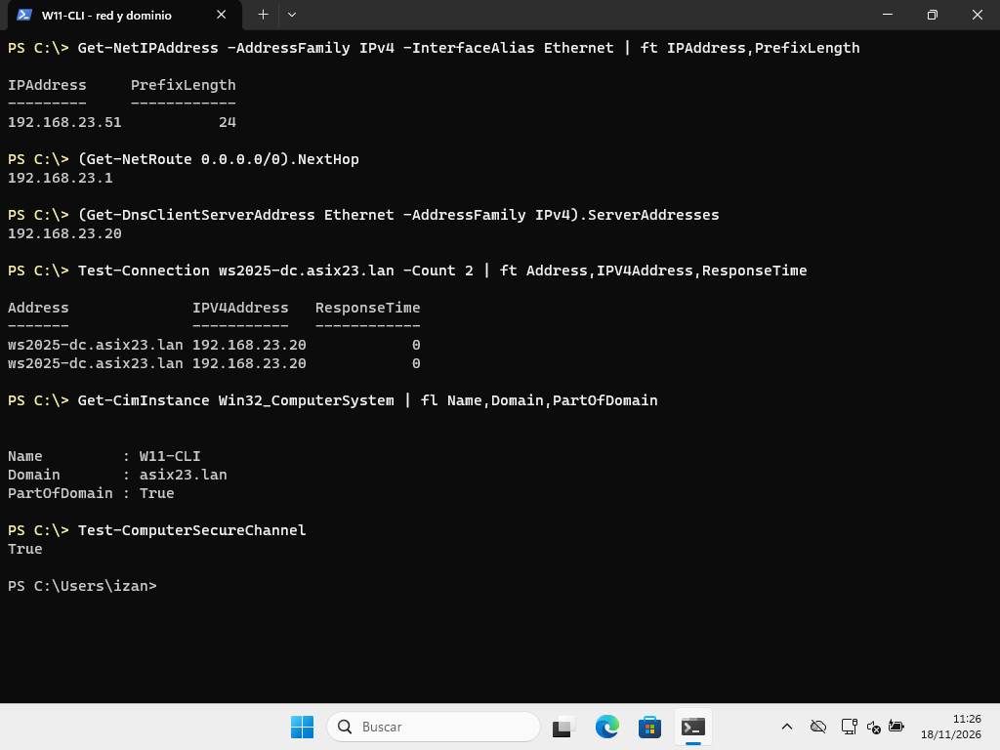

*Demuestra: IP fija 192.168.23.51/24, gateway .1 y DNS .20; el DC resuelve y responde; el equipo es miembro de `asix23.lan` (`PartOfDomain: True`) y su canal seguro con el DC funciona.*

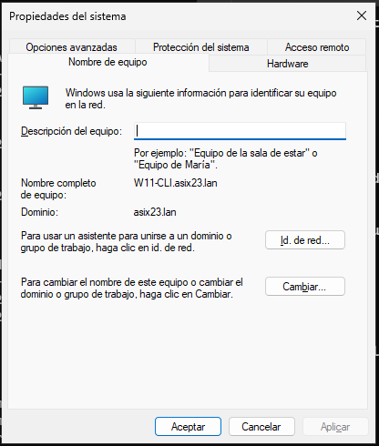

*Demuestra: en *Propiedades del sistema* el nombre completo del equipo es `W11-CLI.asix23.lan` y su dominio, `asix23.lan`.*

## 9. Actualizaciones y vías de recuperación

| Sistema | Cómo se actualiza | Vía de recuperación ante un cambio fallido |
|---|---|---|
| MikroTik | `/system package update` | Copia `.backup` en el propio router + `/export` en Git + copia en el NAS (**probada: 26 s**) |
| OPNsense | *System → Firmware → Updates* | *Configuration → History*: una versión de `config.xml` por cambio (**probada: 15 s**) |
| Debian | `apt update && apt full-upgrade` | Copia de `/etc` en el NAS y `nft -c -f` antes de aplicar reglas (**probada: 21 s**) |
| TrueNAS | *System → Update* (permite volver al entorno de arranque anterior) | Copia de su base de datos de configuración en el pool |
| Proxmox | `apt update && apt full-upgrade` con el repositorio `pve-no-subscription` | Copia de `/etc/pve` en el NAS; las VMs, con `vzdump` |
| Windows | Windows Update | Copia del AD (`ntdsutil ifm`) en el NAS |
| Todas | — | **Instantánea de VirtualBox antes de cualquier cambio importante** |

> **Pendiente:** las vías de recuperación están probadas provocando fallos (§3), pero falta dejar registrada la actualización de cada sistema con su salida y la comprobación posterior.

## 10. Incidencia provocada en una VM desechable

En un **clon enlazado** de DEB13-CLI (si algo sale mal se borra y el original no se toca) añadí a `/etc/fstab` un disco que no existe.

| Paso | Qué se hizo |
|---|---|
| **Síntoma** | Al reiniciar se queda en **modo de emergencia**: `Dependency failed for local-fs.target` |
| **Hipótesis** | Una línea de `fstab` apunta a un disco que no está y, sin `nofail`, systemd no deja seguir el arranque |
| **Comprobación** | `blkid` (discos que existen) frente a `grep datos /etc/fstab`: el UUID pedido no existe → hipótesis confirmada |
| **Solución** | Comentar la línea, `mount -a` y `findmnt --verify` sin errores |
| **Vuelta al estado normal** | Reinicio: arranca hasta la pantalla de inicio de sesión |

*Síntoma: el arranque espera 90 s al disco inexistente y entra en modo de emergencia.*

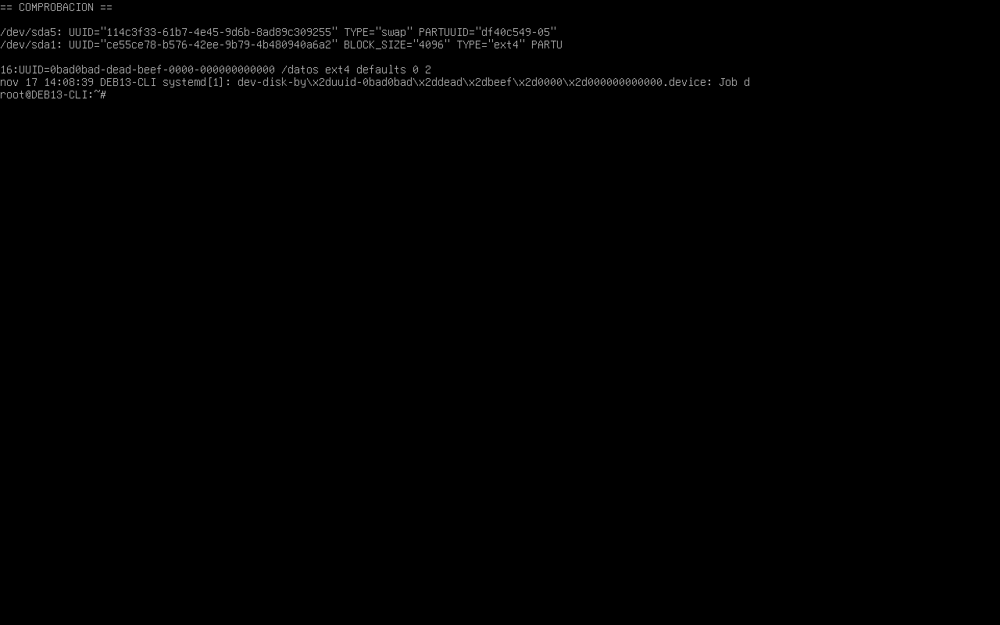

*Comprobación: `blkid` no muestra el UUID que pide la línea 16 de `fstab`.*

*Solución: con la línea comentada, `mount -a` y `findmnt --verify` terminan sin errores.*

**Cómo evitarlo:** comprobar con `mount -a` o `findmnt --verify` antes de reiniciar, y usar `nofail` en discos que no son imprescindibles.

## 11. Apte+: copias automáticas de las configuraciones

El NAS **recoge** (*pull*) cada noche a las 02:00 las configuraciones con el script `copia-configs.sh`, lanzado por una tarea cron. Los equipos **no guardan credenciales del NAS**: si alguien compromete un router, no puede entrar al NAS a borrar las copias.

| Equipo | Qué se copia | Cómo |
|---|---|---|
| MikroTik | `/export` + `/system backup` | SSH con clave |
| OPNsense | `config.xml` | API (HTTPS con clave) |
| Debian SRV | `/etc` + reglas `nft` | SSH + `sudo tar` (solo ese comando) |
| Proxmox | `/etc/pve`, red, corosync | SSH + `tar` |
| TrueNAS | Su base de datos de configuración | Copia local |

Cada copia va a una carpeta por equipo y fecha, se borran las de más de 14 días y, si un equipo está apagado, se anota un aviso y se sigue con los demás.

*Demuestra: la tarea programada ejecuta `copia-configs.sh` cada día a las 02:00 (`0 2 * * *`) con el usuario `izan` y está activada.*

*Demuestra: en `/mnt/copias/configs/` hay una carpeta por equipo con una subcarpeta por fecha, y el registro termina cada ejecución con `0 equipo(s) con error`.*

**¿Qué tiene sentido copiar y qué no?**

| Sí | No |
|---|---|
| Configuraciones: son pequeñas, cambian a menudo y cuesta mucho rehacerlas | El sistema operativo entero de un router o de Proxmox: se reinstala en minutos desde la ISO |
| La base de datos de AD y las VMs y contenedores con servicios | Cachés, temporales y logs antiguos |
| Datos de los usuarios | Copias de las copias en el mismo disco |

## Por qué lo he hecho así

- **¿Contenedor o VM?** El contenedor comparte el kernel del nodo: arranca en segundos y gasta poca RAM, pero solo ejecuta Linux. La VM tiene su propio kernel, aísla más y permite migración en caliente (8 ms frente a ~84 s).
- **¿Por qué las copias las recoge el NAS y no las envían los equipos?** Para que ningún equipo guarde credenciales del NAS: un atacante en un router no podría borrar las copias.

---

**Documentación completa, capturas, salidas de los comandos, configuraciones y scripts:** [https://github.com/ethan3232/iso-naix-un-sistema-individual](https://github.com/ethan3232/iso-naix-un-sistema-individual)
