# Tasca 5 · Instalación y comunicaciones

**Alumno:** izan · 1.º ASIX · Puesto 23 · Red `192.168.23.0/24` · Dominio `asix23.lan` · CIP FP Batoi · Curso 2026-2027

**Repositorio del proyecto:** [https://github.com/ethan3232/iso-naix-un-sistema-individual](https://github.com/ethan3232/iso-naix-un-sistema-individual) · **Esta tarea en GitHub:** [https://github.com/ethan3232/iso-naix-un-sistema-individual/blob/main/Proyecto-por-Tareas/Tasca-5-instalacion-y-comunicaciones.md](https://github.com/ethan3232/iso-naix-un-sistema-individual/blob/main/Proyecto-por-Tareas/Tasca-5-instalacion-y-comunicaciones.md)

**Módulos:** ISO-RA1, FDM-RA1 · **Estado:** ✓ Apte · ✓ Apte+

## Fet: subtareas del enunciado

> **Enunciado (part individual):** *«Cada alumne haurà de configurar en el seu entorn de prova els mateixos sistemes operatius que han fet a classe.»* · Apte+: *«Implementar un sistema per a realitzar còpies de la informació de configuració i/o configuracions importants dels diferents servidors crítics de la xarxa.»*

| # | Subtarea | Nivel | Fet | Dónde / nota |
|---|---|---|:---:|---|
| 1 | 5.1 Requisitos, licencia, recursos y origen de cada imagen; integridad SHA256 | Apte | ✓ | §1. OPNsense y Windows: el fabricante no publica el hash de la ISO (justificado) |
| 2 | 5.2 Firmware, orden de arranque, particionado y sistema de ficheros (UEFI, TPM) | Apte | ✓ | §2 |
| 3 | 5.3 Instalar y registrar las opciones, versión, dispositivos y software | Apte | ✓ | §2 |
| 4 | 5.4 Actualizar y comprobar el funcionamiento; vía de recuperación | Apte | ◐ | Vías de recuperación probadas en los 3 routers. **Falta registrar la actualización de cada sistema** |
| 5 | 5.5 Incidencia en una VM desechable (síntoma, hipótesis, comprobación, solución, retorno) | Apte | ✓ | §10 |
| 6 | Routers: usuario de administración y red WAN/LAN | Apte | ✓ | §3 |
| 7 | Routers: Internet para la LAN | Apte | ✓ | §3 |
| 8 | Routers: una conexión permitida, otra bloqueada e interpretación del registro | Apte | ✓ | §3, en los tres |
| 9 | Routers: copia en el NAS, fallo provocado y recuperación | Apte | ✓ | §3: 26 s, 15 s y 21 s |
| 10 | TrueNAS: usuarios, red, instalación y disco adicional para copias | Apte | ✓ | §4 |
| 11 | Proxmox: usuario, red y clúster | Apte | ✓ | §5 |
| 12 | Proxmox: crear los servidores virtualizados | Apte | ◐ | `srv-infra` (LXC) y una VM dentro del clúster; DC, SRV2 y SRV3 en VirtualBox por falta de RAM |
| 13 | Proxmox: ventajas e inconvenientes; contenedor frente a VM | Apte | ✓ | §5 |
| 14 | Proxmox: migración de un contenedor y de una VM (tiempo, espacio, mejoras) | Apte | ✓ | §5: ~84 s y 8 ms |
| 15 | Proxmox: copias al NAS; qué tiene sentido guardar | Apte | ✓ | §5 |
| 16 | Windows Server: usuarios, red, qué es un dominio y qué aporta, copias | Apte | ✓ | §6 |
| 17 | Servidores Linux: usuario, red, servicio y copia | Apte | ✓ | §7 |
| 18 | Clientes: usuario, red y dominio (si se justifica) | Apte | ✓ | §8: W11 unido; Debian sin unir, justificado |
| 19 | Clientes: copia de la configuración o del sistema | Apte | ◐ | Explicado qué se copia; no hay registro de una copia hecha de los clientes |
| 20 | Copias automáticas de las configuraciones de los servidores críticos | Apte+ | ✓ | §11 |

**Resumen:** 17 de 20 subtareas completas.

**Leyenda:** ✓ Fet · ◐ Fet en parte (se explica en la nota) · ⏳ Pendiente de fecha

## 1. Sistemas, licencias e imágenes (SHA256)

Todas las imágenes se descargaron de la web oficial del fabricante y se comprobó su SHA256 con `sha256sum` contra el valor publicado.

| Función | Sistema y versión | Licencia | SHA256 |
|---|---|---|---|
| Comunicaciones (principal) | MikroTik RouterOS 7.24.5 (x86) | Propietaria; x86 sin clave = demo de 24 h | ✓ coincide |
| Comunicaciones (alternativo) | OPNsense 26.7 | BSD 2-Clause (libre) | N/C ¹ |
| Comunicaciones (alternativo) | Debian 13.1 + nftables | Libre (DFSG) | ✓ coincide |
| NAS | TrueNAS SCALE 25.10.7 | Libre (GPL) | ✓ coincide |
| Virtualización | Proxmox VE 9.2-1 | AGPLv3; suscripción opcional | ✓ coincide |
| Dominio | Windows Server 2025 Standard (evaluación) | Propietaria; 180 días | N/C ² |
| Clientes | Windows 11 Pro 25H2 · Debian 13.1 | Propietaria · Libre | N/C ² · ✓ |

¹ OPNsense publica el hash del archivo comprimido (`.iso.bz2`), no de la ISO. ² Microsoft no publica un fichero de sumas; se guarda el hash calculado para comprobar en el futuro que la imagen no ha cambiado.

**¿Por qué verificar el SHA256?** Si cambia un solo bit de la ISO (descarga corrupta o imagen manipulada), la huella sale totalmente distinta. Coincidir con la del fabricante demuestra que la imagen es íntegra y auténtica.

## 2. Instalación: requisitos, firmware, particionado y opciones

| Sistema | Requisito oficial → asignado | Firmware | Disco y sistema de ficheros | Instalación |
|---|---|---|---|---|
| MikroTik RouterOS 7.24.5 | Muy poca RAM → **512 MB** (usa ~200 MB; bajado de 4 GB) | BIOS | Disco único, formato propio de RouterOS | Instalador de la ISO; `admin` obliga a cambiar la contraseña |
| OPNsense 26.7 | 2 GB recomendados (el instalador pide 3) → **2 GB** | BIOS | 20 GB · **UFS** | Modo *live* → *Install (UFS)* → se quita la ISO |
| Debian 13.1 (router y servidores) | 1 GB → 1 GB (servidores) | BIOS | ext4 + swap (particionado guiado) | Instalación **desatendida** de VirtualBox; servidores **sin escritorio** |
| TrueNAS SCALE 25.10.7 | **8 GB** → 4 GB (suficiente para unos MB de copias) | BIOS | Sistema en `sda` (ZFS `boot-pool`); datos **siempre en otros discos** | Ya instalado; se quitó la ISO del orden de arranque (incidencia 1) |
| Proxmox VE 9.2-1 | 64 bits con VT-x → virtualización **anidada** activada | BIOS | `/dev/sda` · **ext4 + LVM-thin** (un disco: ZFS no aporta redundancia y gasta RAM) | Instalador *Terminal UI*, IP fija; repositorio `pve-no-subscription` |
| Windows Server 2025 | 2 GB y 32 GB, UEFI + TPM recomendados → 4 GB · 50 GB | **UEFI + TPM 2.0** | GPT · NTFS | Desatendida, edición *Standard (experiencia de escritorio)* |
| Windows 11 Pro 25H2 | **4 GB, 64 GB, UEFI + Secure Boot, TPM 2.0** → justo el mínimo | **UEFI + TPM 2.0** | GPT · NTFS | Desatendida (imagen 6 = Pro, necesaria para el dominio) |

**¿Por qué UEFI + TPM solo en Windows?** Windows 11 lo exige y en Server 2025 es lo recomendado (arranque seguro, BitLocker). El resto funciona igual con BIOS, que es lo más sencillo en VirtualBox.

**Orden de arranque:** durante la instalación arranca primero el DVD. Después se **quita la ISO** y se deja solo el disco: si no, la VM vuelve a arrancar el instalador (incidencias 1 y 17).

**Problemas de instalación resueltos:** Windows esperando una tecla para arrancar el DVD en UEFI (incidencia 6), el instalador de Windows 11 parado en la clave de producto (7) y la instalación desatendida de Debian colgada por arrancar desde el disco a medio instalar (17).

## 3. Servidores de comunicaciones

| | MikroTik `.1` | OPNsense `.2` | Debian nftables `.3` |
|---|---|---|---|
| Administración | Usuario `izan` (grupo `full`), SSH con clave; Telnet, FTP y API desactivados | `root` (obligatorio) por la web, solo desde la LAN | `izan` en `sudo`, SSH con clave |
| WAN / LAN | `ether1` DHCP (NAT de VirtualBox) / `ether2` 192.168.23.1 | `em0` DHCP / `em1` 192.168.23.2 | `enp0s3` DHCP / `enp0s8` 192.168.23.3 |
| Internet a la LAN | NAT *masquerade* + DNS con reenvío | NAT automático + Unbound | `ip_forward=1` + `masquerade` |
| Permitido | HTTPS → `HTTP/2 200` | HTTPS → `HTTP/2 200` | HTTPS → `HTTP/2 200` |
| Bloqueado y registrado | Telnet (TCP 23) | Telnet (TCP 23) | Telnet (TCP 23) |
| Copia | `/export` + `/system backup` → NAS | `config.xml` → NAS | `/etc` + reglas → NAS |
| Fallo provocado | Borrar la IP de la LAN y el NAT | Desactivar las reglas de salida | `nftables.conf` roto + reinicio |
| **Recuperación** | **26 s**, 0 pérdida | **15 s**, 0 pérdida | **21 s**, 0 pérdida |

**¿Por qué *masquerade*?** La WAN recibe la IP por DHCP y *masquerade* usa siempre la IP actual de la interfaz; con `src-nat` habría que cambiar la regla cada vez que cambiara la IP.

**Orden de las reglas:** en los tres routers la regla que bloquea Telnet va **antes** que la que permite HTTPS y que la salida general, porque se aplica la primera regla que coincide.

### MikroTik RouterOS

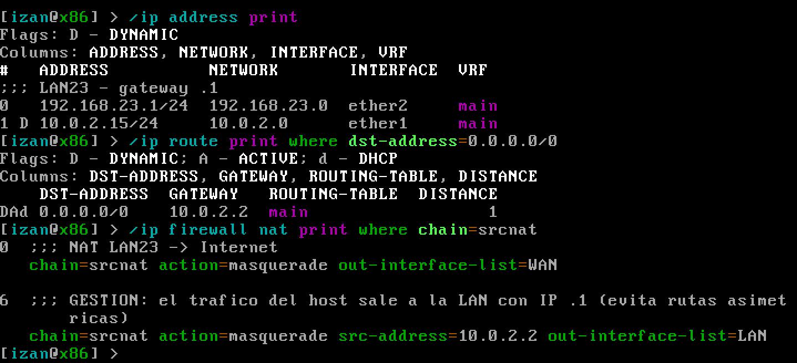

*Demuestra: `ether1` (WAN) tiene IP por DHCP (10.0.2.15), `ether2` (LAN) tiene 192.168.23.1/24, la ruta por defecto sale por 10.0.2.2 y existe la regla de NAT *masquerade* de LAN23 hacia Internet.*

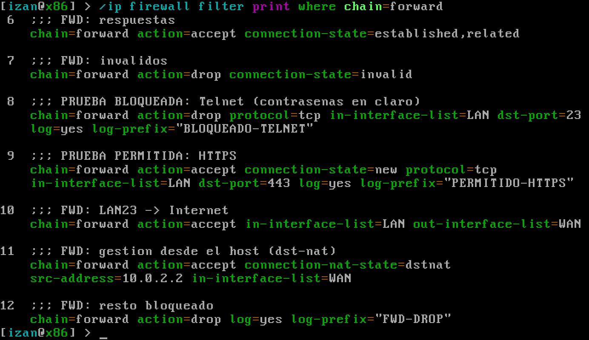

*Demuestra: en el tráfico que atraviesa el router, el bloqueo de Telnet (regla 8) va antes que el permiso de HTTPS (9) y que la salida general LAN → Internet (10); al final, todo lo demás se descarta y se registra (`FWD-DROP`).*


*Demuestra: el cortafuegos registra una sola vez la conexión HTTPS permitida (`PERMITIDO-HTTPS`) y varias veces el mismo intento de Telnet bloqueado (`BLOQUEADO-TELNET`).*

**Interpretación del registro:** la conexión HTTPS aparece **una vez** porque solo se registra el primer paquete (`connection-state:new`); el resto de la conexión pasa como *established*. Telnet aparece **una vez por segundo con el mismo puerto de origen**: son los reintentos del SYN del cliente, que nunca recibe respuesta.

**Fallo y recuperación:** se borraron la IP de la LAN y el NAT (toda la empresa sin gateway). Se recuperó con `/system backup load name=copia-nas.backup` en **26 s** sin servicio. En el primer intento la copia estaba solo en el NAS y **no se podía alcanzar**, porque al NAS se llega a través del propio MikroTik. Lección: la copia tiene que poder alcanzarse sin el equipo que ha fallado. Ahora hay tres copias: en el router, en el NAS y el `/export` en Git.

#### Configuración aplicada y cortafuegos

Archivo completo y comentado: [`configs/mikrotik/mikrotik-base.rsc`](https://github.com/ethan3232/iso-naix-un-sistema-individual/blob/main/configs/mikrotik/mikrotik-base.rsc). Exportación real del router: [`configs/mikrotik/mikrotik-export.rsc`](https://github.com/ethan3232/iso-naix-un-sistema-individual/blob/main/configs/mikrotik/mikrotik-export.rsc).

Resumen:

```routeros
/ip dhcp-client add interface=ether1 comment=WAN
/ip address add address=192.168.23.1/24 interface=ether2
/ip dns set allow-remote-requests=yes servers=1.1.1.1,9.9.9.9
/ip firewall nat add chain=srcnat out-interface-list=WAN action=masquerade
```

##### ¿Por qué *masquerade*?
La LAN usa IPs privadas (192.168.23.x) que no se pueden enrutar en Internet. El NAT cambia la IP de origen de los paquetes por la IP de la WAN del router. Usamos `masquerade` (y no `src-nat` con IP fija) porque la WAN recibe la IP **por DHCP** y podría cambiar.

##### Cortafuegos

| Cadena | Regla | Para qué |
|---|---|---|
| input | aceptar `established,related` | Dejar pasar las respuestas de lo que el router pide |
| input | descartar `invalid` | Paquetes rotos o sin conexión conocida |
| input | aceptar ICMP | Poder hacer ping al router |
| input | aceptar desde lista `LAN` | Gestión desde LAN23 |
| input | aceptar TCP 22/80/8291 desde 10.0.2.2 | Gestión desde el PC anfitrión (NAT) |
| input | **descartar el resto + log `IN-DROP`** | El router no se expone a Internet |
| forward | aceptar `established,related` / descartar `invalid` | Igual que arriba, para el tráfico que lo atraviesa |
| forward | **descartar TCP 23 + log `BLOQUEADO-TELNET`** | **Prueba de conexión bloqueada**: Telnet envía usuario y contraseña en claro |
| forward | **aceptar TCP 443 nuevo + log `PERMITIDO-HTTPS`** | **Prueba de conexión permitida** |
| forward | aceptar LAN → WAN | La LAN navega |
| forward | descartar el resto + log `FWD-DROP` | Política por defecto: lo que no se permite, se bloquea |

El orden importa: RouterOS evalúa las reglas de arriba abajo y aplica la primera que coincide. Por eso la regla que bloquea Telnet está **antes** de la que permite todo LAN → WAN.

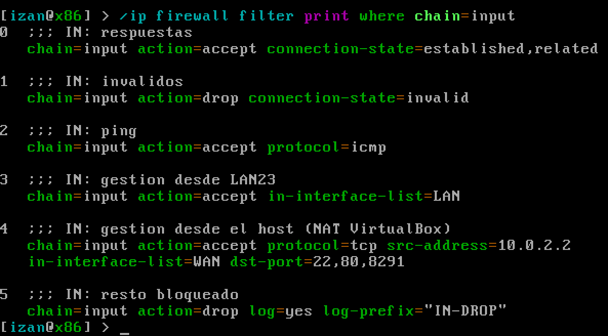

*Demuestra: el router solo acepta respuestas, ping y gestión desde LAN23 o desde el PC (puertos 22, 80 y 8291); todo lo demás que va dirigido a él se descarta y se registra con el prefijo `IN-DROP`.*

#### Copia de seguridad y vuelta atrás

| Copia | Cómo | Para qué |
|---|---|---|
| `00-estado-inicial.backup` | `/system backup save` antes de configurar | Volver al estado de fábrica: `/system backup load name=00-estado-inicial` |
| `mikrotik-export.rsc` | `/export terse` | Configuración en texto, legible y versionada en Git |
| `copia-nas.backup` + `/export`, copiados al **TrueNAS** | El NAS los recoge por SSH/SCP con `copia-configs.sh` y los guarda en `/mnt/copias/configs/mikrotik/<fecha>/` ([truenas §6](https://github.com/ethan3232/iso-naix-un-sistema-individual/blob/main/docs/06-installacio/truenas.md)) | Copia **fuera** del propio equipo: si el router se pierde, la copia sigue en el NAS |

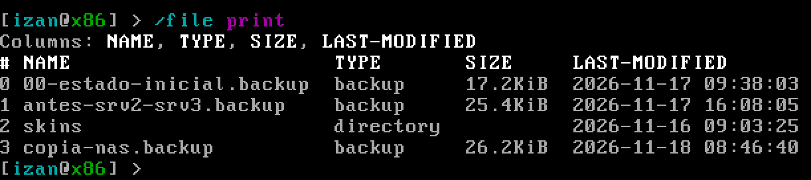

*Demuestra: en el router están la copia del estado inicial, la de antes de añadir SRV2/SRV3 y `copia-nas.backup`, que es la que recoge el NAS.*

**Diferencia entre `/export` y `/system backup`**: el *export* es texto (se puede leer, comparar y aplicar en otro router) pero no incluye contraseñas; el *backup* es binario, incluye usuarios y contraseñas, y solo se restaura en el mismo modelo de equipo.

### OPNsense


*Demuestra: OPNsense 26.7 funcionando, con la WAN (10.0.2.15/24, por DHCP) y la LAN (192.168.23.2/24) activas, la puerta de enlace `WAN_DHCP` (10.0.2.2) en línea y los servicios en verde.*


*Demuestra: en la interfaz LAN la regla que bloquea Telnet (puerto 23) está la primera, antes que la que permite HTTPS (443) y que las reglas por defecto que dejan salir a la LAN.*

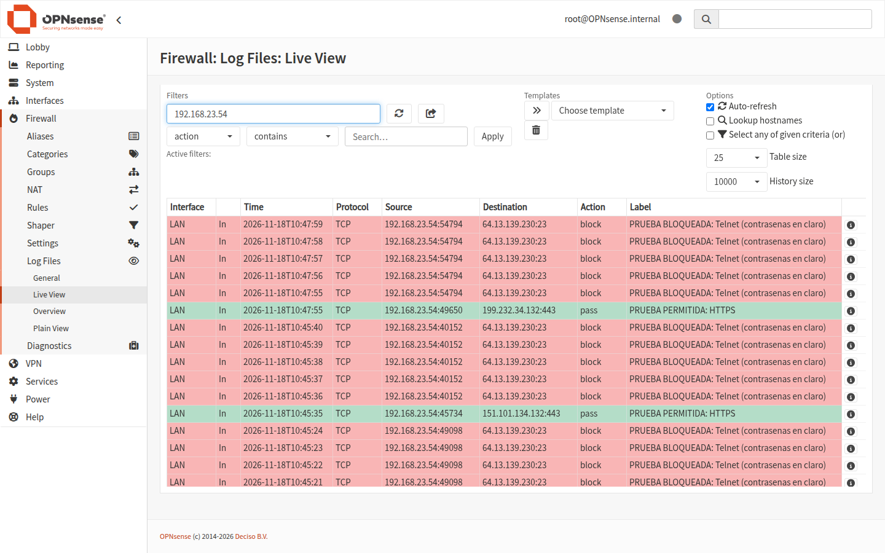

*Demuestra: en Firewall → Log Files → Live View, filtrado por el cliente 192.168.23.54, la conexión HTTPS sale en verde (`pass`) y los intentos de Telnet en rojo (`block`).*

**Fallo y recuperación:** se desactivaron las reglas que dejan salir a la LAN (solo quedaba la denegación por defecto). Se recuperó desde *System → Configuration → History*, que guarda una versión de `config.xml` por cada cambio: **15 s** sin Internet en el cliente.

#### Instalación

1. Arranque de la ISO en modo *live* → login `installer` / `opnsense`.
2. Teclado US · **Install (UFS)** · disco `ada0` (20 GB) · contraseña de root `********` · *Complete Install* → *Halt*.
3. Se quita la ISO y se arranca desde el disco (`/dev/gpt/rootfs`).

**¿Por qué UFS y no ZFS?** Con un solo disco virtual, ZFS no da redundancia y usa más RAM (tenemos 2 GB). UFS es el sistema de ficheros clásico de FreeBSD, ligero y suficiente para un cortafuegos.

#### Internet para la LAN

- **NAT de salida automático**: OPNsense crea solo el NAT (*masquerade*) de la LAN hacia la WAN.
- **DNS**: Unbound, en **modo reenvío** (*forwarding*) hacia el DNS que da el DHCP de la WAN. En modo recursivo no resolvía nada, porque desde la red del aula no se llega a los servidores raíz ([incidencia 15](https://github.com/ethan3232/iso-naix-un-sistema-individual/blob/main/docs/10-incidencies.md)).

#### Verificación ([log completo](https://github.com/ethan3232/iso-naix-un-sistema-individual/blob/main/evidencies/logs/prueba-gw-opnsense.txt))

Cliente `DEB13-CLI` con gateway .2 (`scripts/canvi-gw.sh 2`):

| Prueba | Resultado |
|---|---|
| `ip route` | `default via 192.168.23.2` |
| `traceroute -T -p 443 deb.debian.org` | salto 1 = **192.168.23.2**, salto 2 = 10.0.2.2 |
| `curl -sI https://deb.debian.org` | `HTTP/2 200` → **permitida** |
| `nc -zv telehack.com 23` | *timed out* → **bloqueada** |

Cómo se lee una línea del registro de pf:

```
a1f994e5-...,em1,match,block,in,4,...,tcp,60,192.168.23.54,64.13.139.230,42384,23
   regla      intf        acción dir IPv4   proto      origen          destino    puertos
```

#### Copia de seguridad y vuelta atrás

| Copia | Dónde | Cómo volver |
|---|---|---|
| `00-config-inicial.xml` | `~/iso-lab/backups/opnsense/` (fuera del repo: contiene el *hash* de root) | *System → Configuration → Backups → Restore* o menú de consola `13) Restore a backup` |
| `01-antes-de-reordenar.xml` | ídem | ídem |
| Copia en el NAS | `/mnt/copias/configs/opnsense/<fecha>/config.xml`: la descarga `copia-configs.sh` desde el NAS por la API de OPNsense (con una clave de API, no con la contraseña de root) | *System → Configuration → Backups → Restore* subiendo ese `config.xml` |

**¿Por qué el `config.xml` no se sube a Git?** Contiene los *hashes* de las contraseñas y certificados privados.

### Debian 13 con nftables


*Demuestra: el reenvío está activo (`ip_forward = 1`); la cadena `forward` tiene política `drop`, bloquea Telnet antes de permitir HTTPS y la salida LAN → Internet, y la tabla `nat` hace masquerade por la WAN.*

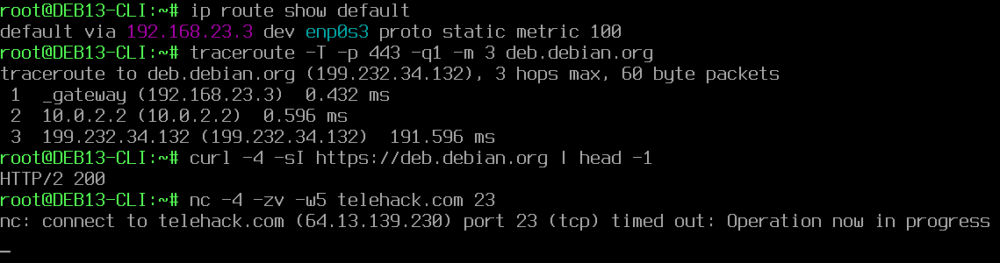

*Demuestra: en DEB13-CLI la ruta por defecto es 192.168.23.3, el primer salto del `traceroute` es el Debian, HTTPS responde `HTTP/2 200` y Telnet se queda sin respuesta (timed out).*

| Tabla / cadena | Política | Reglas importantes |
|---|---|---|
| `inet filtro` / input | **drop** | lo, established, ICMP, gestión desde LAN23, SSH solo desde el anfitrión; el resto se registra con `IN-DROP` |
| `inet filtro` / forward | **drop** | established; **Telnet → drop + log `BLOQUEADO-TELNET`**; **HTTPS nuevo → accept + log `PERMITIDO-HTTPS`**; LAN → WAN accept; el resto con `FWD-DROP` |
| `ip nat` / postrouting | accept | `oifname enp0s3 masquerade` |

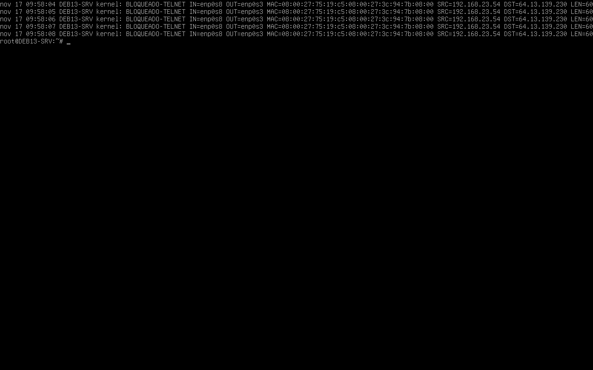

*Demuestra: nftables registra en el log del kernel cada conexión HTTPS permitida una sola vez (el primer paquete) y los intentos de Telnet bloqueados uno por segundo (los reintentos del cliente). La salida se ha filtrado para mostrar solo hora, prefijo, origen, destino y puerto.*

**Política `drop` por defecto:** todo lo que no se permite explícitamente se bloquea, así no hace falta conocer de antemano todos los ataques.

**Fallo y recuperación:** se dejó un error de sintaxis en `/etc/nftables.conf` y se reinició el servidor. Al arrancar, `nftables: failed` con **0 reglas** (sin filtro y sin NAT). `journalctl -u nftables` señaló la línea exacta; se recuperó el fichero de la copia del NAS, se comprobó con `nft -c -f` y se aplicó: **21 s** sin Internet (casi todo es el reinicio).

#### Red en VirtualBox

| Adaptador VBox | Interfaz Debian | Red | IP | Asignación |
|---|---|---|---|---|
| 1 | enp0s3 | NAT de VirtualBox | 10.0.2.15/24, gw 10.0.2.2 | DHCP |
| 2 | enp0s8 | Red interna `LAN23` | 192.168.23.3/24, **sin gateway** | Fija |

La red la gestiona **NetworkManager** (viene con GNOME). Se configuró con `nmcli`:

```bash
# Copia previa para poder volver atrás
tar czf /root/backups/00-red-inicial.tgz /etc/NetworkManager /etc/network

nmcli con add type ethernet ifname enp0s3 con-name WAN ipv4.method auto ipv6.method disabled
nmcli con mod "Wired connection 1" con-name LAN23 ipv4.method manual \
      ipv4.addresses 192.168.23.3/24 ipv4.never-default yes ipv6.method disabled
nmcli con up WAN; nmcli con up LAN23
```

**¿Por qué `ipv4.never-default yes` en la LAN?** Un equipo solo debe tener **una ruta por defecto**. Si la LAN también la tuviera, Debian podría intentar salir a Internet por la LAN (hacia sí mismo) en vez de por la WAN.

#### Activar el reenvío (`ip_forward`)

Por defecto Linux **no reenvía** paquetes entre interfaces (no es un router). Se activa de forma **persistente** en [`/etc/sysctl.d/99-router.conf`](https://github.com/ethan3232/iso-naix-un-sistema-individual/blob/main/configs/debian-srv/99-router.conf):

```
net.ipv4.ip_forward = 1
```

#### Interpretación del registro (`journalctl -k`)

```
DEB13-SRV kernel: PERMITIDO-HTTPS IN=enp0s8 OUT=enp0s3 SRC=192.168.23.54 DST=151.101.134.132 ... PROTO=TCP SPT=56232 DPT=443 ... SYN
DEB13-SRV kernel: BLOQUEADO-TELNET IN=enp0s8 OUT=enp0s3 SRC=192.168.23.54 DST=64.13.139.230 ... PROTO=TCP SPT=44890 DPT=23 ... SYN
```

| Campo | Significado |
|---|---|
| `IN=enp0s8 OUT=enp0s3` | Entra por la LAN y quiere salir por la WAN → cadena *forward* |
| `SRC=192.168.23.54` | El cliente DEB13-CLI |
| `DPT=443` / `DPT=23` | Puerto de destino: HTTPS (permitido) / Telnet (bloqueado) |
| `TTL=63` | Era 64 en el cliente; el router lo ha restado al reenviarlo |
| `SYN` | Primer paquete de la conexión TCP |

#### Copia de seguridad y vuelta atrás

| Copia | Dónde | Cómo volver |
|---|---|---|
| Red original | `/root/backups/00-red-inicial.tgz` | `tar xzf ... -C /` y `systemctl restart NetworkManager` |
| nftables original | `/root/backups/nftables.conf.orig` | `cp` a `/etc/nftables.conf` + `nft -f /etc/nftables.conf` |
| Configuración en Git | `configs/debian-srv/` | Copiar de nuevo con `scp` |
| Copia de `/etc` y de las reglas en TrueNAS | `/mnt/copias/configs/debian-srv/<fecha>/`: la recoge `copia-configs.sh` desde el NAS por SSH (solo puede ejecutar `sudo tar`) | Descomprimir el `.tgz` en `/` y `nft -f /etc/nftables.conf` |

Si una regla deja sin acceso por SSH: la **consola de VirtualBox** no depende de la red → `sudo nft flush ruleset` deja pasar todo.

## 4. TrueNAS SCALE · NAS `.10`

- Administración por la web con `truenas_admin` (TrueNAS 25 ya no deja entrar como `root`) y el usuario `izan` (administrador, con clave SSH para las copias). IP fija 192.168.23.10/24 en LAN23.
- **Disco adicional para copias:** dos discos de 20 GB en **espejo ZFS** (pool `copias`), con dos datasets: `configs` (configuraciones) y `sistemas` (copias de Proxmox, compartido por NFS).

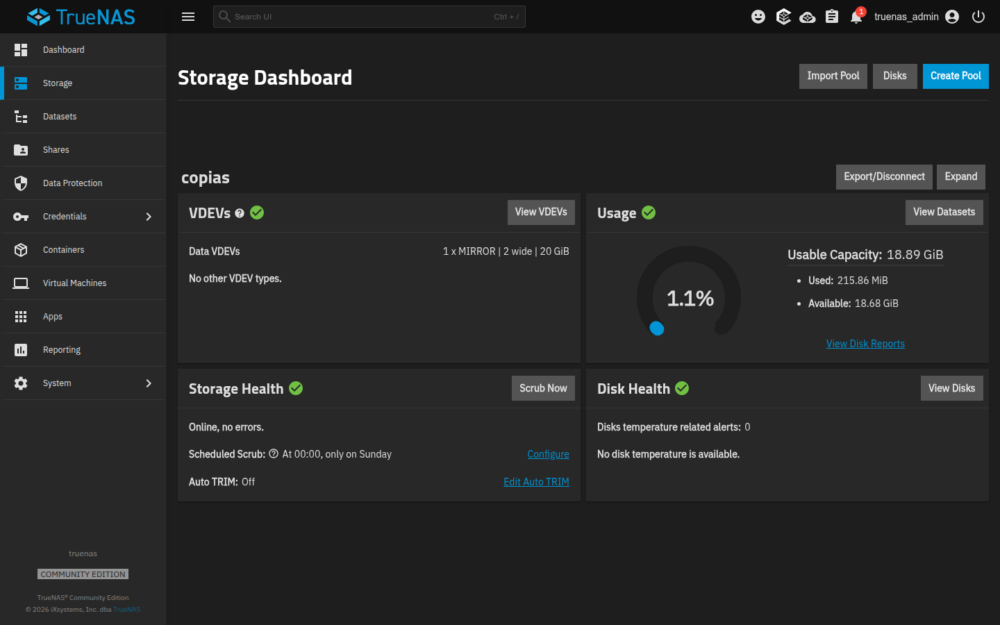

*Demuestra: el pool `copias` es un espejo de 2 discos con 18,89 GiB útiles, sano (`Online, no errors`) y con una comprobación (scrub) programada cada domingo.*

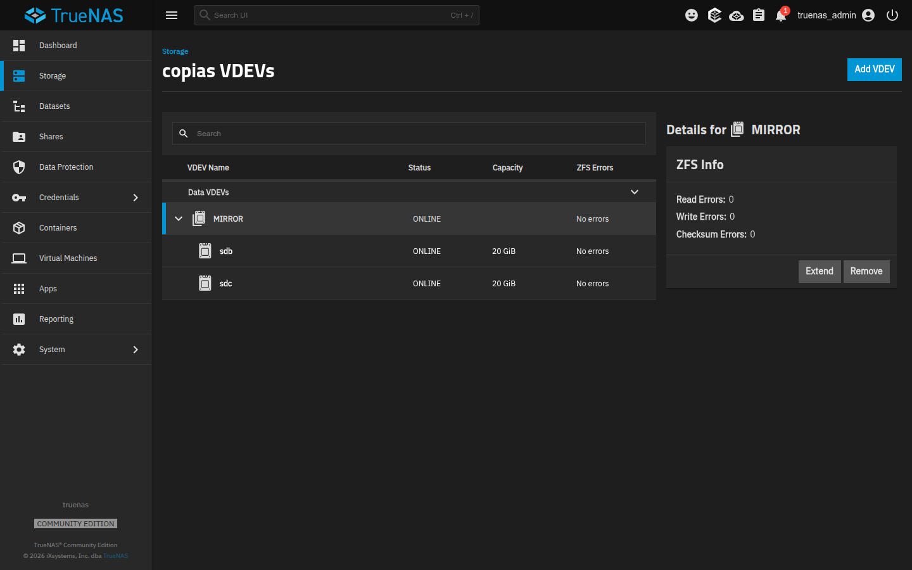

*Demuestra: el espejo está formado por los discos adicionales `sdb` y `sdc` (20 GiB cada uno), los dos `ONLINE` y sin errores de lectura, escritura ni de suma de comprobación.*

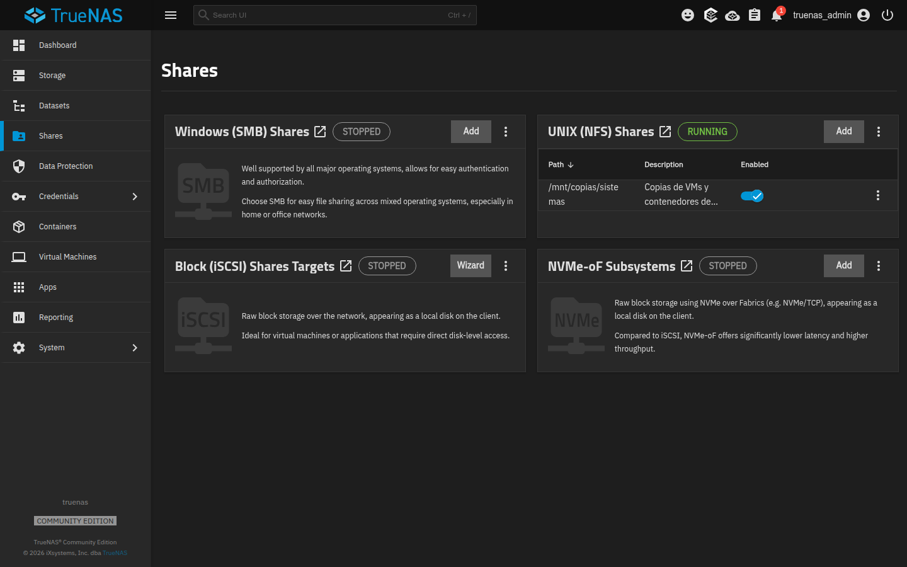

*Demuestra: el servicio NFS está en marcha y comparte `/mnt/copias/sistemas` para las copias de las VMs y contenedores de Proxmox (`nas-copias`).*

**¿Por qué espejo?** Si se rompe un disco del NAS, las copias siguen en el otro. ZFS además comprueba cada bloque con una suma de verificación y el *scrub* semanal detecta datos dañados antes de que hagan falta.

### Red

Configurada desde el **menú de consola** de TrueNAS:

1. `1) Configure network interfaces` → `enp0s3` → `ipv4_dhcp: No` → `aliases: 192.168.23.10/24` → *Save* → `a` (aplicar) → comprobación con ping desde MikroTik → `p` (**persistir**).
2. `2) Configure network settings` → `domain: asix23.lan` · `ipv4gateway: 192.168.23.1` · `nameserver1: 192.168.23.1`.

> **Vuelta atrás automática**: al aplicar un cambio de red TrueNAS da **60 segundos** para confirmarlo. Si no se confirma (porque nos hemos quedado sin red), vuelve solo a la configuración anterior. Es exactamente la idea de "preparar cómo volver al estado anterior" que pide el enunciado.

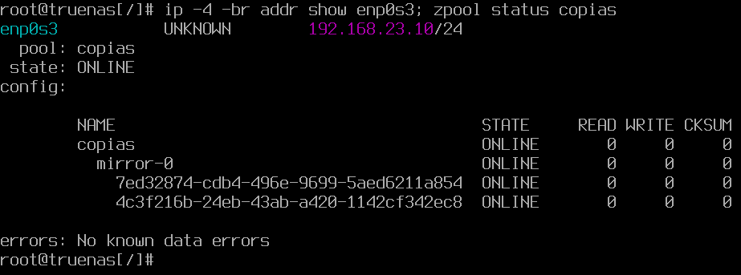

*Demuestra: la interfaz `enp0s3` tiene la IP fija 192.168.23.10/24 de LAN23 y el pool `copias` está `ONLINE` en espejo (`mirror-0`) con los dos discos sin errores.*

Zona horaria cambiada a `Europe/Madrid` (venía en la de EE. UU. y las copias salían con la hora mal).

### Disco adicional para las copias: pool `copias` en espejo

| Elemento | Valor | Por qué |
|---|---|---|
| Pool | `copias` | Agrupa los discos de datos |
| Disposición | **MIRROR** (espejo, equivalente a RAID 1) con `sdb` + `sdc` | Si falla un disco, las copias siguen disponibles en el otro |
| Capacidad útil | ~19 GB de 40 GB brutos | El espejo "gasta" la mitad en redundancia |
| Datasets | `copias/configs` (configuraciones) · `copias/sistemas` (imágenes de sistemas) | Separar por tipo permite cuotas, permisos e instantáneas distintas |
| Compresión | LZ4 | Casi gratis en CPU y los ficheros de texto se comprimen mucho |

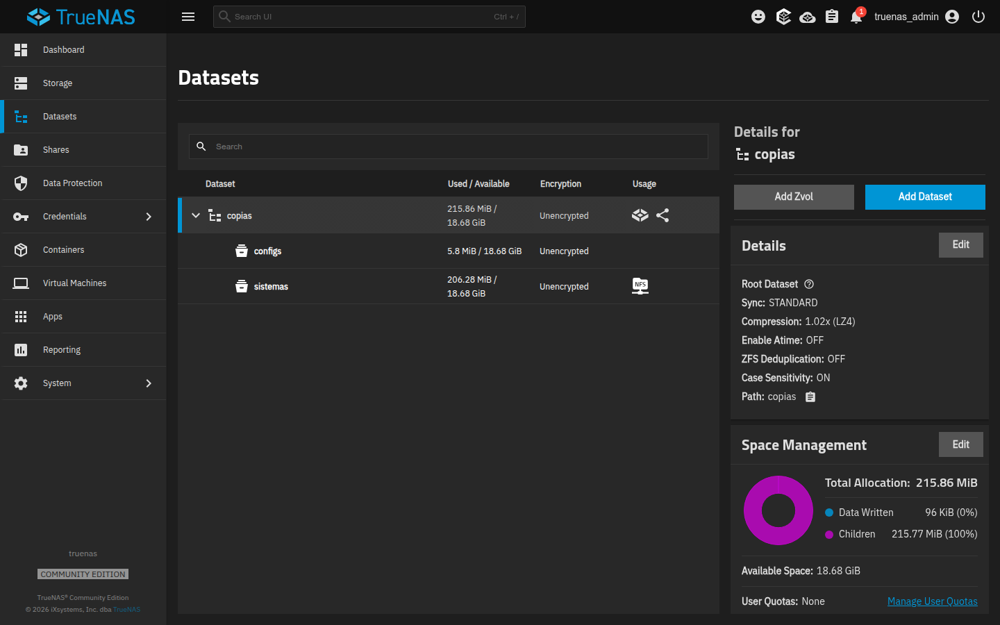

*Demuestra: dentro del pool hay dos datasets separados, `configs` (configuraciones) y `sistemas` (imágenes de VMs, compartido por NFS), con compresión LZ4.*

Estado del pool ([log completo](https://github.com/ethan3232/iso-naix-un-sistema-individual/blob/main/evidencies/logs/truenas-estado.txt)):

```
  pool: copias
 state: ONLINE
	NAME          STATE     READ WRITE CKSUM
	copias        ONLINE       0     0     0
	  mirror-0    ONLINE       0     0     0
	    <disco 1> ONLINE       0     0     0
	    <disco 2> ONLINE       0     0     0
errors: No known data errors
```

## 5. Proxmox VE · clúster `asix23` (`.11`, `.12`, `.13`)

- **Clúster de 3 nodos** (`pvecm create` + `pvecm add`). Se probó apagando un nodo: con 2 de 3 votos sigue habiendo **quórum** y todo funciona.
- **Servidores:** contenedor LXC `srv-infra` (`.30`, intranet con nginx) y una VM KVM de prueba para las migraciones.
- **Almacenamiento:** `local` y `local-lvm` en cada nodo, y `nas-copias` (NFS del TrueNAS) compartido para las copias.

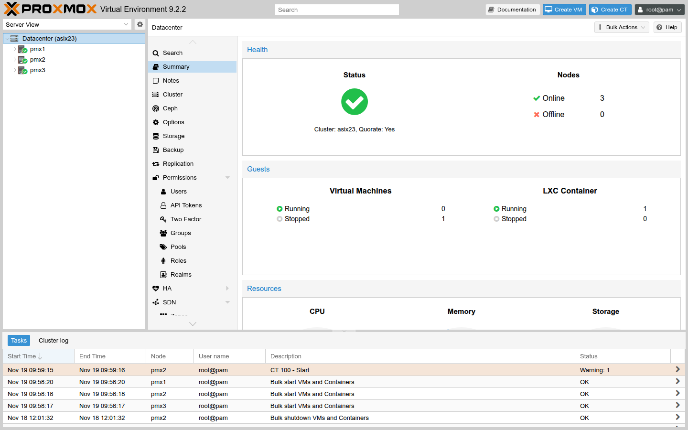

*Demuestra: el clúster `asix23` tiene quórum (`Quorate: Yes`) con los 3 nodos en línea; el contenedor está en marcha y la VM de prueba, parada.*

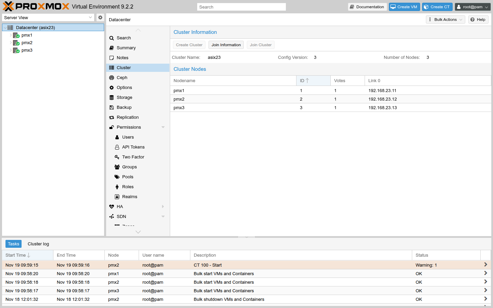

*Demuestra: los 3 nodos (pmx1, pmx2 y pmx3) forman parte del clúster, cada uno con 1 voto y su enlace de corosync en la red LAN23.*


*Demuestra: el contenedor `srv-infra` (sin privilegios) está en marcha en el nodo pmx2 con la IP `192.168.23.30` y consume solo ~48 MB de los 512 MB de RAM asignados.*

**Cuándo usar cada uno:** contenedor para servicios Linux ligeros (web, DNS, proxy), porque caben más en el mismo nodo; VM cuando hace falta otro sistema operativo (Windows Server), un kernel propio o más aislamiento.

| | Contenedor (LXC) | Máquina virtual (KVM) |
|---|---|---|
| Qué virtualiza | Solo el sistema operativo (comparte el kernel) | Todo el hardware (kernel propio) |
| Sistemas | Solo Linux | Cualquiera |
| Consumo | Muy bajo (~48 MB de RAM en reposo) | Más alto |
| Aislamiento | Menor | Mayor |
| **Migración medida** | `pct migrate --restart`: **~84 s sin servicio**, copió los **4 GB** del disco | `qm migrate --online`: **12,7 s** en total y solo **8 ms** sin servicio |

**Espacio:** al migrar con discos locales se copia el disco entero bloque a bloque (el contenedor usaba 0,9 GB y se copiaron 4 GB; la VM de 2 GB vacía quedó 100 % ocupada en el destino). Se mejoraría con almacenamiento compartido (solo se copia la RAM) o con ZFS y replicación.

| Ventajas de virtualizar | Inconvenientes |
|---|---|
| Varios servidores en un equipo: menos hardware, luz y espacio | Punto único de fallo: si cae el host, caen sus VMs |
| Copias e instantáneas de máquinas enteras | Pequeño coste de rendimiento |
| Migrar servidores entre nodos | Unas VMs pueden frenar a otras (lo vimos con el disco) |

**Copias:** `vzdump` del contenedor (205 MB en 47 s) y de la VM al NFS del NAS, con una tarea programada diaria a las 02:30.


*Demuestra: hay una tarea de copia activa para todos los nodos, cada día a las 02:30, que guarda el contenedor 100 y la VM 101 en `nas-copias`.*

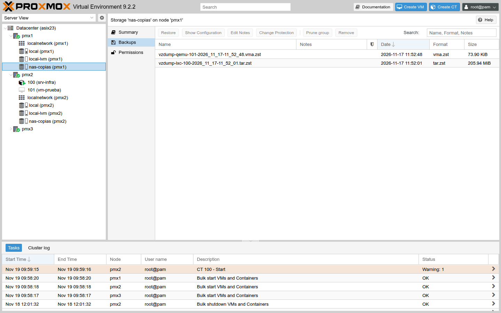

*Demuestra: las copias del contenedor (`.tar.zst`, 205 MB) y de la VM (`.vma.zst`) están en el NFS del TrueNAS y se pueden restaurar desde aquí.*

### Clúster

```bash
# en PMX1
pvecm create asix23
# en PMX2 y en PMX3
pvecm add 192.168.23.11 --use_ssh
```

PMX3 se unió en **12 s**. Estado final ([log](https://github.com/ethan3232/iso-naix-un-sistema-individual/blob/main/evidencies/logs/proxmox-cluster.txt)): `Expected votes: 3 · Total votes: 3 · Quorum: 2 · Quorate`.

#### Prueba de quórum: se apaga un nodo

| | Antes | PMX3 apagado |
|---|---|---|
| Votos | 3 de 3 | **2 de 3** |
| Quórum necesario | 2 | 2 |
| Estado | Quorate | **Quorate ✓** — el clúster sigue gestionando |

Con **2 nodos** esto no pasaba: al caer uno quedaba 1 de 2 votos y el clúster se bloqueaba. **Por eso se usan 3 nodos** (o 2 + un QDevice): siempre queda mayoría con un nodo caído.

> El primer `pvecm add` falló con *"cluster not ready - no quorum?"* porque se lanzó justo mientras PMX1 reiniciaba corosync. Al repetirlo, se unió en **14 s**.

#### Nodos, quórum, red y almacenamiento

| Concepto | En nuestro clúster |
|---|---|
| **Quórum** | Mayoría de votos (más de la mitad) para que el clúster acepte cambios y evitar el *split-brain*. Con **3 nodos** el quórum es 2: **aguanta la caída de un nodo** (probado). Con 2 nodos no aguantaba ninguna |
| **Red del clúster (corosync)** | Comparte la red de gestión LAN23. En producción va en una red separada, porque corosync necesita latencia baja |
| **Almacenamiento** | Cada nodo tiene su `local-lvm` (**local**, no compartido) + `nas-copias` (NFS del NAS, **compartido**, solo para copias) |
| Gestión conjunta | ✓ Una sola web para los tres nodos |
| Migración | ✓ Manual, probada (ver abajo) |
| **Alta disponibilidad (HA)** | ✗ No: necesita almacenamiento compartido para los discos y 3 votos. Diferencia clave: migrar = lo muevo yo; HA = se mueve solo si un nodo muere |

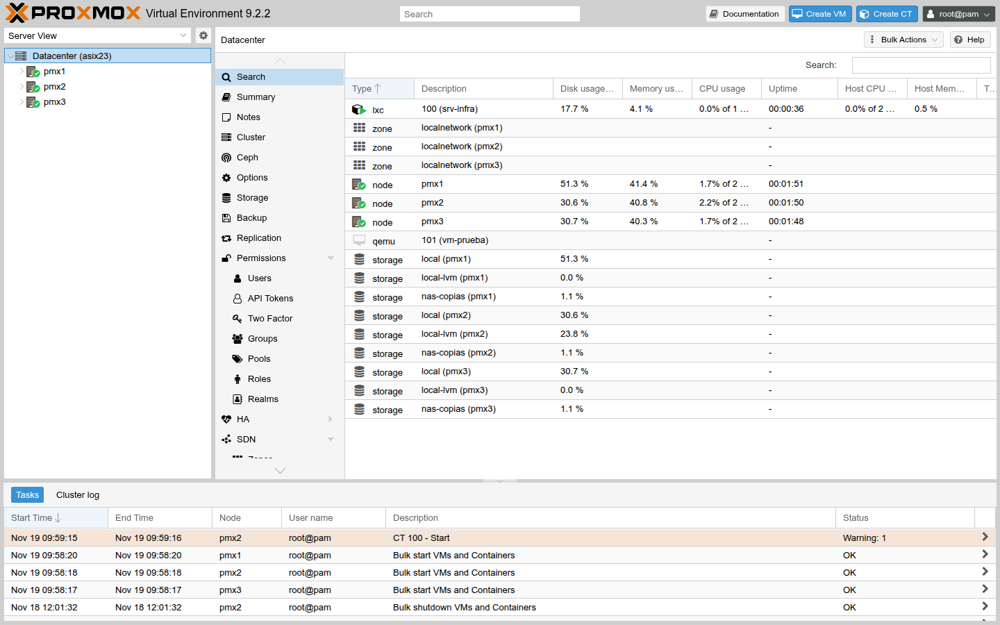

*Demuestra: desde una sola web se ven todos los recursos de los 3 nodos: el contenedor 100, la VM 101 y los almacenamientos de cada nodo.*

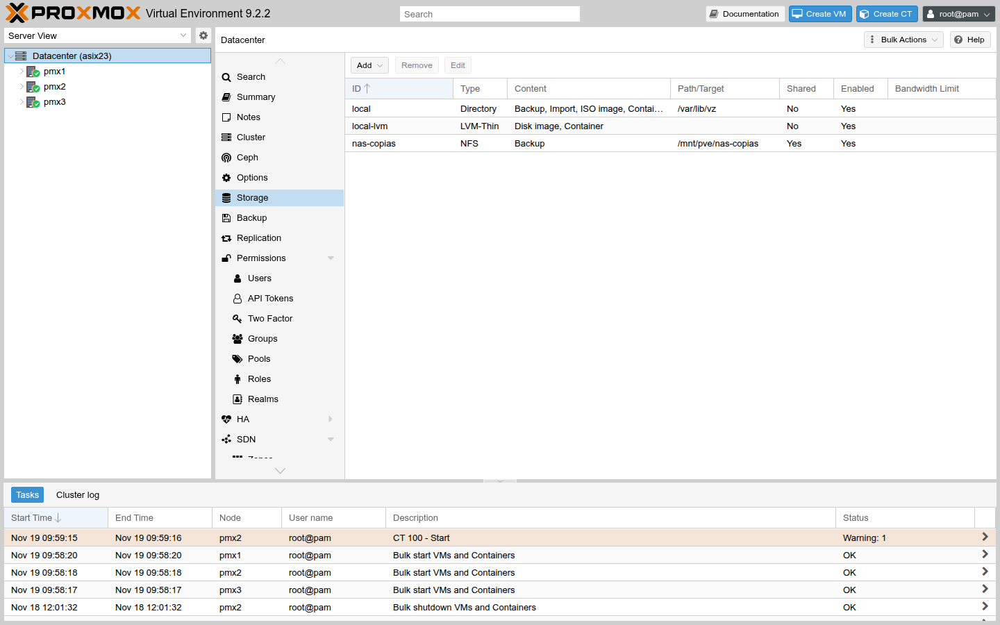

*Demuestra: `local` y `local-lvm` son de cada nodo (no compartidos) y `nas-copias` es un NFS compartido (`Shared: Yes`) que solo guarda copias (`Backup`).*

### Migraciones medidas ([log completo](https://github.com/ethan3232/iso-naix-un-sistema-individual/blob/main/evidencies/logs/proxmox-migraciones.txt))

| | Contenedor 100 → pmx2 | VM 101 → pmx2 |
|---|---|---|
| Comando | `pct migrate 100 pmx2 --restart` | `qm migrate 101 pmx2 --online --with-local-disks` |
| Duración total | **1 min 25 s** | **12,7 s** |
| Corte de servicio | **~84 s** (intranet medida desde el NAS cada segundo) | **8 ms** |
| Disco | 4 GB asignados, **~0,9 GB usados** → se copiaron **los 4 GB** | 2 GB vacíos → en el destino quedaron **100 % ocupados** |
| Velocidad | 50–190 MB/s (baja al llenarse la caché) | 528 MiB/s (RAM) |

#### ¿Se puede mejorar?

1. **Almacenamiento compartido** (NFS/iSCSI del NAS o Ceph): los discos no se copian, solo la RAM → migración en segundos y sin corte también para el contenedor.
2. **ZFS en los nodos** + replicación (`pvesr`): se copia solo lo que cambia desde la última réplica.
3. Al migrar con discos locales, el LVM-thin **pierde la reserva dinámica** (copia bloque a bloque). Con `fstrim` dentro del invitado (o `qm disk rescan` + *discard*) se recupera el espacio.
4. Red dedicada para migraciones (10 GbE en producción).

## 6. Windows Server 2025 · controlador de dominio `.20`

- Instalación desatendida, IP fija 192.168.23.20/24, gateway `.1` y DNS `127.0.0.1` (él mismo).
- Roles **AD DS + DNS**: dominio `asix23.lan` (NetBIOS `ASIX23`), una **OU por departamento** y reenviador DNS al gateway para los nombres de Internet.


*Demuestra: el servidor tiene instalados los roles AD DS y DNS y los dos están en buen estado.*

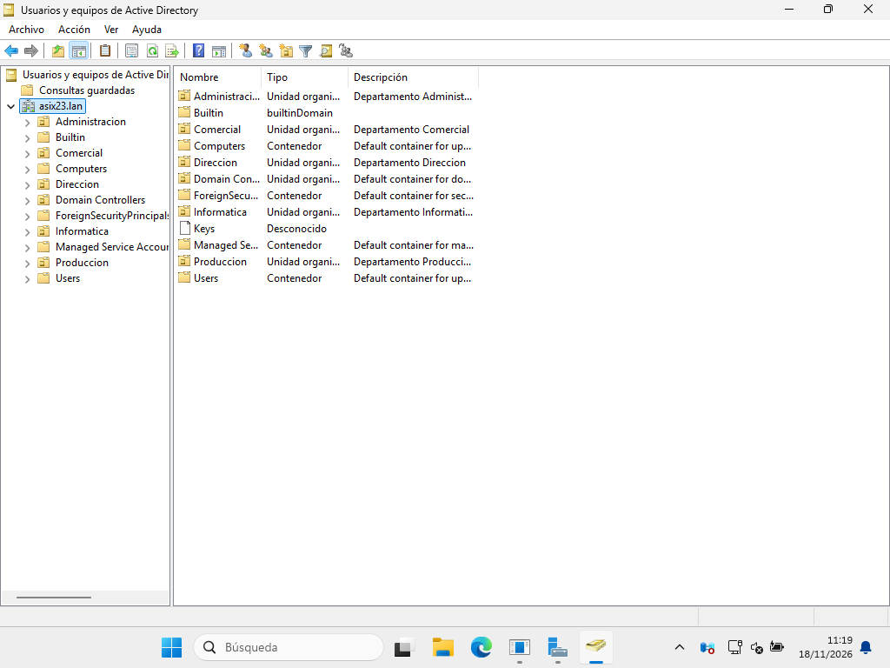

*Demuestra: el dominio `asix23.lan` tiene una unidad organizativa por departamento (Administracion, Comercial, Direccion, Informatica y Produccion).*

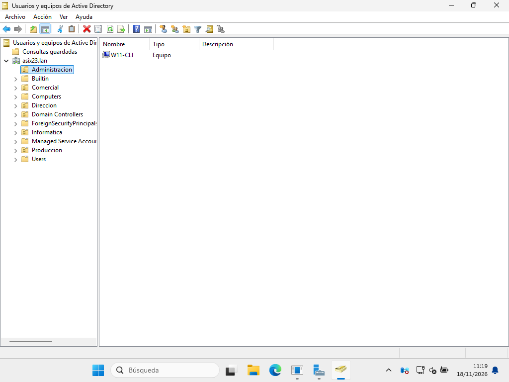

*Demuestra: el cliente Windows 11 (`W11-CLI`) está unido al dominio y colocado en la OU de su departamento, Administracion.*

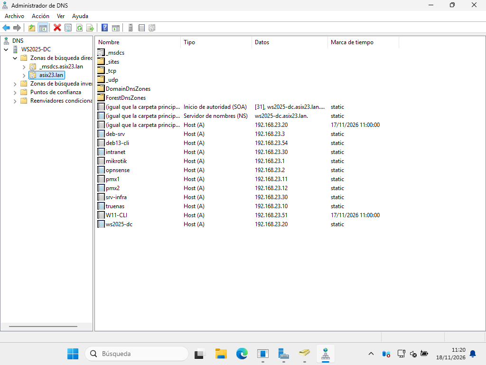

*Demuestra: la zona DNS `asix23.lan` está integrada en AD y tiene un registro A por cada equipo de LAN23 (routers, NAS, nodos Proxmox, intranet y clientes); el de `W11-CLI` se creó solo al unirse al dominio (tiene marca de tiempo).*

**¿Por qué `.lan` y no `.local`?** `.local` está reservado para mDNS (Bonjour/Avahi) y da conflictos con Linux y macOS.

**¿Qué es un dominio y qué aporta?** Un grupo de equipos y usuarios que comparten una base de datos central de cuentas (Active Directory). Con dominio hay **una sola cuenta por persona** válida en cualquier PC, las contraseñas se cambian una vez, las políticas (GPO) se aplican a todo un departamento y, si alguien se va, se deshabilita su cuenta y pierde el acceso a todo.

**Copia:** con `ntdsutil ifm` se hizo una copia coherente de la base de datos de AD (`ntds.dit`) y de SYSVOL con el DC en marcha: 4,9 MB guardados en el NAS. El sistema operativo no se copia porque se reinstala; lo valioso es AD.

### Usuarios de administración

| Cuenta | Uso |
|---|---|
| `Administrador` (local → pasa a ser `ASIX23\Administrador`) | Administrador del dominio |
| `izan` (local, grupo Administradores) | Creado por la instalación |

> **Contraseña compleja obligatoria**: Windows exige al menos 3 de 4 tipos de carácter (mayúscula, minúscula, número, símbolo). Por eso en Windows se usa una variante con mayúscula de la contraseña del proyecto (`********`).

### Red

Script: [`scripts/windows/ws2025-dc.ps1`](https://github.com/ethan3232/iso-naix-un-sistema-individual/blob/main/scripts/windows/ws2025-dc.ps1) (fase `red`).

```powershell
New-NetIPAddress -InterfaceAlias Ethernet -IPAddress 192.168.23.20 -PrefixLength 24 -DefaultGateway 192.168.23.1
Set-DnsClientServerAddress -InterfaceAlias Ethernet -ServerAddresses 192.168.23.1   # antes de ser DC
Enable-NetFirewallRule -Name FPS-ICMP4-ERQ-In                                        # permitir ping
```

**¿Por qué IP fija?** Todos los equipos del dominio buscan al DC por su IP (es su servidor DNS). Si cambiara, nadie encontraría el dominio.

### AD DS + DNS: dominio `asix23.lan`

```powershell
Install-WindowsFeature AD-Domain-Services, DNS -IncludeManagementTools
Install-ADDSForest -DomainName asix23.lan -DomainNetbiosName ASIX23 -InstallDns -SafeModeAdministratorPassword <********>
```

Después del reinicio:

| Ajuste | Valor | Por qué |
|---|---|---|
| DNS del propio DC | `127.0.0.1` | El DC se resuelve a sí mismo y a los registros SRV del dominio |
| Reenviador DNS | `192.168.23.1` (gateway) | Lo que no es `asix23.lan` (p. ej. `deb.debian.org`) se pregunta fuera |
| Unidades organizativas | Direccion, Administracion, Comercial, Produccion, Informatica | Una por departamento → se pueden aplicar GPO distintas a cada uno |

**¿Por qué `.lan` y no `.local`?** `.local` está reservado para mDNS (Bonjour/Avahi) y da conflictos con Linux y macOS. Microsoft recomienda usar un subdominio de un dominio propio; en el laboratorio usamos `.lan`, que no es un dominio público.

#### Verificación ([log completo](https://github.com/ethan3232/iso-naix-un-sistema-individual/blob/main/evidencies/logs/ws2025-dc-dominio.txt) · [registros DNS de la zona](https://github.com/ethan3232/iso-naix-un-sistema-individual/blob/main/evidencies/logs/ws2025-dns-registros.txt))

```
ADWS     Running Servicios web de Active Directory
DNS      Running Servidor DNS
Netlogon Running Net Logon
NTDS     Running Servicios de dominio de Active Directory

Maestro de esquema          WS2025-DC.asix23.lan      ← los 5 roles FSMO en este DC
PDC                         WS2025-DC.asix23.lan

"OU=Administracion,DC=asix23,DC=lan"  ... (5 OUs)
"CN=W11-CLI,OU=Administracion,DC=asix23,DC=lan"      ← el cliente ya es miembro
```

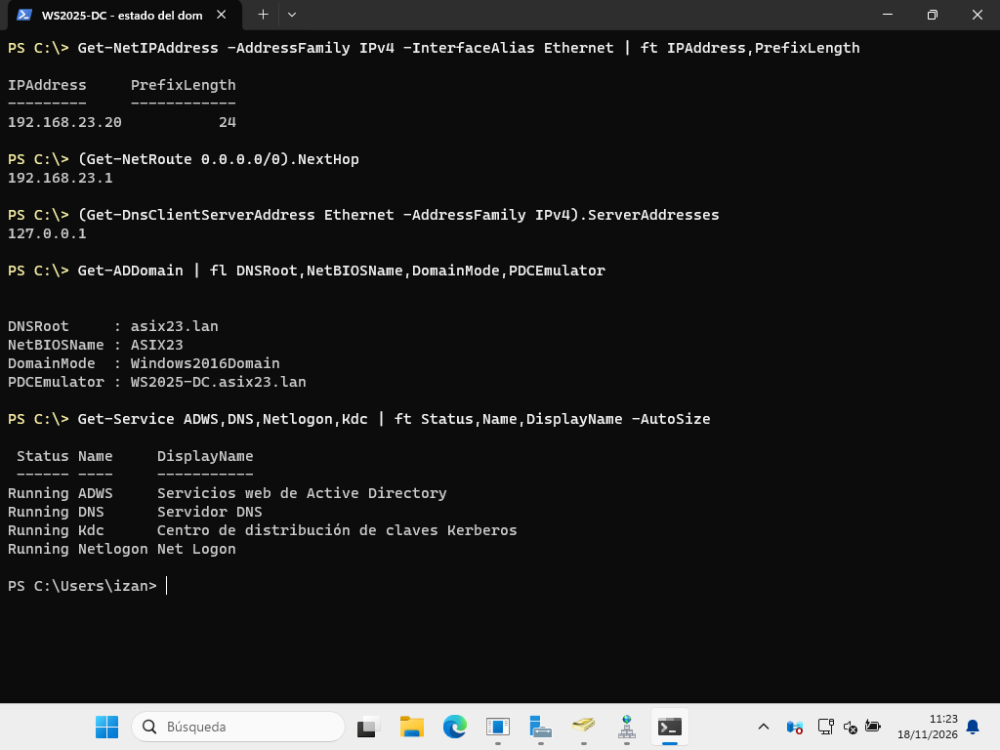

*Demuestra: el DC tiene la IP fija 192.168.23.20/24, gateway .1 y se usa a sí mismo como DNS (`127.0.0.1`); el dominio `asix23.lan` (NetBIOS `ASIX23`) tiene el DC como emulador de PDC y los servicios ADWS, DNS, Kerberos (Kdc) y Netlogon están en marcha.*

> **Incidencia**: tras el reinicio, los cmdlets `Get-ADOrganizationalUnit` fallaban con *"No se pudo encontrar ningún servidor que ejecutara Servicios web de Active Directory"* aunque el servicio ADWS estaba en marcha. Causa: la sesión remota de `guestcontrol` no tiene credenciales Kerberos para ADWS. Solución: usar `dsadd`/`dsquery`, que hablan LDAP directamente. ([incidencia 9](https://github.com/ethan3232/iso-naix-un-sistema-individual/blob/main/docs/10-incidencies.md))

## 7. Servidores Debian 13 (infraestructura) · SRV2 `.21` y SRV3 `.22`

- Instalación desatendida **sin escritorio** (arrancan con ~230 MB de RAM y tienen menos superficie de ataque), IP fija en LAN23, DNS al DC.
- **SRV2:** servidor de ficheros con Samba (recurso `compartida` sobre el RAID 1) y los RAID de la Tasca 6. **SRV3:** servidor web Apache con la intranet.
- **Copia:** el NAS se lleva cada noche `/etc` (red, `fstab`, RAID, Samba, Apache). El sistema se reinstala en ~15 min.


*Demuestra: el recurso `[compartida]` está definido, el servicio `smbd` está activo y un usuario autenticado puede listar los archivos de la carpeta.*

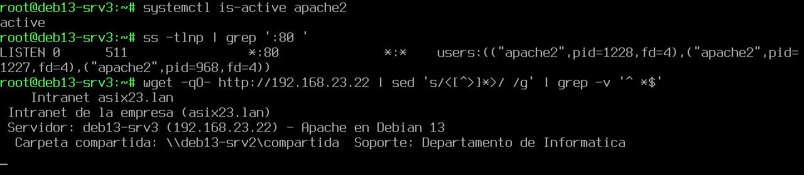

*Demuestra: Apache está activo, escucha en el puerto 80 y sirve la página de la intranet en 192.168.23.22.*

### Instalación (desatendida)

Debian 13.1 *netinst* (misma ISO y SHA256 que en [03-sistemes](https://github.com/ethan3232/iso-naix-un-sistema-individual/blob/main/docs/03-sistemes.md)), con la instalación desatendida de VirtualBox. Sin escritorio: solo «utilidades estándar» + SSH.

```bash
VBoxManage unattended install DEB13-SRV2 --iso=debian-13.1.0-amd64-netinst.iso --user=izan \
  --password-file=<fichero> --hostname=deb13-files.asix23.lan --locale=es_ES --country=ES \
  --time-zone=Europe/Madrid --start-vm=headless
```

- Durante la instalación, el adaptador 1 está en **NAT** para descargar paquetes. Después se pasa a `LAN23`.
- Problemas encontrados: arranque desde el disco a medio instalar, el script post-instalación que falla (sin `sudo`) y `dhcpcd` que borra los DNS → incidencias en [10-incidencies](https://github.com/ethan3232/iso-naix-un-sistema-individual/blob/main/docs/10-incidencies.md).
- **¿Por qué sin escritorio?** Un servidor no lo necesita: arranca con ~230 MB de RAM usados y tiene menos paquetes que actualizar y menos superficie de ataque.

### Red

`/etc/network/interfaces` (copia anterior en `interfaces.antes-lan23`):

```
auto enp0s3
iface enp0s3 inet static
    address 192.168.23.21/24
    gateway 192.168.23.1
```

DNS en `/etc/resolv.conf.head`: `192.168.23.20` (DC) y `192.168.23.1` (MikroTik) de reserva.

**Verificación** (los dos servidores): ping al gateway **0 % de pérdida, 0,3 ms**; ping a Internet `1.1.1.1` **0 % de pérdida, 15 ms**; resolución de `deb.debian.org` correcta, también **tras reiniciar**.

#### Acceso desde el PC (sin tocar la red del aula)

PC `127.0.0.1:2221/2222/8422` → reenvío de puertos de VirtualBox en el adaptador NAT del MikroTik → **`dst-nat`** del MikroTik → `.21:22`, `.22:22`, `.22:80`. Las reglas aceptan **solo** el tráfico que viene del PC (`src-address=10.0.2.2`), como las del resto de servidores. Copia de las reglas anteriores: [`mikrotik-nat-antes-srv2-srv3.json`](https://github.com/ethan3232/iso-naix-un-sistema-individual/blob/main/evidencies/logs/mikrotik-nat-antes-srv2-srv3.json) y backup `antes-srv2-srv3` en el router.

### Copias de seguridad

| Qué | Cómo |
|---|---|
| Configuración (`/etc`: red, `fstab`, `mdadm.conf`, `drbd.d/r0.res`, Samba, Apache) | Igual que DEB13-SRV1-NFT: la copia nocturna del NAS se lleva `/etc` en un `.tgz` |
| Datos de los RAID, de la carpeta compartida y del espejo DRBD | Ni el RAID ni DRBD **son una copia** (un borrado se replica al instante): los datos importantes se copian al NAS |
| Sistema completo | Se reinstala en ~15 min con la instalación desatendida + `/etc` de la copia |

## 8. Clientes · W11-CLI `.51` y DEB13-CLI `.54`

| | W11-CLI (Administración) | DEB13-CLI (Informática) |
|---|---|---|
| Por qué este sistema | Programas de gestión y contabilidad para Windows; la edición **Pro** es necesaria para unirse a un dominio | Herramientas de administración (SSH, `tcpdump`, scripts), sin licencia |
| Red | IP fija, gateway `.1`, DNS `.20` (el DC) | IP fija con NetworkManager, gateway según la prueba |
| Dominio | ✓ Unido a `asix23.lan` en la OU Administracion | ✗ No: es el puesto de pruebas que cambia de gateway constantemente; unirlo no aporta nada a las pruebas |
| Copia | Los datos del usuario van al servidor; el sistema se reinstala | `/etc` y `/home` al NAS cuando se necesite |


*Demuestra: IP fija 192.168.23.51/24, gateway .1 y DNS .20; el DC resuelve y responde; el equipo es miembro de `asix23.lan` (`PartOfDomain: True`) y su canal seguro con el DC funciona.*


*Demuestra: en *Propiedades del sistema* el nombre completo del equipo es `W11-CLI.asix23.lan` y su dominio, `asix23.lan`.*

### Unión al dominio

```powershell
Add-Computer -DomainName asix23.lan -OUPath "OU=Administracion,DC=asix23,DC=lan" -Credential ASIX23\Administrador
Restart-Computer
```

Comprobación después del reinicio ([log](https://github.com/ethan3232/iso-naix-un-sistema-individual/blob/main/evidencies/logs/w11-cli-dominio.txt)):

```
Domain       : asix23.lan
PartOfDomain : True
Test-ComputerSecureChannel → True        ← la relación de confianza con el DC funciona
DC: \\WS2025-DC.asix23.lan   Dirección: \\192.168.23.20
```

En el DC: `CN=W11-CLI,OU=Administracion,DC=asix23,DC=lan`.

### DEB13-CLI: red y cliente de pruebas

#### Red (NetworkManager)

```bash
nmcli con mod "Wired connection 1" con-name LAN23 ipv4.method manual \
  ipv4.addresses 192.168.23.54/24 ipv4.gateway 192.168.23.1 ipv4.dns 192.168.23.1 \
  ipv4.dns-search asix23.lan ipv6.method disabled
```

Paquetes: `openssh-server sudo traceroute curl netcat-openbsd`, instalados **a través de MikroTik** (primera prueba real del NAT). `izan` está en el grupo `sudo`.

#### Cliente de pruebas de los tres routers

`scripts/canvi-gw.sh 1|2|3` cambia su gateway y su DNS. Con él se hicieron las pruebas de [MikroTik](https://github.com/ethan3232/iso-naix-un-sistema-individual/blob/main/docs/06-installacio/mikrotik.md), [OPNsense](https://github.com/ethan3232/iso-naix-un-sistema-individual/blob/main/docs/06-installacio/opnsense.md) y [Debian](https://github.com/ethan3232/iso-naix-un-sistema-individual/blob/main/docs/06-installacio/debian-srv.md).

## 9. Actualizaciones y vías de recuperación

| Sistema | Cómo se actualiza | Vía de recuperación ante un cambio fallido |
|---|---|---|
| MikroTik | `/system package update` | Copia `.backup` en el propio router + `/export` en Git + copia en el NAS (**probada: 26 s**) |
| OPNsense | *System → Firmware → Updates* | *Configuration → History*: una versión de `config.xml` por cambio (**probada: 15 s**) |
| Debian | `apt update && apt full-upgrade` | Copia de `/etc` en el NAS y `nft -c -f` antes de aplicar reglas (**probada: 21 s**) |
| TrueNAS | *System → Update* (permite volver al entorno de arranque anterior) | Copia de su base de datos de configuración en el pool |
| Proxmox | `apt update && apt full-upgrade` con el repositorio `pve-no-subscription` | Copia de `/etc/pve` en el NAS; las VMs, con `vzdump` |
| Windows | Windows Update | Copia del AD (`ntdsutil ifm`) en el NAS |
| Todas | — | **Instantánea de VirtualBox antes de cualquier cambio importante** |

> **Pendiente:** las vías de recuperación están probadas provocando fallos (§3), pero falta dejar registrada la actualización de cada sistema con su salida y la comprobación posterior.

## 10. Incidencia provocada en una VM desechable

En un **clon enlazado** de DEB13-CLI (si algo sale mal se borra y el original no se toca) añadí a `/etc/fstab` un disco que no existe.

| Paso | Qué se hizo |
|---|---|
| **Síntoma** | Al reiniciar se queda en **modo de emergencia**: `Dependency failed for local-fs.target` |
| **Hipótesis** | Una línea de `fstab` apunta a un disco que no está y, sin `nofail`, systemd no deja seguir el arranque |
| **Comprobación** | `blkid` (discos que existen) frente a `grep datos /etc/fstab`: el UUID pedido no existe → hipótesis confirmada |
| **Solución** | Comentar la línea, `mount -a` y `findmnt --verify` sin errores |
| **Vuelta al estado normal** | Reinicio: arranca hasta la pantalla de inicio de sesión |

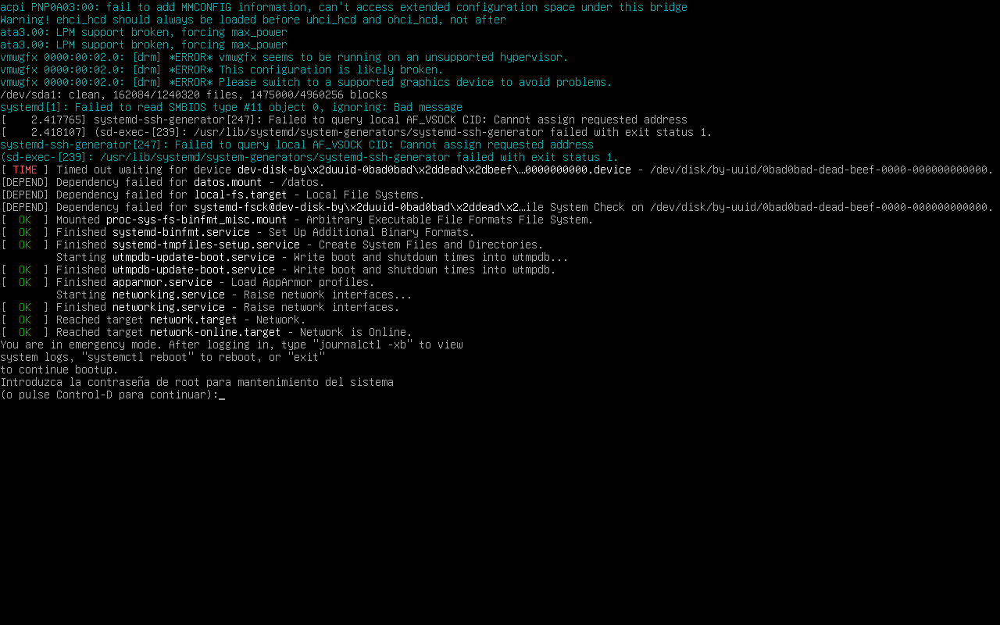

*Síntoma: el arranque espera 90 s al disco inexistente y entra en modo de emergencia.*


*Comprobación: `blkid` no muestra el UUID que pide la línea 16 de `fstab`.*

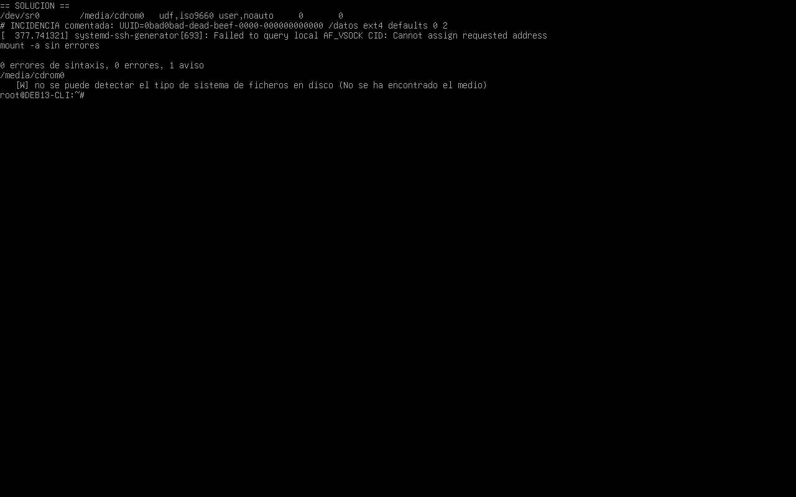

*Solución: con la línea comentada, `mount -a` y `findmnt --verify` terminan sin errores.*

**Cómo evitarlo:** comprobar con `mount -a` o `findmnt --verify` antes de reiniciar, y usar `nofail` en discos que no son imprescindibles.

## 11. Apte+: copias automáticas de las configuraciones

El NAS **recoge** (*pull*) cada noche a las 02:00 las configuraciones con el script `copia-configs.sh`, lanzado por una tarea cron. Los equipos **no guardan credenciales del NAS**: si alguien compromete un router, no puede entrar al NAS a borrar las copias.

| Equipo | Qué se copia | Cómo |
|---|---|---|
| MikroTik | `/export` + `/system backup` | SSH con clave |
| OPNsense | `config.xml` | API (HTTPS con clave) |
| Debian SRV | `/etc` + reglas `nft` | SSH + `sudo tar` (solo ese comando) |
| Proxmox | `/etc/pve`, red, corosync | SSH + `tar` |
| TrueNAS | Su base de datos de configuración | Copia local |

Cada copia va a una carpeta por equipo y fecha, se borran las de más de 14 días y, si un equipo está apagado, se anota un aviso y se sigue con los demás.

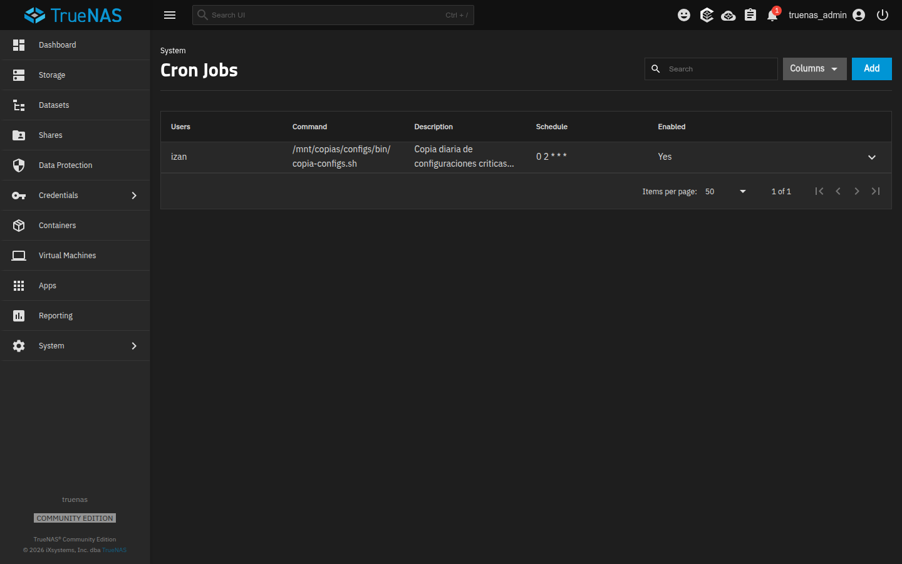

*Demuestra: la tarea programada ejecuta `copia-configs.sh` cada día a las 02:00 (`0 2 * * *`) con el usuario `izan` y está activada.*

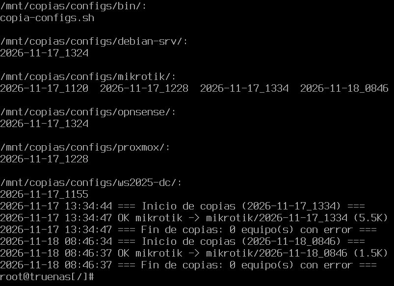

*Demuestra: en `/mnt/copias/configs/` hay una carpeta por equipo con una subcarpeta por fecha, y el registro termina cada ejecución con `0 equipo(s) con error`.*

**¿Qué tiene sentido copiar y qué no?**

| Sí | No |
|---|---|
| Configuraciones: son pequeñas, cambian a menudo y cuesta mucho rehacerlas | El sistema operativo entero de un router o de Proxmox: se reinstala en minutos desde la ISO |
| La base de datos de AD y las VMs y contenedores con servicios | Cachés, temporales y logs antiguos |
| Datos de los usuarios | Copias de las copias en el mismo disco |

## Por qué lo he hecho así

- **¿Contenedor o VM?** El contenedor comparte el kernel del nodo: arranca en segundos y gasta poca RAM, pero solo ejecuta Linux. La VM tiene su propio kernel, aísla más y permite migración en caliente (8 ms frente a ~84 s).
- **¿Por qué las copias las recoge el NAS y no las envían los equipos?** Para que ningún equipo guarde credenciales del NAS: un atacante en un router no podría borrar las copias.

### MikroTik

- **¿Por qué la WAN es NAT de VirtualBox y no puente?** Porque la red del aula (172.16.222.0/24) es compartida: con puente, mi router aparecería en ella y podría causar conflictos. El enunciado permite NAT con IP por DHCP.
- **¿Qué hace masquerade?** Cambia la IP privada de origen por la de la WAN para que las respuestas vuelvan al router.
- **¿Por qué hay dos cadenas (input y forward)?** `input` = tráfico **para** el router; `forward` = tráfico que **atraviesa** el router.
- **¿Por qué el bloqueo de Telnet sale varias veces en el log?** Por los reintentos del SYN, ya que el router descarta sin responder (*drop*, no *reject*).
- **¿Cómo vuelvo atrás si una regla me deja sin acceso?** Desde la consola de la VM (no depende de la red): `/system backup load name=00-estado-inicial` o desactivar la regla con `/ip firewall filter disable <n>`.

### OPNsense

- **¿Qué diferencia hay entre MikroTik, OPNsense y Debian como router?** Los tres hacen lo mismo (NAT + filtrado); cambia la forma de gestionarlos: RouterOS por CLI o Winbox, OPNsense por web (basado en FreeBSD y pf) y Debian a mano con nftables.
- **¿Por qué el orden de las reglas importa?** Porque las reglas `quick` se aplican en cuanto coinciden. Si "permitir todo" va primero, el bloqueo nunca se evalúa.
- **¿Qué es la regla *anti-lockout*?** Una regla automática que siempre deja entrar a la web desde la LAN, para no quedarte fuera por error.

### Debian nftables

- **¿Qué diferencia hay entre `input` y `forward`?** `input` = paquetes dirigidos al propio Debian; `forward` = paquetes que pasan a través de él de una red a otra.
- **¿Qué pasa si reinicio y no he hecho persistente `ip_forward`?** Vuelve a 0 y Debian deja de enrutar: la LAN se queda sin Internet aunque las reglas nftables estén bien.
- **¿Por qué `inet` y no `ip`?** La familia `inet` aplica las mismas reglas a IPv4 e IPv6 a la vez. El NAT se hace en una tabla `ip` porque solo hacemos NAT de IPv4.
- **¿Cómo sé que es Debian el que enruta y no MikroTik?** `traceroute`: el primer salto es 192.168.23.3. Además, el log aparece en el kernel de Debian.

### TrueNAS

- **¿Por qué un espejo y no un solo disco?** Con un solo disco, si se estropea perdemos todas las copias. El espejo aguanta la pérdida de un disco.
- **¿Un espejo es una copia de seguridad?** **No.** Si borro un fichero, se borra en los dos discos. El espejo protege de fallos de **hardware**; la copia protege de **errores y borrados**. Por eso hacemos las dos cosas.
- **¿Qué pasa si se cae el NAS?** Perdemos el destino de las copias, no los servicios. Los equipos siguen funcionando y las configuraciones también están en Git (`configs/`), que hace de segunda copia fuera del NAS.
- **¿Por qué el NAS recoge y no los equipos envían?** Por seguridad: así ningún equipo necesita la contraseña del NAS.

### Proxmox

- **¿Por qué hace falta virtualización anidada?** Proxmox necesita VT-x para ejecutar VMs con KVM, y como él mismo es una VM de VirtualBox, VirtualBox tiene que "pasarle" VT-x.
- **¿Qué pasa si apago un nodo?** Quedan 2 votos de 3 → sigue habiendo quórum y todo funciona (probado). Si caen **dos**, el que queda pierde el quórum y no deja cambiar nada; emergencia: `pvecm expected 1`.
- **¿Por qué la VM migra sin cortes y el contenedor no?** KVM puede copiar la RAM en caliente mientras la VM sigue funcionando y solo la para unos milisegundos al final. LXC no tiene esa función en Proxmox: hay que parar, copiar y arrancar.
- **¿Por qué el contenedor tardó más si es más ligero?** Porque tenía un disco de 4 GB que se copió entero; la VM de prueba tenía 2 GB y casi todo ceros.

### Windows Server

- **¿Por qué el DC usa 127.0.0.1 como DNS?** Porque él mismo es el servidor DNS del dominio. Si apuntara al router, no encontraría sus propios registros SRV (`_ldap._tcp.asix23.lan`).
- **¿Para qué sirve el reenviador?** Para que los clientes, que solo preguntan al DC, puedan resolver también nombres de Internet.
- **¿Qué es FSMO?** Cinco "roles maestros" que solo puede tener un DC a la vez (esquema, nombres de dominio, PDC, RID, infraestructura). Con un solo DC, los tiene todos.
- **¿Qué pasa si se cae el DC?** Los usuarios ya conectados siguen trabajando (credenciales en caché), pero no se puede iniciar sesión con cuentas nuevas ni resolver nombres del dominio. Por eso en producción se ponen **dos DC**.

### Servidores Debian

- **¿Por qué IP fija y no DHCP?** Es un servidor: los clientes y el DNS tienen que encontrarlo siempre en la misma dirección. Además, en LAN23 no hay servidor DHCP.
- **¿Qué diferencia hay entre un RAID y una copia de seguridad?** El RAID protege ante la avería de un disco; si alguien borra un archivo de la carpeta compartida, el RAID lo borra en todos los discos a la vez. Solo una copia (en el NAS) permite recuperarlo.
- **¿Por qué `nofail` en el `fstab` de los RAID?** Para que, si un RAID no arranca, el servidor arranque igualmente (lección de la incidencia provocada del `fstab`).

### Clientes

- **¿Por qué W11 Pro y no Home?** Home no puede unirse a un dominio de Active Directory.
- **¿Qué pasa si el cliente usa el router como DNS?** Navega bien, pero no encuentra el dominio: `Add-Computer` falla con *"no se pudo contactar con el dominio"*.
- **¿Qué es el canal seguro?** Una contraseña de equipo que comparten el PC y el DC. Si se rompe (por ejemplo, al restaurar una copia antigua del PC), el equipo deja de poder iniciar sesiones de dominio y hay que repararlo con `Test-ComputerSecureChannel -Repair`.

---

**Documentación completa, capturas, salidas de los comandos, configuraciones y scripts:** [https://github.com/ethan3232/iso-naix-un-sistema-individual](https://github.com/ethan3232/iso-naix-un-sistema-individual)
