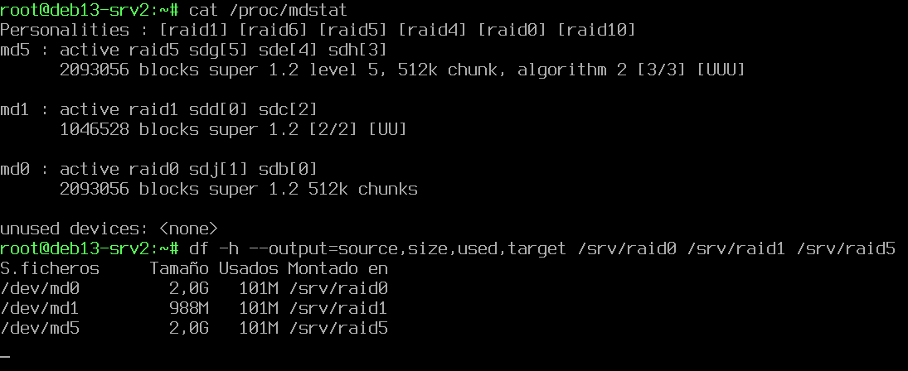
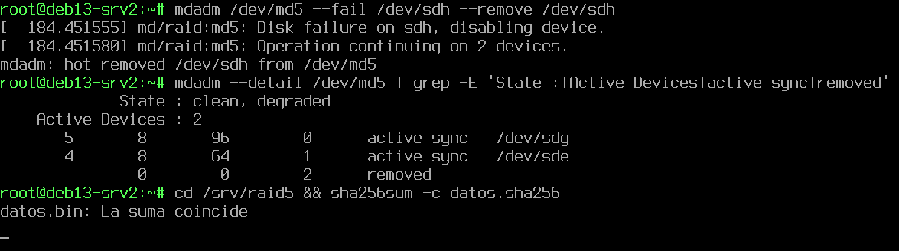
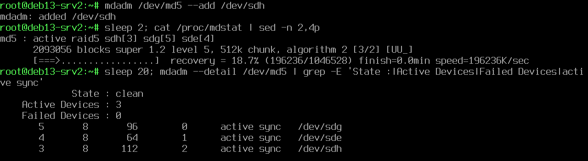
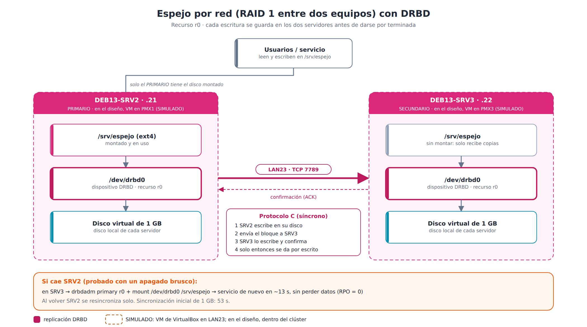
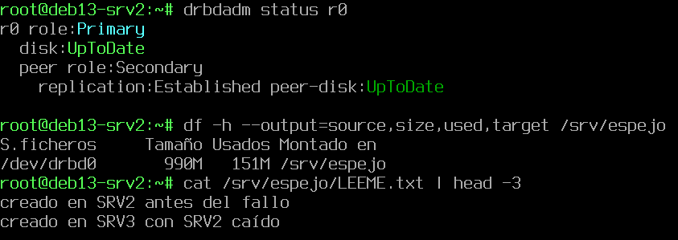

# Tasca 6 · Almacenamiento

**Alumno:** izan · 1.º ASIX · Puesto 23 · Red `192.168.23.0/24` · Dominio `asix23.lan` · CIP FP Batoi · Curso 2026-2027

**Repositorio del proyecto:** [https://github.com/ethan3232/iso-naix-un-sistema-individual](https://github.com/ethan3232/iso-naix-un-sistema-individual) · **Esta tarea en GitHub:** [https://github.com/ethan3232/iso-naix-un-sistema-individual/blob/main/Proyecto-por-Tareas/Tasca-6-almacenamiento.md](https://github.com/ethan3232/iso-naix-un-sistema-individual/blob/main/Proyecto-por-Tareas/Tasca-6-almacenamiento.md)

**Módulo:** ISO-RA3 · **Estado:**  Apte ·  Apte+

## Qué pide el enunciado

| Nivel | Criterio |
|---|---|
| Apte | Crear 3 tipos de RAID, verificarlos y explicar qué se gana con cada uno |
| Apte+ | RAID en espejo entre 2 equipos, con un caso de uso |

## Qué he hecho

### Apte: RAID 0, 1 y 5 con `mdadm` en DEB13-SRV2

1. He añadido **8 discos virtuales de 1 GB** a DEB13-SRV2. Son pequeños para que la sincronización y la reconstrucción tarden segundos y se puedan repetir.
2. He creado RAID 0 (2 discos), RAID 1 (2 discos) y RAID 5 (3 discos + 1 de reserva), con sistema de archivos y montaje permanente en `/etc/fstab`.
3. Para verificarlos he **provocado fallos**: he marcado discos como rotos, los he quitado y vuelto a añadir, y he comprobado los datos con SHA256 antes y después.

| RAID | Espacio útil | ¿Aguanta un disco roto? | Resultado de la prueba |
|---|---|---|---|
| RAID 0 | 2,0 GB (100 %) |  No | Más espacio y velocidad teórica, sin protección |
| RAID 1 | 1,0 GB (50 %) |  Sí | 0 lecturas fallidas en modo degradado · reconstrucción en **54 s** |
| RAID 5 | 2,0 GB (67 %) |  Sí (solo uno) | 0 lecturas fallidas · reconstrucción en **15 s** · **disco de reserva automático en 21 s** |



*Demuestra: los tres RAID (`md0` nivel 0, `md1` nivel 1 y `md5` nivel 5) están activos con todos sus discos y montados en `/srv`.*



*Demuestra: con un disco menos el RAID 5 queda `clean, degraded` y el archivo de prueba sigue íntegro (`La suma coincide`).*



*Demuestra: al volver a añadir el disco se reconstruye (`recovery`) y el RAID vuelve a `clean` con los 3 discos en `active sync`.*

**Qué se gana con cada uno:** RAID 0 da rendimiento sin seguridad (datos temporales). RAID 1 da seguridad sencilla (disco del sistema, pool del NAS). RAID 5 equilibra espacio y seguridad (carpetas de los departamentos).

**Límite del entorno:** los 8 "discos" son archivos en el mismo SSD físico, así que el RAID 0 no puede ir más rápido. El cuello de botella es el disco del anfitrión, no el RAID.

### Apte+: espejo entre dos equipos con DRBD



- **DRBD** replica un disco de 1 GB entre SRV2 (primario) y SRV3 (secundario) por la red, con **protocolo C** (síncrono): una escritura no termina hasta que está en los dos.
- **Caso de uso:** el servidor de ficheros de la empresa. Un RAID 1 normal protege de que se rompa un disco; DRBD protege de que se rompa **el servidor entero**.
- **Prueba:** apagado brusco de SRV2 (como un corte de luz). En SRV3, `drbdadm primary r0` + `mount` → datos disponibles en **~13 s**, con el SHA256 idéntico (**RPO 0**). Al volver SRV2 se resincronizó solo, copiando únicamente lo que había cambiado (206 MB en 25 s).



*Demuestra: SRV2 es primario, los dos discos están `UpToDate`, la replicación está establecida y el espejo conserva los archivos escritos en las pruebas de caída.*

## Desarrollo

### Implementación

```bash
mdadm --create /dev/md0 --level=0 --raid-devices=2 /dev/sdb /dev/sdc
mdadm --create /dev/md1 --level=1 --raid-devices=2 /dev/sdd /dev/sde
mdadm --create /dev/md5 --level=5 --raid-devices=3 /dev/sdf /dev/sdg /dev/sdh
mkfs.ext4 -L raid-0 /dev/md0      # (igual con md1 y md5)
mdadm --detail --scan >> /etc/mdadm/mdadm.conf   # para que se monten solos al arrancar
update-initramfs -u
# /etc/fstab:
LABEL=raid-0 /srv/raid0 ext4 defaults,nofail 0 2
```

- **`mdadm.conf` + `update-initramfs`**: sin esto, al reiniciar los RAID pueden aparecer con otro nombre (`md127`) y el `fstab` no los encuentra.
- **`nofail` en el `fstab`**: es la lección de la [incidencia provocada](https://github.com/ethan3232/iso-naix-un-sistema-individual/blob/main/docs/10-incidencies.md). Si un RAID no arranca, el servidor arranca igualmente en lugar de quedarse en modo de emergencia.
- **Montar por `LABEL`** y no por `/dev/mdX`: si cambia el número del dispositivo, la etiqueta sigue siendo la misma.
- Copias de los ficheros originales en la VM: `/etc/fstab.antes-raid` y `/etc/mdadm/mdadm.conf.antes-raid` (vuelta atrás).

#### Capacidad resultante

| RAID | Espacio bruto | Espacio útil | Aprovechamiento | Fórmula |
|---|---|---|---|---|
| RAID 0 | 2 GB | **2,0 GB** | 100 % | N × disco |
| RAID 1 | 2 GB | **1,0 GB** | 50 % | 1 disco |
| RAID 5 | 3 GB | **2,0 GB** | 67 % | (N − 1) × disco |

### Verificación: fallos provocados

Método: se escriben **100 MB aleatorios** en cada RAID y se guarda su **SHA256**. Después se provoca el fallo y se comprueba si los datos siguen siendo **accesibles** y **exactamente iguales**. Durante el fallo, un bucle lee el fichero cada 0,5 s (vaciando la caché) para ver si el servicio se corta.

| Prueba | Qué se hace | Resultado | ¿Datos? |
|---|---|---|---|
| **RAID 0** sin un disco | Se para `md0` y se intenta arrancar solo con `sdb` |  *"Not enough devices to start the array"*: **no arranca** | Inaccesibles (vuelven al poner los 2 discos) |
| **RAID 1** pierde `sde` | `mdadm --fail` → `--remove` → `--add sdi` |  Sigue funcionando `[U_]` · **22 lecturas correctas, 0 fallidas** | SHA256 coincide en modo degradado y tras reconstruir |
| Reconstrucción RAID 1 | Copia completa de `sdd` → `sdi` |  **54,3 s** (1 GB) · estado final `[UU]` |  |
| **RAID 5** pierde `sdg` | `--fail` → `--remove` → `--add sde` (el disco "reparado") |  Sigue funcionando `[U_U]` · **7 lecturas correctas, 0 fallidas** | SHA256 coincide |
| Reconstrucción RAID 5 | Recalcula el disco que falta con la **paridad** |  **14,6 s** · estado final `[UUU]` |  |
| **RAID 5 + disco de reserva** | `--add-spare sdg` y se rompe `sdf` **sin tocar nada más** |  La reserva entra **automáticamente** y se reconstruye en **21,2 s** |  |
| **Reinicio** | `systemctl reboot` |  Los 3 RAID se montan solos |  Los 3 SHA256 coinciden |

**Observaciones de la prueba:**
- En modo degradado el RAID 5 hizo **7 lecturas en 20 s** y el RAID 1 **22**. Con un disco menos, cada lectura del RAID 5 tiene que **recalcular los datos que faltan con la paridad** (XOR), así que va más lenta. En cambio, el RAID 1 sigue teniendo una copia completa.
- La reconstrucción del RAID 1 (54 s) fue más lenta que la del RAID 5 (15 s). No es por el tipo de RAID: el disco nuevo del RAID 1 (`sdi`) era un VDI **sin estrenar** y VirtualBox tenía que hacer crecer el fichero mientras escribía. Ver el apartado 4.

### Comparativa: qué ganamos con cada tipo

| | RAID 0 (*striping*) | RAID 1 (espejo) | RAID 5 (paridad distribuida) |
|---|---|---|---|
| Discos mínimos | 2 | 2 | 3 |
| Espacio útil | 100 % | 50 % | (N−1)/N → 67 % con 3 |
| ¿Aguanta un disco roto? |  **No**, y con N discos el riesgo se multiplica por N |  Sí |  Sí (solo **uno**) |
| Lectura (teoría) | Muy alta: N discos en paralelo | Mejor: puede leer de los dos | Mejor: lee de N discos |
| Escritura (teoría) | Muy alta | = (escribe en los dos) | Peor: *penalización de escritura*: leer, recalcular la paridad y escribir |
| En modo degradado | — (perdido) | Igual de rápido | **Más lento** (recalcula con la paridad; lo hemos visto: 7 lecturas frente a 22) |
| Uso típico | Datos temporales, caché, edición de vídeo **con copia aparte** | Disco del sistema, servidores pequeños, el pool del NAS | Servidor de ficheros: buen equilibrio de espacio y seguridad |
| En mi sistema | No se usaría para datos de la empresa | **Pool `copias` del TrueNAS** (espejo) | Carpetas de departamentos en DEB13-SRV2 |

## Cómo comprobarlo

```bash
cat /proc/mdstat                       # estado de los RAID: [UU] sano, [U_] degradado
sudo mdadm --detail /dev/md5           # detalle del RAID 5 y el disco de reserva
cat /proc/drbd                         # Connected Primary/Secondary UpToDate/UpToDate
```

## Por qué lo he hecho así

- **¿Un RAID es una copia de seguridad?** No. Si borras un archivo, se borra en todos los discos a la vez. El RAID protege de que se rompa un disco; la copia protege de errores, borrados y ransomware.
- **¿Por qué no se nota que el RAID 0 vaya más rápido?** Porque todos los discos virtuales están en el mismo SSD físico. Con discos físicos separados sí se notaría.
- **¿Qué diferencia hay entre DRBD y una copia en el NAS?** DRBD es en tiempo real (no se pierde nada, RPO 0); la copia es periódica (se pierde lo escrito desde la última).

---

**Documentación completa, capturas, salidas de los comandos, configuraciones y scripts:** [https://github.com/ethan3232/iso-naix-un-sistema-individual](https://github.com/ethan3232/iso-naix-un-sistema-individual)
